# Libranet C++ Overview

Version 0.1 • November 2026

---

## 1. Purpose

This document is a map of the C++ node's code: the libraries it is made of,
where each class lives, how the libraries depend on each other, and how the
classes relate. It is written for someone new to the code, who wants to know
where to look before reading it, and for someone about to change a class, who
wants to see what is around it.

It says what the code is, not what it must do, nor how it is built. Those are
elsewhere:

- What every node must do is in the specifications, in
  [`docs/specs/`](../../docs/specs/): [High-Level Design](../../docs/specs/HighLevelDesign.md),
  [HTTP API](../../docs/specs/HttpApi.md), and
  [Handshake Protocol](../../docs/specs/HandshakeProtocol.md) above all.
- How to build, test, fuzz, and check the code is in the
  [README](../README.md).
- The messages the node's parts post to each other are in
  [Messages](Messages.md).
- How the code is written is in [Coding Style](Coding%20Style.md) and
  [Coding Style in Libranet](Coding%20Style%20in%20Libranet.md).
- How the node came to be as it is, and what comes next, is in the
  [plans](plans/), from [Phase 1](plans/Phase%201.md) on.

The authority remains the code: each class's header says what it is for, in
its name and interface, and in the comment above it where those leave
something out. Paths below are relative to `cpp/src/`, and are as of
2026-11-27.

## 2. The Node at a Glance

`main.cpp` reads the command line: the YAML settings file `--config` names
(`node::SettingsFile`), or else `libranet/libranet.yaml` in the user's
configuration directory (`io::Directories::user_config()`), where the Python
node looks for its own, if it is there; and the nodes to dial first, each
named by a `--seed`. It runs a `node::Node` until the process is sent SIGINT
or SIGTERM. The node reads every setting it uses, by the Python node's name
and with its default, and refuses one it cannot use, naming it, before it
makes anything. Then it:

1. lays out its data directory: `cas/`, where content is stored, and
   `incoming/`, whose directories are read as content too, together as one
   `storage::Manager` of `storage::DataDir`s;
2. reads its Ed25519 key from `node-key.pem`, or makes one the first time, as
   an `identity::NodeIdentity`, whose public key it puts in the store, so that
   other nodes can fetch it by the node's id;
3. makes its parts, each after those it uses, handing each what it needs of
   the store, the identity, and the settings, and binding the functions that
   stand in for what one part asks of another (§4.3). The recorder is made
   last, as the lists it posts as it starts are for the others, and keeps
   `libranet.sqlite3` in the data directory. Each part starts the threads it
   needs as it is made, and stops and joins them as it goes, last made
   first;
4. tells `api::Service` the port `config::Service` took, so that the main
   port can say where `/config` is.

A node has five parts, each a class, or a few, that run threads of their
own:

| Part | Class | Job |
| --- | --- | --- |
| Web | `api::Service` | Runs `web::Server`, with a handler for each endpoint beneath `/data`, each behind an `api::SignatureGuard`; keeps the latest lists the stats derive, to serve, and what peers name for searches; sends a `GET` of a page of `/config` to `/config`'s port |
| Stats | `stats::Recorder` | Records, in SQLite, the addresses of nodes and how content is used; derives the node list, the candidates to dial, and the seek list; ranks content for eviction |
| Connections | `peer::Connections`, `peer::Seeker`, `peer::Pusher` | Owns the outgoing connections, and keeps up the mix of peers, dialing the seeds while it knows no other, and an address `/config` asks for at once; makes first contact, and reads peers' seek lists again; with the classes beside it in `peer/`, fetches and searches for what the node lacks (`Seeker`), fulfills peers' seek lists, pushes new content (`Pusher`), and hands content off |
| Eviction | `eviction::Evictor` | Keeps storage within its limits, handing content off to peers before deleting it |
| Config | `config::Service` | Runs a second `web::Server`, at `127.0.0.1` on `/config`'s port, with the `/config` page and the endpoints beneath `/config/api`, each behind a `config::Guard`, which serves only clients on this machine that give the `/config` credential, and no other site's pages; has the connections dial the address a request names, and hears what came of it (`config::DialOutcomes`) |

The node also makes a `peer::Fetch`, before the web server, which asks it
whether a search for content is held off, and which the seeker runs; and a
`peer::HandOff`, through which the evictor hands content off. It makes
`config::Service` after `api::Service`, whose port its own is placed above,
and after `peer::Connections`, which dials for it, so that it stops before
them.

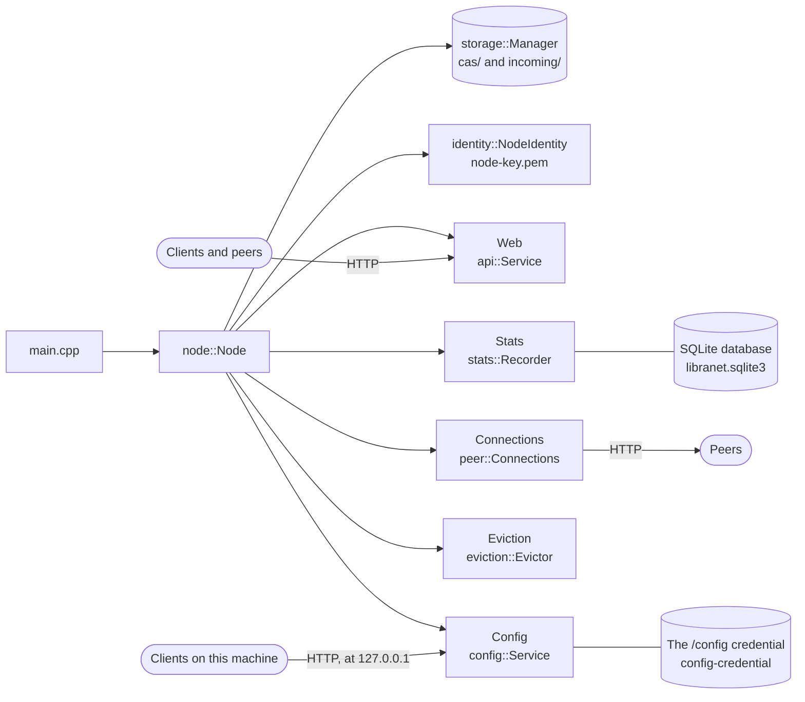

The parts do not call each other. Each posts what happened as a message on a
`msg::Channel`, under a name, and takes the messages it needs on a
`msg::AsyncChannel` of its own, from a thread of its own. These are the
messages that pass between them; [Messages](Messages.md) says who posts
each, who takes it, and why.

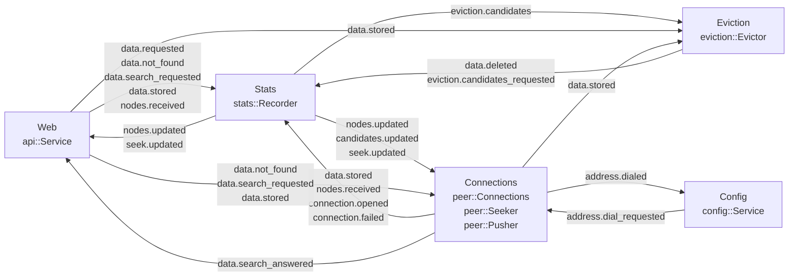

Left out above: `data.stored` from Connections to its own `peer::Pusher`;
`data.search_answered` from the web server's `api::SearchHandler` to its
`api::Service`; `peers.connected`, which no part takes yet; and the timers'
ticks, which each part posts to itself.

`/config` is served on a port of its own, apart from the main port
([HTTP API §2.3](../../docs/specs/HttpApi.md#23-local-configuration-interface)).
`config::Service` listens at `127.0.0.1` alone: on `network.config_port`
when the settings name one, `0` having the system pick it, and otherwise on
the first port free of the main port plus 100, plus 200, and so on. The node
refuses a `network.config_port` that is the main port, and, when none is
named, a main port that leaves no port 100 above it. As it starts, it logs
where `/config` is, as `/config is at http://127.0.0.1:8180/config/`. On the
main port, a `GET` of a page of `/config` is a `302` to the same path on
`/config`'s port, and anything else beneath `/config` is `404`, naming where
it is. `/config` is served as the hosts `network.config_hosts` names, as
shell-style patterns, by default `localhost`, `127.0.0.1`, and `::1`, and as
the name the machine gives itself.

The first request that `config::Guard` lets as far as the credential
captures it, from its `Authorization: Basic` header (§6.3).
`config::Credential` keeps the whole `user:password` as one Argon2id hash,
19 MiB and 2 passes, in `config-credential` in the data directory, which
only its owner may read. The file is read again for each request, so a lost
or forgotten credential is recovered by removing the file: the next
credential given is captured in its place
([§2.3.2](../../docs/specs/HttpApi.md#232-credential-storage)). The data
directory is `storage.data_dir`, by default `libranet/` in
`~/Library/Application Support` on macOS, and in `$XDG_DATA_HOME`, or
`~/.local/share` when that is not set, on Linux.

## 3. Where to Find Things

### 3.1 The Layout

```text
cpp/
├── CMakeLists.txt     The build: options, warnings, and each library
├── conanfile.py       The libraries the node is built on
├── docs/              This document, Messages, the coding style, and the plans
└── src/
    ├── main.cpp       The libranet program
    └── <library>/     A library: its headers, its .cpp files, and its CMakeLists.txt
        ├── tests/     Its GoogleTest tests, built into <library>_tests
        └── fuzz/      A libFuzzer program for each of its parsers
```

What makes a thing easy to find:

- **A library is a directory under `src/`**, a CMake target named
  `libranet_<directory>` with the alias `libranet::<directory>`, and a
  namespace named for the directory. So `peer::Connections` is in
  `src/peer/Connections.hpp`, and is built into `libranet::peer`.
- **A file is named for the class it holds.** Headers are included from
  `src/`, as `#include "storage/Identifier.hpp"`. Small types that only one
  class uses are nested in it, as its `Settings`, its `Limits`, and the
  messages it posts or takes.
- **Some libraries are mostly headers, and some mostly `.cpp` files.** In
  `types/`, `http/`, `crypto/`, `storage/`, `protocol/`, `io/`, and `msg/`,
  most code is in the header, below the class, and a `.cpp` file holds what
  a header must not: code that includes a platform's or another library's
  headers, such as sockets, OpenSSL, SQLite, zlib, or yaml-cpp; static data;
  and the factory that picks an implementation for the platform. Each class
  of the parts and of `node/`, and many of the rest, has a `.cpp` file of
  its own, whose anonymous namespace holds the steps of its methods, so that
  its header holds little more than the class.
- **One source file is made by the build.** `config/CMakeLists.txt` writes
  the shared `/config` page,
  [`applications/config/index.html`](../../applications/config/index.html),
  into `PageHtml.cpp`, in the build directory, from `config/PageHtml.cpp.in`,
  so that `config::Page` is built with it. Git keeps no copy of the page in
  `cpp/`.
- **An interface is named `I…`**, as `storage::IDataSource` and
  `net::ISocket`, and makes its implementations with static factories, as
  `crypto::ISignKey::Ed25519()` and `net::ISocket::connect()`. An
  implementation is named for what it is, then what it is built on:
  `net::SocketPosix`, `crypto::Sha256OpenSsl`, `crypto::Sha256Macos`.
- **The tests of a class `X` are in `tests/TestX.cpp`**, in its library, with
  what several of them share in `tests/Fixtures.hpp`. The fuzzer of a parser
  of class `X` is `fuzz/FuzzX.cpp`.
- **A message is a struct with a `static constexpr auto name`**, in the
  header of the class that posts or takes it: `storage/` for those about
  content, as `storage::DataStored`, and `stats::Recorder`,
  `eviction::Evictor`, and `peer::Connections` for the rest.

### 3.2 The Libraries

From those every other library uses, to the node itself:

| Library | Holds | Main classes |
| --- | --- | --- |
| [`types/`](../src/types/) | Values every library uses | `Json`, `Integer` (of any size), `BlockingQueue<Type>`, `Converter` (text, bytes, and hex; trimming text, and checking it is UTF-8), and `Constants.hpp`: sizes, as `Megabyte`; the bits of bytes and hex digits; the HTTP API's paths, `X-Search-Relays`, and media types; and the limits on what is decompressed |
| [`net/`](../src/net/) | Addresses and sockets, on POSIX systems | `Address`, `IpAddress`, `ISocket`, `SocketPosix` |
| [`crypto/`](../src/crypto/) | Hashing, signing, encrypting, and password hashing, with OpenSSL, and on macOS with Apple's frameworks where they serve | `IHasher`, `ISignKey`, `IEncryptKey`, `IMultiKey`, `IPasswordHasher`, and their implementations; `Base64`, `Pem`, `RsaDer` |
| [`logger/`](../src/logger/) | The log: lines at levels, from any thread, to stderr, stdout, a file, or the system log | `Logger` and its macros, `lInfo`, `lWarn`, and so on; `ILogOutput`, `ILogFormatter` |
| [`db/`](../src/db/) | A connection to an SQLite database | `Database`, `Database::Transaction`, `Statement`, `SqliteError` |
| [`msg/`](../src/msg/) | Messages, the channels that carry them, and timers | `IMessage`, `Message<Type>`, `Channel`, `AsyncChannel`, `AsyncChannelOf<Type>`, `Timer` |
| [`io/`](../src/io/) | Reading files, and input with limits; writing files whole; and where the user's data and settings are kept | `IReader`, `BufferedReader`, `MeteredReader`, `SocketReader`, `FileReader`, `SafeWriteFile`, `Directories` |
| [`http/`](../src/http/) | Reading and writing HTTP, and the credentials of Basic authentication | `Request`, `Response`, `Headers`, `ResponseCode`, `Url`, `Query`, `Problem`, `StructuredField`, `BasicCredentials` |
| [`storage/`](../src/storage/) | Content: its ids, the store, and searches by prefix; and the messages about content | `Identifier`, `HashPrefix`, `IDataSource`, `DataDir`, `Manager`, `SearchAnswers`, `Zlib`; `DataStored`, `DataRequested`, `DataNotFound`, `DataDeleted`, `SearchAnswered` |
| [`identity/`](../src/identity/) | The node's identity, and the signatures on what nodes send each other (RFC 9421) | `NodeIdentity`, `KnownKeys`, `MessageSigner`, `MessageVerifier`, `SignatureBase`, `ContentDigest` |
| [`protocol/`](../src/protocol/) | The bodies nodes send each other, and the address `/config` is asked to dial | `NodeList`, `SeekList`, `SearchResults`, `DialRequest` |
| [`web/`](../src/web/) | An HTTP/1.1 server, a thread for each connection; and the checks that keep other sites' pages out of what only this machine is served | `Server`, `ConnectionInfo`, `SiteChecks` |
| [`api/`](../src/api/) | What the web server serves, beneath `/data`, and where it says `/config` is | `Service`, `SignatureGuard`, `DataHandler`, `NodesHandler`, `SeekHandler`, `SearchHandler` |
| [`eviction/`](../src/eviction/) | Keeping storage within its limits | `Evictor`, `Scorer` |
| [`stats/`](../src/stats/) | What the node remembers of the network, in SQLite | `Recorder`, `NodeAddresses`, `ContentUses`, `Sought` |
| [`peer/`](../src/peer/) | The node's outgoing connections, and all it does over them | `Connections`, `DialPlan`, `Buckets`, `FirstContact`, `NodeListPublisher`, `SeekFulfiller`, `PeerSession`, `PeerConnection`, `Seeker`, `Fetch`, `PeerSearch`, `Pusher`, `HandOff` |
| [`config/`](../src/config/) | `/config`, on a port of its own: whom it serves, its page, and what it answers | `Service`, `Guard`, `Credential`, `Page`, `NodeHandler`, `NotOffered`, `ConnectHandler`, `DialOutcomes` |
| [`node/`](../src/node/) | The node, which makes the rest, and its settings file | `Node`, `SettingsFile` |

### 3.3 Where to Look

| To change | Look in |
| --- | --- |
| How the node starts, the settings it reads, and what it makes | `node/Node.cpp`, and `main.cpp` for the command line and where the settings file is looked for |
| What an endpoint beneath `/data` answers | The handler in `api/`: `DataHandler`, `NodesHandler`, `SeekHandler`, or `SearchHandler`; where each is registered, in `api/Service.cpp` |
| What `/config` serves, and on which port | `config/Service.cpp`; on the main port, `api/Service.cpp` |
| Whom `/config` serves | `config/Guard`, with `web/SiteChecks` for other sites' pages, `config/Credential` for the credential, and `http/BasicCredentials` for reading it |
| What an endpoint beneath `/config/api` answers | `config/NodeHandler`; `config/ConnectHandler`, with `config/DialOutcomes`; and `config/NotOffered`, for what the node does not offer yet |
| The `/config` page | [`applications/config/index.html`](../../applications/config/index.html), which `config/CMakeLists.txt` builds into `config/Page` |
| Dialing an address `/config` asks for | `peer/Connections`, and `protocol/DialRequest` for how the address is read |
| How requests are read and connections kept open | `web/Server.cpp` |
| Which requests must be signed, and how many may come before a signer's key is held | `api/SignatureGuard` |
| How a message is signed, or a signature checked | `identity/MessageSigner`, `identity/MessageVerifier`, `identity/SignatureBase`, and `identity/ContentDigest`; for answers from peers, `peer/PeerSession` |
| How content is checked against its id | `storage::Identifier::content_of()` |
| How content is kept on disk | `storage/DataDir`, and `storage/Manager` for several directories as one store |
| How a search by prefix is answered | `storage/SearchAnswers`, and `api/SearchHandler` |
| The bodies nodes exchange | `protocol/NodeList`, `protocol/SeekList`, `protocol/SearchResults` |
| A message: what it holds, who posts it, who takes it | [Messages](Messages.md), then the header that declares it |
| The tables in the database | The `schema` of `stats/NodeAddresses`, `stats/ContentUses`, and `stats/Sought` |
| The HTTP API's paths, headers, and media types, and the limits on what is decompressed | `types/Constants.hpp` |
| Which nodes are dialed, and when | `peer/DialPlan` and `peer/Buckets`; `peer/Connections` dials them, and the seeds while it knows no other |
| What happens at first contact with a peer | `peer/FirstContact`, with `peer/SeekFulfiller`, which `peer/Connections` also has read each peer's seek list again |
| Fetching, searching, pushing, and handing off content | `peer/Seeker`, which runs `peer/Fetch` and `peer/PeerSearch`; `peer/Pusher`; and `peer/HandOff` |
| What is evicted first, and when | `eviction/Scorer` for the order, `eviction/Evictor` for when |
| The code built on OpenSSL, Apple's frameworks, SQLite, zlib, or yaml-cpp | `crypto/*OpenSsl*` and `crypto/OpenSsl.hpp`; `crypto/*Macos*`, `crypto/CFObject.hpp`, and `crypto/CFBytes.hpp`; `db/`; `storage/Zlib.cpp`; `node/SettingsFile.cpp` |
| The fuzzer of a parser | The library's `fuzz/`; the [README](../README.md#fuzzing) lists them |

## 4. Library Dependencies

### 4.1 The Graph

Each arrow points from a library to one it uses. Arrows that follow from
others are left out: `api` uses `storage` too, through `web` and `identity`.
§4.2 lists every library each uses directly. The libraries of the parts of
§2, and `node`, are drawn with a heavy border.

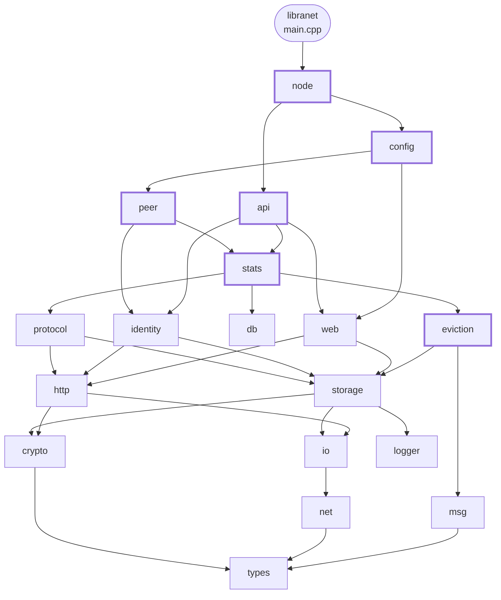

There are no cycles: no library uses one that uses it. The libraries fall
in three layers, each using only those in its own layer or below:

- **Foundations**: `types`, `net`, `crypto`, `logger`, `db`, `msg`, and
  `io`. They use no other library of the node's, but for `types`, which
  `net`, `crypto`, `msg`, and `io` use, and `net`, which `io` uses. Each is
  of use to any program.
- **Building blocks**: `http`, `storage`, `identity`, `protocol`, and
  `web`. They are what nodes say to each other, and how: HTTP, content and
  its ids, signatures, and the bodies of the protocol. Each knows the
  network's rules, but runs nothing of its own, but for `web::Server`'s
  threads.
- **Parts**: `api`, `stats`, `eviction`, `peer`, and `config`, those of §2,
  each with threads of its own; and `node`, which makes them.

### 4.2 Every Library Each Uses

What each library's code includes, tests and fuzzers aside, and what it is
built on from outside. Each `CMakeLists.txt` links these libraries
`PUBLIC`, or `INTERFACE` in `types` and `http`, which are headers alone;
and what it is built on `PRIVATE` where only its `.cpp` files include it,
as `db` does SQLite, `storage` zlib, and `node` yaml-cpp.

| Library | Uses | Built on |
| --- | --- | --- |
| `types` | — | Threads |
| `net` | `types` | POSIX sockets |
| `crypto` | `types` | OpenSSL 3.2 or newer; on macOS, CoreFoundation and Security |
| `logger` | — | Threads; syslog |
| `db` | — | SQLite |
| `msg` | `types` | Threads |
| `io` | `net`, `types` | POSIX files |
| `http` | `crypto`, `io`, `types` | — |
| `storage` | `crypto`, `io`, `logger`, `types` | zlib |
| `web` | `http`, `io`, `logger`, `net`, `storage`, `types` | Threads; POSIX `gethostname()` and `fnmatch()` |
| `identity` | `crypto`, `http`, `io`, `logger`, `storage`, `types` | — |
| `protocol` | `http`, `logger`, `net`, `storage`, `types` | — |
| `eviction` | `logger`, `msg`, `storage`, `types` | Threads |
| `stats` | `db`, `eviction`, `logger`, `msg`, `protocol`, `storage` | — |
| `api` | `http`, `identity`, `logger`, `msg`, `net`, `protocol`, `stats`, `storage`, `types`, `web` | — |
| `peer` | `http`, `identity`, `io`, `logger`, `msg`, `net`, `protocol`, `stats`, `storage`, `types` | Threads |
| `config` | `crypto`, `http`, `identity`, `io`, `logger`, `msg`, `net`, `peer`, `protocol`, `storage`, `types`, `web` | `applications/config/index.html`, built in |
| `node` | `api`, `config`, `eviction`, `http`, `identity`, `io`, `logger`, `net`, `peer`, `protocol`, `stats`, `storage`, `types` | yaml-cpp; POSIX signals |
| `libranet` | `node` | — |

The tests are built on GoogleTest, and the fuzzers on libFuzzer. Conan
provides OpenSSL, SQLite, zlib, yaml-cpp, and GoogleTest
([`conanfile.py`](../conanfile.py)).

### 4.3 Why Some Arrows Are There

Most arrows are what they seem. These are less plain:

- **`net`, `crypto`, and `io` use `types`** for `types/Constants.hpp`
  alone: the bits in a byte and in a hex digit, the hex digits, and how
  much is read at a time.
- **`http` uses `crypto`** for `crypto::Base64`, in which
  `http::StructuredField` reads and writes byte sequences; and **`io`** for
  `http::Response::read()`, which reads an answer through an
  `io::MeteredReader`.
- **`io` uses `net`** for `io::SocketReader`, which reads from a
  `net::ISocket`.
- **`storage` uses `crypto`** for `crypto::IHasher`, with which
  `storage::Identifier` checks that content hashes to its id.
- **`web` uses `storage`** for `storage::Identifier`: a
  `web::ConnectionInfo` carries the id of the node whose signature verified
  on it.
- **`api` and `peer` use `stats`** for the messages `stats::Recorder` posts
  and takes, which are declared in `stats/Recorder.hpp`:
  `api::Service` takes `nodes.updated` and `seek.updated`, and
  `api::SearchHandler` posts `data.search_requested`, which `peer::Seeker`
  takes. `peer::DialPlan` also takes `stats::NodeAddresses::Candidate`s.
- **`stats` uses `eviction`** to answer `eviction::Evictor`'s
  `CandidatesRequested`, ranking what is held with `eviction::Scorer`.
- **`config` uses `peer`** for the messages `peer::Connections` takes and
  posts, which are declared in `peer/Connections.hpp`:
  `config::ConnectHandler` posts `address.dial_requested`, and
  `config::DialOutcomes` takes `address.dialed`. It also takes
  `peer::PeerConnection::Limits`, to know how long a dial may take.
- **`config` uses `web`** for a `web::Server` of its own, on `/config`'s
  port, and for `web::SiteChecks`; and **`crypto`** for
  `crypto::IPasswordHasher`, with which `config::Credential` hashes the
  credential.
- **`node` uses every part's library**, as it makes each part, and binds
  the functions below.

And some arrows are missing on purpose. A class that must ask something of
a library above it, or beside it, is given a function in its place, which
`node::Node` binds:

- `eviction::Evictor::Peers` hands an object off, and names the nodes
  connected: the node binds them to `peer::HandOff::hand_off()` and
  `peer::Connections::connected_ids()`; so `eviction` does not use `peer`.
- `api::DataHandler::IsHeldOff`, given in `api::Service::Settings`, says
  whether a search for content is held off: the node binds it to
  `peer::Fetch::is_held_off()`; so `api` does not use `peer`.
- `peer::Fetch`, `peer::HandOff`, `peer::Pusher`, and `peer::Seeker` each
  take a `GetPeers`, giving the sessions connected now: the node binds each
  to `peer::Connections::open_sessions()`, so that none of them needs the
  connections.
- `storage::SearchAnswers::Held` gives what the store holds that begins with
  a prefix: `api::Service` binds it to the store's `starting_with()`.

Nor does `api` use `config`: once `config::Service` has taken its port, the
node tells `api::Service` which it is, with `set_config_port()`.

## 5. Class Diagrams

The diagrams below are UML class diagrams, one for each area of the code.
Each shows the classes of its libraries, and those of other libraries only
where they connect, each in a box for its namespace. They show the public
methods that say most of what a class is for, not all of them, and leave out
most nested types and every message but a few.

| Arrow | Means |
| --- | --- |
| `A <\|-- B` | B is derived from A |
| `A <\|.. B` | B implements the interface A |
| `A *-- B` | A owns B: a member, by value or `std::unique_ptr` |
| `A o-- B` | A shares B: a `std::shared_ptr` |
| `A --> B` | A refers to B, by a reference or a pointer, and B must outlive it |
| `A ..> B` | A uses B: makes it, calls it, or takes it as a parameter |

### 5.1 The Node and the Web Server

`node`, `api`, and `web`. `node::Node` owns each part, and what they share.
`api::Service` owns a `web::Server`, and registers each handler beneath
`/data` with it behind its `api::SignatureGuard`, which checks the signature
on each request before the handler sees it, and signs each answer as the
node. What is beneath `/config` it answers itself, outside the guard,
signing that too. The server calls the handler on the thread serving the
connection, with the `web::ConnectionInfo` it made for it, which knows the
address the connection came from and the address of this machine it
reached.

```mermaid
classDiagram
    direction TB
    namespace node {
        class Node {
            +run(SettingsFile, seeds)$
            +local_address() Address
        }
        class SettingsFile {
            +parse(text)$ SettingsFile
            +load(path)$ SettingsFile
            +value(name) string
            +list(name) List
        }
    }
    namespace api {
        class Service {
            +local_address() Address
            +own_endpoints() strings
            +set_config_port(port)
        }
        class SignatureGuard {
            +in_front_of(Handler) Handler
        }
        class DataHandler
        class NodesHandler
        class SeekHandler
        class SearchHandler
    }
    namespace web {
        class Server {
            +register_handler(path, RequestHandler)
            +set_on_every_answer(name, value)
            +start(backlog)
            +stop()
        }
        class ConnectionInfo {
            +remote_address() Address
            +local_address() Address
            +node() optional~Identifier~
            +set_node(Identifier)
            +close_after_answer()
        }
    }
    namespace storage {
        class IDataSource {
            <<interface>>
        }
        class Manager
        class SearchAnswers
    }
    namespace identity {
        class NodeIdentity
        class MessageSigner
        class MessageVerifier
    }
    namespace msg {
        class AsyncChannel
    }
    namespace net {
        class ISocket {
            <<interface>>
        }
    }
    namespace peer {
        class Fetch {
            +is_held_off(Identifier) bool
        }
        class Connections
        class Seeker
        class Pusher
        class HandOff
    }
    namespace eviction {
        class Evictor
    }
    namespace stats {
        class Recorder
    }
    namespace config {
        class ConfigService["Service"]
    }

    Node ..> SettingsFile : reads
    Node o-- Manager : makes, shares
    Node *-- NodeIdentity
    Node *-- Fetch
    Node *-- Service
    Node *-- Connections
    Node *-- ConfigService : after Service and Connections
    Node ..> Service : tells the port /config took
    Node *-- Seeker
    Node *-- Pusher
    Node *-- HandOff
    Node *-- Evictor
    Node *-- Recorder : made last
    IDataSource <|.. Manager
    Service *-- SignatureGuard
    Service *-- DataHandler
    Service *-- NodesHandler
    Service *-- SeekHandler
    Service *-- SearchHandler
    Service *-- Server
    Service *-- AsyncChannel : keeps the lists, and what peers name
    Service o-- SearchAnswers : adds what peers name to
    SignatureGuard *-- MessageVerifier
    SignatureGuard *-- MessageSigner
    MessageSigner --> NodeIdentity : signs as
    DataHandler o-- IDataSource
    DataHandler ..> Fetch : asks, as the node binds it
    SearchHandler o-- SearchAnswers
    Server *-- ISocket : listens on
    Server ..> ConnectionInfo : one per connection
```

### 5.2 `/config`

`config`. `config::Service` owns a `web::Server` of its own, at `127.0.0.1`
on `/config`'s port, and registers each handler with it behind a
`config::Guard`, signing every answer as the node, the guard's refusals
among them. The guard looks at the connection's addresses, then at the
headers `web::SiteChecks` reads and at the `Referer`, and last at the
credential, which `http::BasicCredentials` reads, and `config::Credential`
captures or checks (§6.3). Every answer carries `Guard::policy` as its
`Content-Security-Policy`, and no header granting a cross-origin request;
the server adds the policy to the answers it makes itself, as to a request
it cannot read (`web::Server::set_on_every_answer()`).
`config::ConnectHandler` has `peer::Connections` dial the address a request
names, by message, and waits in `config::DialOutcomes`, which hears what
came of each dial on a channel of its own (§6.4).

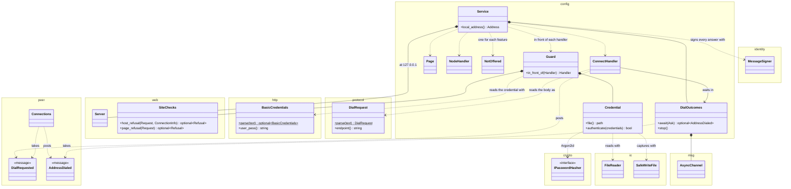

What each path on `/config`'s port is answered with, once the guard lets it
through:

| Path | Answered by |
| --- | --- |
| `/config`, and each path beneath it outside `/config/api` | `config::Page`: the page, to a `GET`, and `405` to any other method |
| `/config/api` | The endpoints `/config` serves, with the method and purpose of each, to a `GET` |
| `/config/api/node` | `config::NodeHandler`: the node's id, where its main port listens, and the first endpoint its node list names it at |
| `/config/api/connections` | `config::ConnectHandler`: a `POST` naming an address to connect to |
| `/config/api/metadata`, `trust`, `connecting`, `karma`, `applications`, `users`, `builds`, `exports`, `backups`, and `restores` | `config::NotOffered`: `404`, saying what the node does not offer yet, which a later phase brings |
| Any other path | `404` |

### 5.3 Content

`storage` and `protocol`. Every part reads and writes content through
`storage::IDataSource`, which the node makes as a `storage::Manager` over a
`storage::DataDir` for each directory. Content is named by a
`storage::Identifier`, an algorithm and a hash, and searched for by a
`storage::HashPrefix`. The `protocol` classes read and write the bodies nodes
send each other, each within 1 MiB.

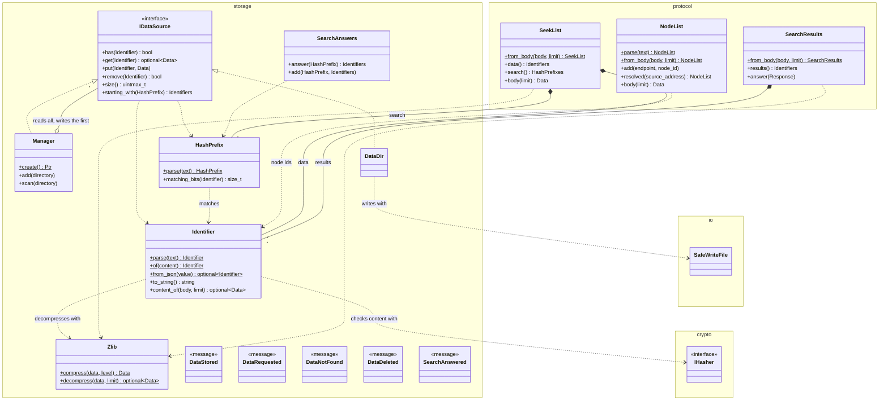

### 5.4 Identity and Signatures

`identity`. A node's id is the `storage::Identifier` of its public key, so
`identity::KnownKeys` reads another node's key from the store, by its id.
`identity::MessageSigner` signs what the node sends, and
`identity::MessageVerifier` checks what it receives: `api::SignatureGuard`
uses both for the web server, and `peer::PeerSession` both for each peer.

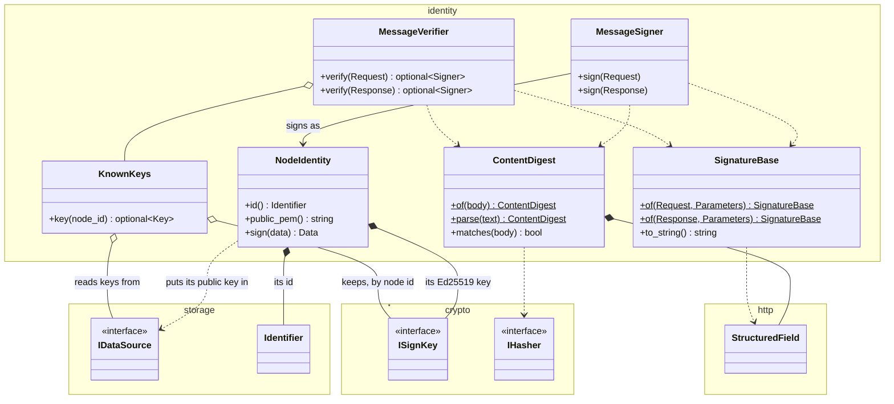

### 5.5 Cryptography

`crypto`. Each interface makes its implementations with a factory, defined in
its `.cpp` file, which picks the one built for the platform. On macOS,
SHA-256, AES, and RSA are built on Apple's frameworks; elsewhere, on OpenSSL.
Ed25519, which node ids are made from, and Argon2id, which the `/config`
credential is hashed with, are built on OpenSSL everywhere.

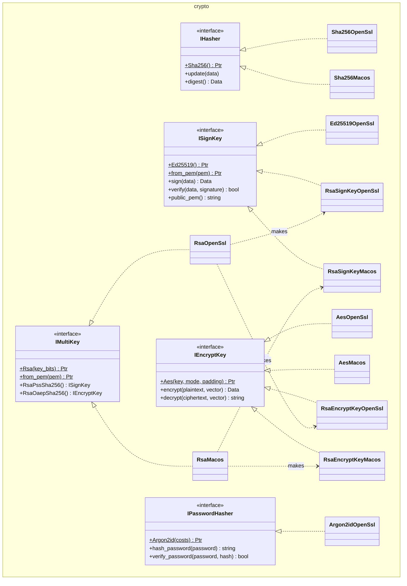

Beside these are the helpers the implementations share, which no other
library uses but `Base64`:

| Helper | For |
| --- | --- |
| `Base64` | Base64 text, to and from bytes; `http::StructuredField` and `http::BasicCredentials` use it too |
| `Pem` | PEM's armor: a label, and Base64 lines |
| `RsaDer` | RSA keys in DER, between PKCS #1 and the forms that hold it |
| `RsaPemOpenSsl`, `RsaPemMacos` | RSA keys to and from PEM, on each platform |
| `OpenSsl.hpp` | `OpenSslBytes`, `OpenSslFree`, `OpenSslDer`, and `OpenSslError`: OpenSSL's bytes, objects, DER, and errors |
| `CFObject`, `CFBytes` | Core Foundation's objects, released when they go, and its data |

### 5.6 Peers

`peer`. `peer::Connections` dials the nodes `peer::DialPlan` names, to fill
the `peer::Buckets` of node ids left empty, and makes first contact with each
over a new `peer::PeerConnection` (`peer::FirstContact`), which gives a
`peer::PeerSession` once the node has proved its id. A session signs each
request, and checks each answer, over a connection that sends requests
without waiting for each answer. `Connections` takes its messages on an
`msg::AsyncChannel`, with a `msg::Timer` for its checks, at each of which it
has the `peer::SeekFulfiller` it shares with `FirstContact` read again the
seek lists that are due; `FirstContact` and `SeekFulfiller` share the store.
An address `/config` asks for (`address.dial_requested`) it dials at once,
on a thread of its own, outside the peer mix and whatever the address's
rest, and posts what came of it (`address.dialed`, §6.4).

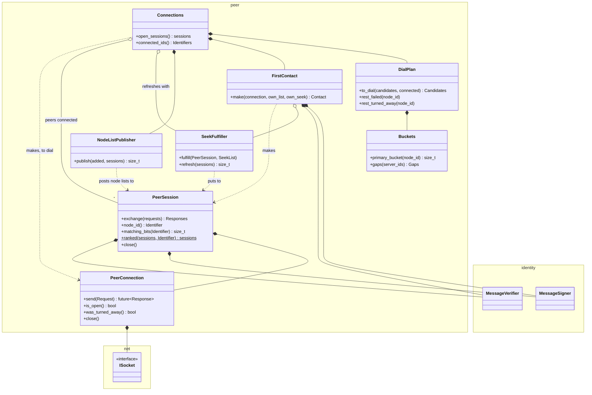

The rest of `peer` does its work over the sessions connected: `Fetch`,
`HandOff`, `Pusher`, and `Seeker` are each given a function that gives them
(`GetPeers`), and `PeerSearch` is given them for each pass. `Fetch`,
`PeerSearch`, and `HandOff` run on the threads that call them. `Seeker`
takes `data.not_found` and `data.search_requested` on a `msg::AsyncChannel`
of its own, with a `msg::Timer` for the passes that come due, and runs each
fetch, and each making of passes, on a thread of its own. `Pusher` takes
`data.stored` on a `msg::AsyncChannel` of its own.

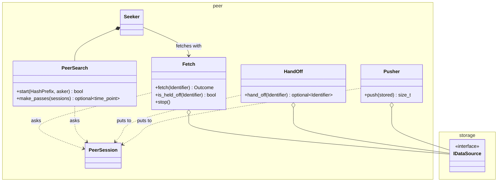

### 5.7 Stats and the Database

`stats` and `db`. `stats::Recorder` is the only class that opens the
database. It keeps a table for each of `stats::NodeAddresses`,
`stats::ContentUses`, and `stats::Sought`, each of which prepares the
`db::Statement`s it needs on the `db::Database` the recorder owns, and is
used from the recorder's thread alone. The recorder also keeps the
`protocol::NodeList` and `protocol::SeekList` it last derived, and takes its
messages on a `msg::AsyncChannel`, with a `msg::Timer` for its derivations.

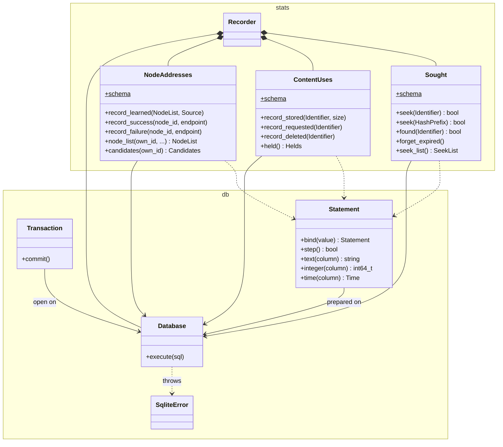

### 5.8 Eviction

`eviction`. `eviction::Evictor` asks `stats::Recorder`, by message, what to
let go of first, and the recorder ranks what is held with
`eviction::Scorer`. The evictor hands each object off through the functions
it is given (`Evictor::Peers`), which `node::Node` binds to `peer::HandOff`
and `peer::Connections`, and deletes it from the store once a peer took it.


### 5.9 Messages and Threads

`msg`. A `msg::Channel` listens on names; `Channel::post()` wraps a value
in a `msg::Message` and puts it in the queue of every channel listening on
its name, from a registry of them all. A `msg::AsyncChannel` takes what
reaches it on a thread of its own, and calls its callback with each, in
order. A `msg::Timer` posts a `Timer::Tick` under a name every interval.

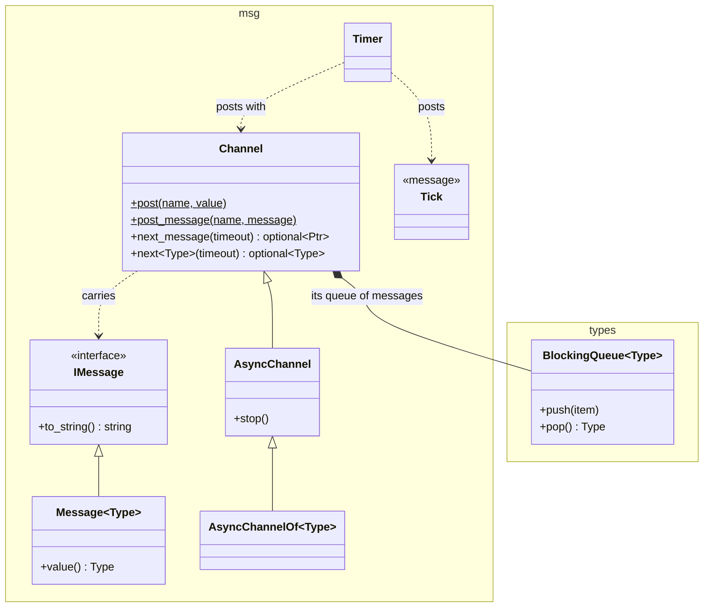

### 5.10 Input, Output, and Sockets

`io` and `net`. A `net::ISocket` is made by `bind()`, `connect()`, or
`accept()`. Readers are stacked: `web::Server` and `peer::PeerConnection` each
read through a `MeteredReader` over a `BufferedReader` over a
`SocketReader`, so that no input from outside takes more than its limit.
Each file the node reads itself, the database aside, it reads through an
`io::FileReader`: the settings and the seeds, the node's key, the `/config`
credential, and the store's content. The key, the content, and the
credential it writes whole, through an `io::SafeWriteFile`, which renames
what it wrote into place, or links it into place where no file must be
there already, as when the `/config` credential is captured.

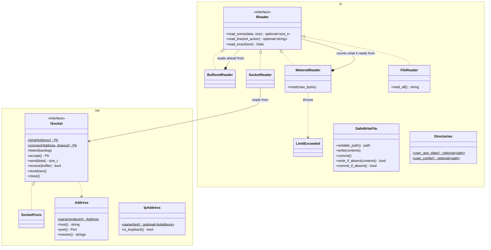

### 5.11 HTTP

`http`. A `Request` and a `Response` are read from, and written to, a
stream; `Response::read()` reads one through an `io::MeteredReader`, within
limits. An error is answered with a `Problem` (RFC 9457).
`StructuredField` reads and writes the dictionaries signatures and digests
are sent in (RFC 9651). `BasicCredentials` reads the username and password
of an `Authorization: Basic` header (RFC 7617), and wipes the password as it
goes.

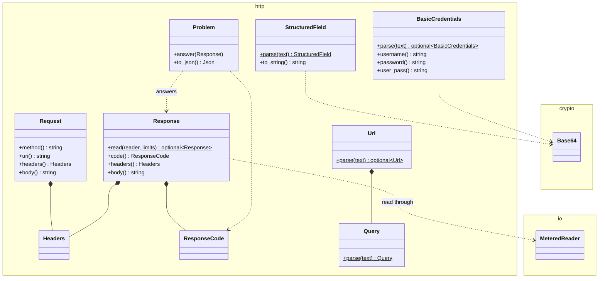

### 5.12 The Log

`logger`. Each line is a `logger::Logger`, made by a macro, as
`lWarn << "Cannot reach " << address;`, which writes itself to every output
when it goes, at the end of the statement, formatted by the formatter. What
it writes to, how, and at what level, are set for the whole program, by
`Logger`'s static methods.

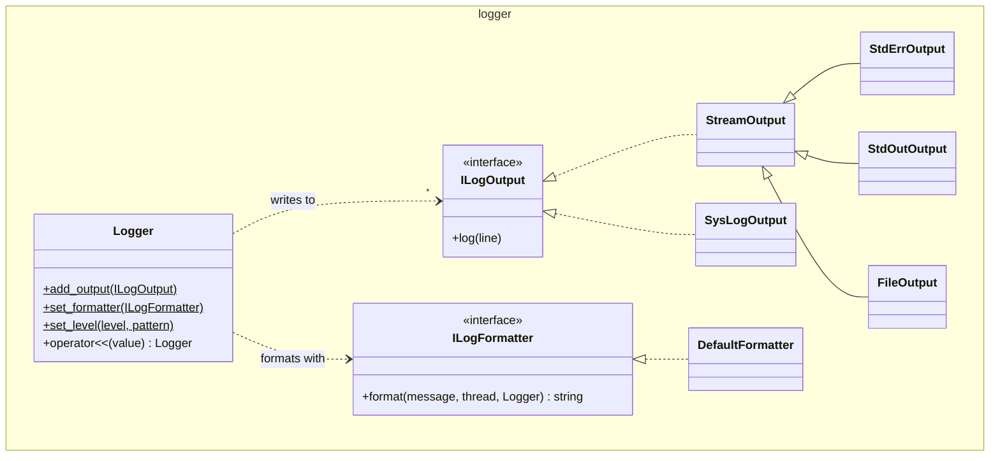

`types` has no diagram: its classes, `Json`, `Integer`, `BlockingQueue`,
and `Converter`, each stand alone.

## 6. Following the Code

### 6.1 A GET of Content

What happens when a client asks for `GET /data/sha256/{hash}`, in the node as
it runs now:

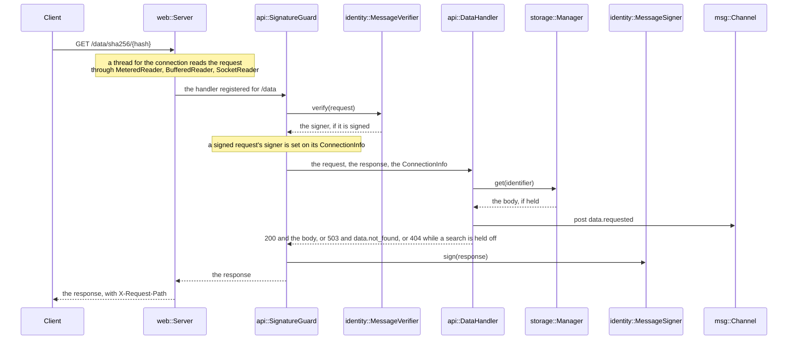

A `503` tells the client when to ask again. Meanwhile `stats::Recorder`
adds the content to the seek list, and `peer::Seeker` fetches it from the
peers (`peer::Fetch`), each on taking `data.not_found`, so that the next
`GET` may find it held. Whether a search is held off, the handler asks of
`peer::Fetch::is_held_off()`, as the node binds it.

A `PUT` goes the same way to `DataHandler`, which checks the body against
its id (`storage::Identifier::content_of()`), puts it in the store, and posts
`data.stored`.

### 6.2 Dialing a Peer

What `peer::Connections` does as the candidates change, or a check is due.
Each dial runs on a thread of its own.

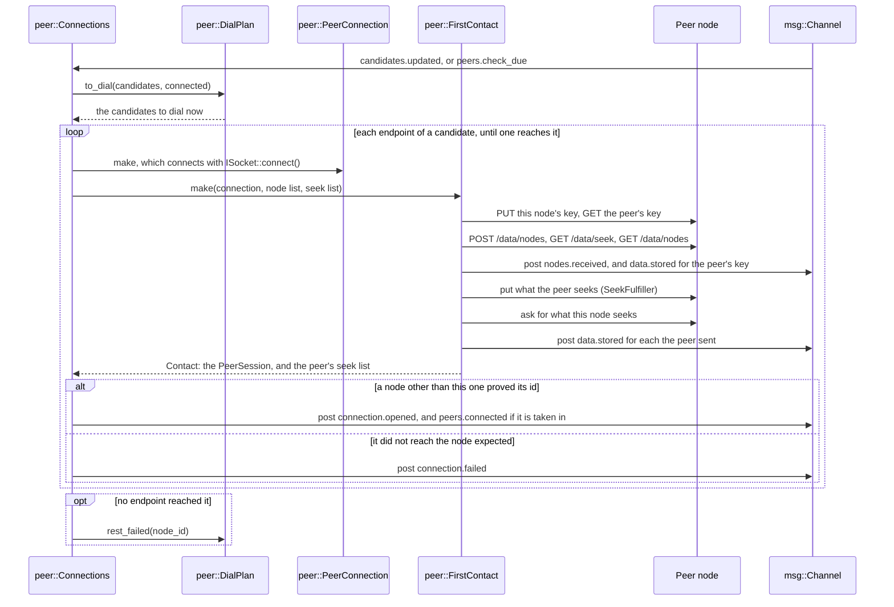

While the candidates name no node, as when the database is new,
`Connections` dials the seeds in their place, each endpoint on a thread of
its own, expecting the node id the seed names, if it names one, and rests
each endpoint for `peers.retry_delay_seconds` whatever came of it.

[Handshake Protocol §3](../../docs/specs/HandshakeProtocol.md) gives the
steps of first contact; `peer/FirstContact.cpp` takes each.

### 6.3 A Request to `/config`

What `config::Guard` asks of each request on `/config`'s port, in order,
before its handler sees it
([HTTP API §2.3.3](../../docs/specs/HttpApi.md#233-requests-from-other-sites)).
It looks at nothing but the connection's addresses and the request's
headers until the credential is checked, so a request refused or challenged
has its body read by nothing.

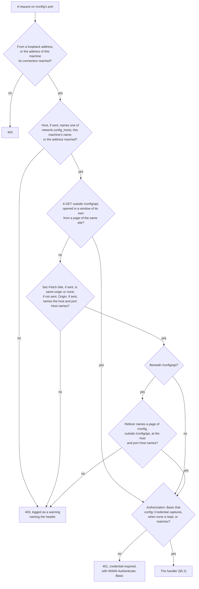

Whatever the guard or the handler answers carries `Guard::policy` and no
header granting a cross-origin request, and `config::Service` signs it as
the node.
A request carrying none of `Host`, `Sec-Fetch-Site`, and `Origin` is from no
browser, and passes those checks.

### 6.4 Connecting to a Node From `/config`

What happens when the page asks the node to connect to another, with
`POST /config/api/connections`, once the guard has let it through:

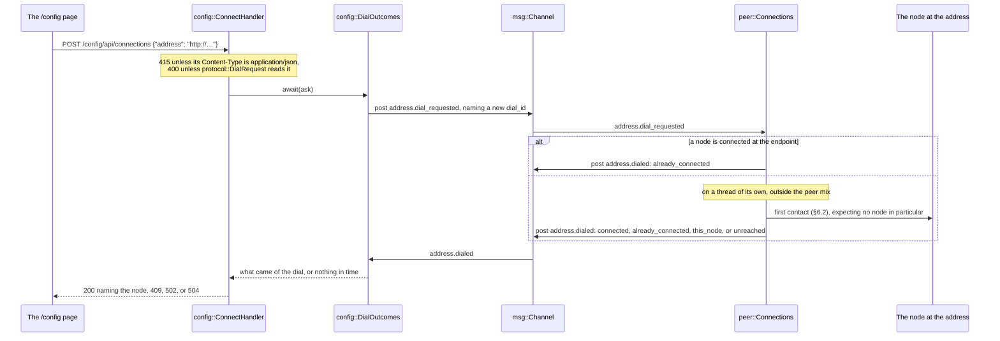

A node reached joins the peers, as any node dialed does, and its address is
recorded as reaching it (`connection.opened`), so that it may be dialed as a
candidate after a restart. An address where no node was reached is not
remembered. A request waits as long as one dial may take,
`peers.connect_timeout_seconds` and two `peers.request_timeout_seconds`,
and 5 seconds more. As the node stops, `config::Service` lets each request
waiting go first, and each is answered `504`.

## 7. Patterns Used Throughout

- **What the parts share is made once, by the node, and handed in.** The
  store is a `storage::IDataSource::Ptr`, a `std::shared_ptr`; the identity
  is passed by reference, and must outlive what it is given to. The only
  state held in statics is the log's, its outputs, formatter, and levels,
  and the registry of channels.
- **A class that starts threads owns them**, and stops and joins them as it
  goes: a `msg::AsyncChannel`, a `msg::Timer`, a `web::Server`, a
  `peer::PeerConnection`'s sender and reader, and the jobs
  `peer::Connections`, `peer::Seeker`, and `eviction::Evictor` start. Such a
  class is neither copied nor moved, and declares its threads last, so that
  they stop first, before what they use goes.
- **Time is a function.** A class that needs the time takes a
  `ClockFunction`, `&Clock::now` by default, so that a test can set it.
- **A function stands in for a library above.** As §4.3 says, a class that
  must ask something of a library it does not use is given a function to
  call in its place.
- **Settings are a struct of the class's own**, as
  `eviction::Evictor::Settings`, with the defaults the Python node has, as
  `default_…` constants. `node::Node` reads each from the settings file, by
  the Python node's name, and checks it as the Python node does, before it
  makes anything.
- **A message is a plain struct**, with its `name` and an
  `explicit operator std::string() const` for the log, posted with
  `msg::Channel::post()` and read with `msg::value_of<Type>()`.
- **A parser is a static method**: `parse()` for text, `from_body()` for
  what a node sends, which may be compressed, or `read()` from a reader. It
  refuses what it cannot read with `std::invalid_argument`, or an empty
  `std::optional`, and has a fuzzer.
