# Libranet C++ Overview

Version 0.1 • November 2026

---

## 1. Purpose

This document is a map of the C++ node's code: the libraries it is made of,
where each class lives, how the libraries depend on each other, and how the
classes relate. It is written for someone new to the code, who wants to know
where to look before reading it, and for someone about to change a class, who
wants to see what is around it.

It says what the code is, not what it must do, nor how it is built. Those are
elsewhere:

- What every node must do is in the specifications, in
  [`docs/specs/`](../../docs/specs/): [High-Level Design](../../docs/specs/HighLevelDesign.md),
  [HTTP API](../../docs/specs/HttpApi.md), and
  [Handshake Protocol](../../docs/specs/HandshakeProtocol.md) above all.
- How to build, test, fuzz, and check the code is in the
  [README](../README.md).
- The messages the node's parts post to each other are in
  [Messages](Messages.md).
- How the code is written is in [Coding Style](Coding%20Style.md) and
  [Coding Style in Libranet](Coding%20Style%20in%20Libranet.md).
- How the node came to be as it is, and what comes next, is in the
  [plans](plans/), from [Phase 1](plans/Phase%201.md) on.

The authority remains the code: each class's header says what it is for, in
the comment above it. Paths below are relative to `cpp/src/`, and are as of
2026-11-24.

## 2. The Node at a Glance

`main.cpp` reads the command line, and the YAML settings file it names
(`node::SettingsFile`), and runs a `node::Node` until the process is sent
SIGINT or SIGTERM. As it is made, the node:

1. lays out its data directory: `cas/`, where content is stored, and
   `incoming/`, whose directories are read as content too, together as one
   `storage::Manager` of `storage::DataDir`s;
2. reads its Ed25519 key from `node-key.pem`, or makes one the first time, as
   an `identity::NodeIdentity`, whose public key it puts in the store, so that
   other nodes can fetch it by the node's id;
3. makes its parts, handing each what it needs of the store and the identity.
   Each part starts the threads it needs as it is made, and stops and joins
   them as it goes.

A node has four parts, each a class that runs threads of its own:

| Part | Class | Job |
| --- | --- | --- |
| Web | `api::Service` | Runs `web::Server`, with a handler for each endpoint beneath `/data`, each behind an `api::SignatureGuard`; keeps the latest lists the stats derive, to serve |
| Stats | `stats::Recorder` | Records, in SQLite, the addresses of nodes and how content is used; derives the node list, the candidates to dial, and the seek list; ranks content for eviction |
| Connections | `peer::Connections` | Owns the outgoing connections, and keeps up the mix of peers; makes first contact; with the classes beside it in `peer/`, fetches, searches, fulfills peers' seek lists, pushes new content, and hands content off |
| Eviction | `eviction::Evictor` | Keeps storage within its limits, handing content off to peers before deleting it |

**For now, `node::Node` makes only the web server.** The other three parts
are built and tested on their own. `libranet::node` does not yet link
`libranet::peer`, and nothing makes a `stats::Recorder` or an
`eviction::Evictor` but their tests.

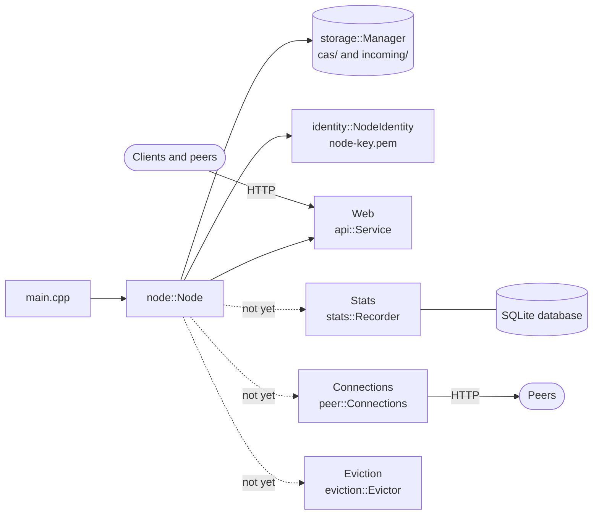

The parts do not call each other. Each posts what happened as a message on a
`msg::Channel`, under a name, and takes the messages it needs on a
`msg::AsyncChannel` of its own, from a thread of its own. These are the
messages that pass between them; [Messages](Messages.md) says who posts
each, who takes it, and why.

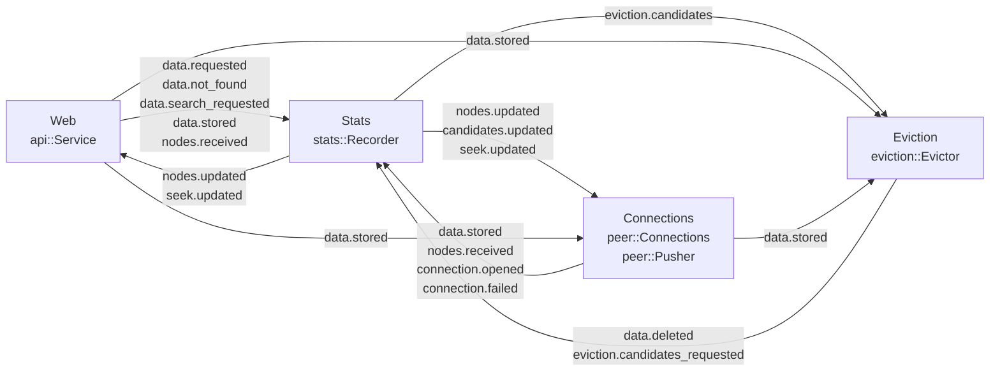

Left out above: `data.stored` from Connections to its own `peer::Pusher`;
`data.search_answered` and `peers.connected`, which no part takes yet; and
the timers' ticks, which each part posts to itself.

## 3. Where to Find Things

### 3.1 The Layout

```text
cpp/
├── CMakeLists.txt     The build: options, warnings, and each library
├── conanfile.py       The libraries the node is built on
├── docs/              This document, Messages, the coding style, and the plans
└── src/
    ├── main.cpp       The libranet program
    └── <library>/     A library: its headers, its .cpp files, and its CMakeLists.txt
        ├── tests/     Its GoogleTest tests, built into <library>_tests
        └── fuzz/      A libFuzzer program for each of its parsers
```

What makes a thing easy to find:

- **A library is a directory under `src/`**, a CMake target named
  `libranet_<directory>` with the alias `libranet::<directory>`, and a
  namespace named for the directory. So `peer::Connections` is in
  `src/peer/Connections.hpp`, and is built into `libranet::peer`.
- **A file is named for the class it holds.** Headers are included from
  `src/`, as `#include "storage/Identifier.hpp"`. Small types that only one
  class uses are nested in it, as its `Settings`, its `Limits`, and the
  messages it posts or takes.
- **Most code is in the header**, below the class. A `.cpp` file holds what
  a header must not: code that includes a platform's or another library's
  headers, such as sockets, OpenSSL, SQLite, zlib, or yaml-cpp; static data;
  and the factory that picks an implementation for the platform.
- **An interface is named `I…`**, as `storage::IDataSource` and
  `net::ISocket`, and makes its implementations with static factories, as
  `crypto::ISignKey::Ed25519()` and `net::ISocket::connect()`. An
  implementation is named for what it is, then what it is built on:
  `net::SocketPosix`, `crypto::Sha256OpenSsl`, `crypto::Sha256Macos`.
- **The tests of a class `X` are in `tests/TestX.cpp`**, in its library, with
  what several of them share in `tests/Fixtures.hpp`. The fuzzer of a parser
  of class `X` is `fuzz/FuzzX.cpp`.
- **A message is a struct with a `static constexpr auto name`**, in the
  header of the class that posts or takes it: `storage/` for those about
  content, as `storage::DataStored`, and `stats::Recorder`,
  `eviction::Evictor`, `peer::Connections`, and `peer::PeerSearch` for the
  rest.

### 3.2 The Libraries

From those every other library uses, to the node itself:

| Library | Holds | Main classes |
| --- | --- | --- |
| [`types/`](../src/types/) | Values every library uses | `Json`, `Integer` (of any size), `BlockingQueue<Type>`, `Converter` (text, bytes, and hex), and `Constants.hpp` (`Kilobyte`, `Megabyte`) |
| [`net/`](../src/net/) | Addresses and sockets, on POSIX systems | `Address`, `IpAddress`, `ISocket`, `SocketPosix` |
| [`crypto/`](../src/crypto/) | Hashing, signing, encrypting, and password hashing, with OpenSSL, and on macOS with Apple's frameworks where they serve | `IHasher`, `ISignKey`, `IEncryptKey`, `IMultiKey`, `IPasswordHasher`, and their implementations; `Base64`, `Pem`, `RsaDer` |
| [`logger/`](../src/logger/) | The log: lines at levels, from any thread, to stderr, stdout, a file, or the system log | `Logger` and its macros, `lInfo`, `lWarn`, and so on; `ILogOutput`, `ILogFormatter` |
| [`db/`](../src/db/) | A connection to an SQLite database | `Database`, `Database::Transaction`, `Statement`, `SqliteError` |
| [`msg/`](../src/msg/) | Messages, the channels that carry them, and timers | `IMessage`, `Message<Type>`, `Channel`, `AsyncChannel`, `AsyncChannelOf<Type>`, `Timer` |
| [`io/`](../src/io/) | Reading input with limits, and writing files whole | `IReader`, `BufferedReader`, `MeteredReader`, `SocketReader`, `SafeWriteFile`, `Directories` |
| [`http/`](../src/http/) | Reading and writing HTTP | `Request`, `Response`, `Headers`, `ResponseCode`, `Url`, `Query`, `Problem`, `StructuredField` |
| [`storage/`](../src/storage/) | Content: its ids, the store, and searches by prefix; and the messages about content | `Identifier`, `HashPrefix`, `IDataSource`, `DataDir`, `Manager`, `SearchAnswers`, `Zlib`; `DataStored`, `DataRequested`, `DataNotFound`, `DataDeleted`, `SearchAnswered` |
| [`identity/`](../src/identity/) | The node's identity, and the signatures on what nodes send each other (RFC 9421) | `NodeIdentity`, `KnownKeys`, `MessageSigner`, `MessageVerifier`, `SignatureBase`, `ContentDigest` |
| [`protocol/`](../src/protocol/) | The bodies nodes send each other | `NodeList`, `SeekList`, `SearchResults` |
| [`web/`](../src/web/) | An HTTP/1.1 server, a thread for each connection | `Server`, `ConnectionInfo` |
| [`api/`](../src/api/) | What the web server serves, beneath `/data` | `Service`, `SignatureGuard`, `DataHandler`, `NodesHandler`, `SeekHandler`, `SearchHandler` |
| [`eviction/`](../src/eviction/) | Keeping storage within its limits | `Evictor`, `Scorer` |
| [`stats/`](../src/stats/) | What the node remembers of the network, in SQLite | `Recorder`, `NodeAddresses`, `ContentUses`, `Sought` |
| [`peer/`](../src/peer/) | The node's outgoing connections, and all it does over them | `Connections`, `DialPlan`, `Buckets`, `FirstContact`, `NodeListPublisher`, `SeekFulfiller`, `PeerSession`, `PeerConnection`, `Fetch`, `PeerSearch`, `Pusher`, `HandOff` |
| [`node/`](../src/node/) | The node, which makes the rest, and its settings file | `Node`, `SettingsFile` |

### 3.3 Where to Look

| To change | Look in |
| --- | --- |
| How the node starts, the settings it reads, and what it makes | `node/Node.cpp`, and `main.cpp` for the command line |
| What an endpoint beneath `/data` answers | The handler in `api/`: `DataHandler`, `NodesHandler`, `SeekHandler`, or `SearchHandler`; where each is registered, in `api/Service.cpp` |
| How requests are read and connections kept open | `web/Server.cpp` |
| Which requests must be signed, and how many may come before a signer's key is held | `api/SignatureGuard` |
| How a message is signed, or a signature checked | `identity/MessageSigner`, `identity/MessageVerifier`, `identity/SignatureBase`, and `identity/ContentDigest`; for answers from peers, `peer/PeerSession` |
| How content is checked against its id | `storage::Identifier::content_of()` |
| How content is kept on disk | `storage/DataDir`, and `storage/Manager` for several directories as one store |
| How a search by prefix is answered | `storage/SearchAnswers`, and `api/SearchHandler` |
| The bodies nodes exchange | `protocol/NodeList`, `protocol/SeekList`, `protocol/SearchResults` |
| A message: what it holds, who posts it, who takes it | [Messages](Messages.md), then the header that declares it |
| The tables in the database | The `schema` of `stats/NodeAddresses`, `stats/ContentUses`, and `stats/Sought` |
| Which nodes are dialed, and when | `peer/DialPlan` and `peer/Buckets`; `peer/Connections` dials them |
| What happens at first contact with a peer | `peer/FirstContact`, with `peer/SeekFulfiller` |
| Fetching, searching, pushing, and handing off content | `peer/Fetch`, `peer/PeerSearch`, `peer/Pusher`, and `peer/HandOff` |
| What is evicted first, and when | `eviction/Scorer` for the order, `eviction/Evictor` for when |
| The code built on OpenSSL, Apple's frameworks, SQLite, zlib, or yaml-cpp | `crypto/*OpenSsl*` and `crypto/OpenSsl.hpp`; `crypto/*Macos*`, `crypto/CFObject.hpp`, and `crypto/CFBytes.hpp`; `db/`; `storage/Zlib.cpp`; `node/SettingsFile.cpp` |
| The fuzzer of a parser | The library's `fuzz/`; the [README](../README.md#fuzzing) lists them |

## 4. Library Dependencies

### 4.1 The Graph

Each arrow points from a library to one it uses. Arrows that follow from
others are left out: `api` uses `storage` too, through `web` and `identity`.
§4.2 lists every library each uses directly. The parts of §2, and `node`,
are drawn with a heavy border; `peer`, drawn dashed, is not yet linked into
the node.

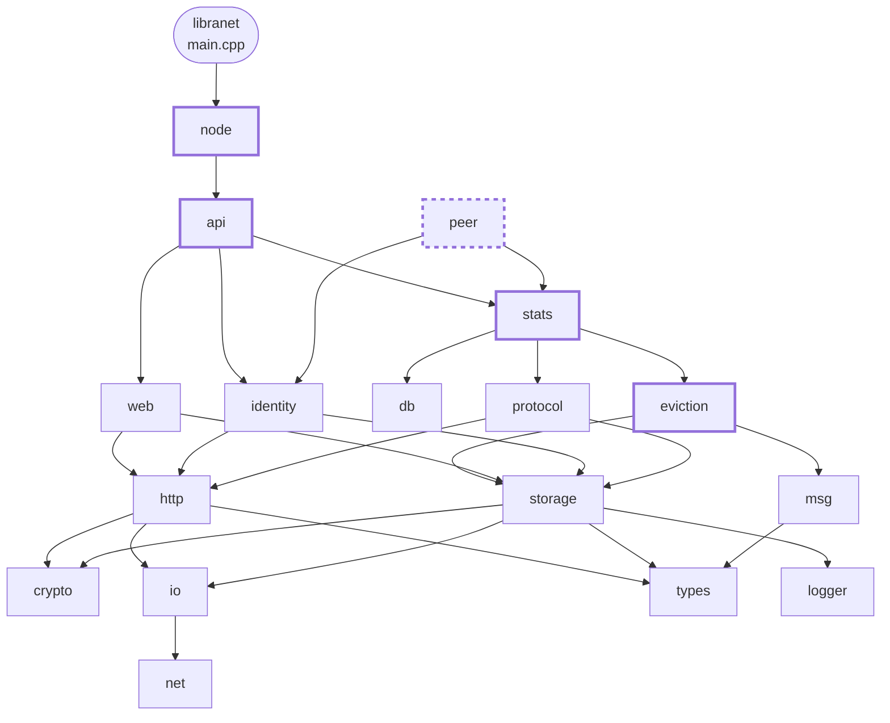

There are no cycles: no library uses one that uses it. The libraries fall
in three layers, each using only those in its own layer or below:

- **Foundations**: `types`, `net`, `crypto`, `logger`, `db`, `msg`, and
  `io`. They use no other library of the node's, but for `msg`, which uses
  `types`, and `io`, which uses `net`. Each is of use to any program.
- **Building blocks**: `http`, `storage`, `identity`, `protocol`, and
  `web`. They are what nodes say to each other, and how: HTTP, content and
  its ids, signatures, and the bodies of the protocol. Each knows the
  network's rules, but runs nothing of its own, but for `web::Server`'s
  threads.
- **Parts**: `api`, `stats`, `eviction`, and `peer`, those of §2, each with
  threads of its own; and `node`, which makes them.

### 4.2 Every Library Each Uses

What each library's code includes, tests and fuzzers aside, and what it is
built on from outside. Each `CMakeLists.txt` links the libraries its
headers name `PUBLIC`, so a library may include a header of one it reaches
only through another, as `node` does `net`'s.

| Library | Uses | Built on |
| --- | --- | --- |
| `types` | — | Threads |
| `net` | — | POSIX sockets |
| `crypto` | — | OpenSSL 3.2 or newer; on macOS, CoreFoundation and Security |
| `logger` | — | Threads; syslog |
| `db` | — | SQLite |
| `msg` | `types` | Threads |
| `io` | `net` | — |
| `http` | `crypto`, `io`, `types` | — |
| `storage` | `crypto`, `io`, `logger`, `types` | zlib |
| `web` | `http`, `io`, `net`, `storage` | Threads |
| `identity` | `crypto`, `http`, `io`, `logger`, `storage`, `types` | — |
| `protocol` | `http`, `logger`, `net`, `storage`, `types` | — |
| `eviction` | `logger`, `msg`, `storage`, `types` | Threads |
| `stats` | `db`, `eviction`, `logger`, `msg`, `protocol`, `storage` | — |
| `api` | `http`, `identity`, `logger`, `msg`, `net`, `protocol`, `stats`, `storage`, `types`, `web` | — |
| `peer` | `http`, `identity`, `io`, `logger`, `msg`, `net`, `protocol`, `stats`, `storage`, `types` | Threads |
| `node` | `api`, `identity`, `io`, `logger`, `net`, `storage` | yaml-cpp |
| `libranet` | `node` | — |

The tests are built on GoogleTest, and the fuzzers on libFuzzer. Conan
provides OpenSSL, SQLite, zlib, yaml-cpp, and GoogleTest
([`conanfile.py`](../conanfile.py)).

`storage`'s `CMakeLists.txt` links `http` as well, though its code includes
no header of it.

### 4.3 Why Some Arrows Are There

Most arrows are what they seem. These are less plain:

- **`http` uses `crypto`** for `crypto::Base64`, in which
  `http::StructuredField` reads and writes byte sequences; and **`io`** for
  `http::Response::read()`, which reads an answer through an
  `io::MeteredReader`.
- **`io` uses `net`** for `io::SocketReader`, which reads from a
  `net::ISocket`.
- **`storage` uses `crypto`** for `crypto::IHasher`, with which
  `storage::Identifier` checks that content hashes to its id.
- **`web` uses `storage`** for `storage::Identifier`: a
  `web::ConnectionInfo` carries the id of the node whose signature verified
  on it.
- **`api` and `peer` use `stats`** for the messages `stats::Recorder` posts
  and takes, which are declared in `stats/Recorder.hpp`:
  `api::Service` takes `nodes.updated` and `seek.updated`, and
  `api::SearchHandler` posts `data.search_requested`. `peer::DialPlan` also
  takes `stats::NodeAddresses::Candidate`s.
- **`stats` uses `eviction`** to answer `eviction::Evictor`'s
  `CandidatesRequested`, ranking what is held with `eviction::Scorer`.

And some arrows are missing on purpose. A class that must ask something of
a library above it, or beside it, is given a function in its place, which
whoever makes it binds:

- `eviction::Evictor::Peers` hands an object off, as `peer::HandOff` does,
  and names the nodes connected; so `eviction` does not use `peer`.
- `api::DataHandler::IsHeldOff` says whether a search for content is held
  off, as `peer::Fetch::is_held_off()` does; so `api` does not use `peer`.
- `peer::Fetch`, `peer::HandOff`, and `peer::Pusher` each take a `GetPeers`,
  giving the sessions connected now, as `peer::Connections` has them.
- `storage::SearchAnswers::Held` gives what the store holds that begins with
  a prefix.

## 5. Class Diagrams

The diagrams below are UML class diagrams, one for each area of the code.
Each shows the classes of its libraries, and those of other libraries only
where they connect, each in a box for its namespace. They show the public
methods that say most of what a class is for, not all of them, and leave out
most nested types and every message but a few.

| Arrow | Means |
| --- | --- |
| `A <\|-- B` | B is derived from A |
| `A <\|.. B` | B implements the interface A |
| `A *-- B` | A owns B: a member, by value or `std::unique_ptr` |
| `A o-- B` | A shares B: a `std::shared_ptr` |
| `A --> B` | A refers to B, by a reference or a pointer, and B must outlive it |
| `A ..> B` | A uses B: makes it, calls it, or takes it as a parameter |

### 5.1 The Node and the Web Server

`node`, `api`, and `web`. `api::Service` owns a `web::Server`, and registers
each handler with it behind its `api::SignatureGuard`, which checks the
signature on each request before the handler sees it, and signs each answer
as the node. The server calls the handler on the thread serving the
connection, with the `web::ConnectionInfo` it made for it.

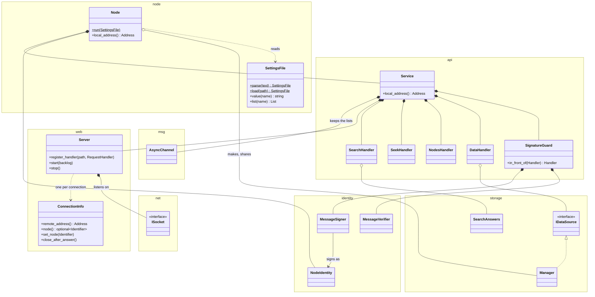

### 5.2 Content

`storage` and `protocol`. Every part reads and writes content through
`storage::IDataSource`, which the node makes as a `storage::Manager` over a
`storage::DataDir` for each directory. Content is named by a
`storage::Identifier`, an algorithm and a hash, and searched for by a
`storage::HashPrefix`. The `protocol` classes read and write the bodies nodes
send each other, each within 1 MiB.

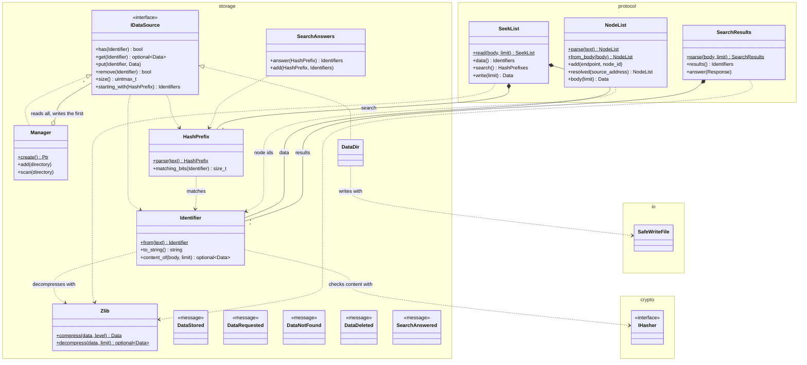

### 5.3 Identity and Signatures

`identity`. A node's id is the `storage::Identifier` of its public key, so
`identity::KnownKeys` reads another node's key from the store, by its id.
`identity::MessageSigner` signs what the node sends, and
`identity::MessageVerifier` checks what it receives: `api::SignatureGuard`
uses both for the web server, and `peer::PeerSession` both for each peer.

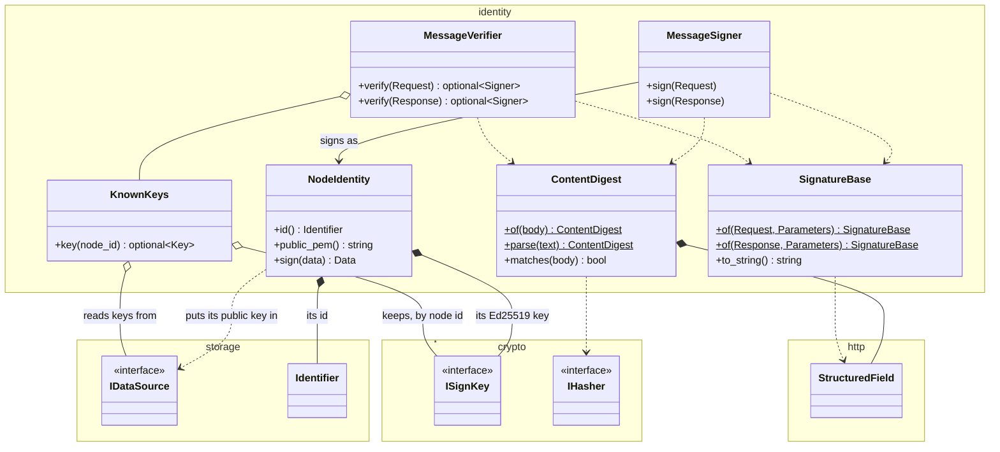

### 5.4 Cryptography

`crypto`. Each interface makes its implementations with a factory, defined in
its `.cpp` file, which picks the one built for the platform. On macOS,
SHA-256, AES, and RSA are built on Apple's frameworks; elsewhere, on OpenSSL.
Ed25519, which node ids are made from, and Argon2id are built on OpenSSL
everywhere.

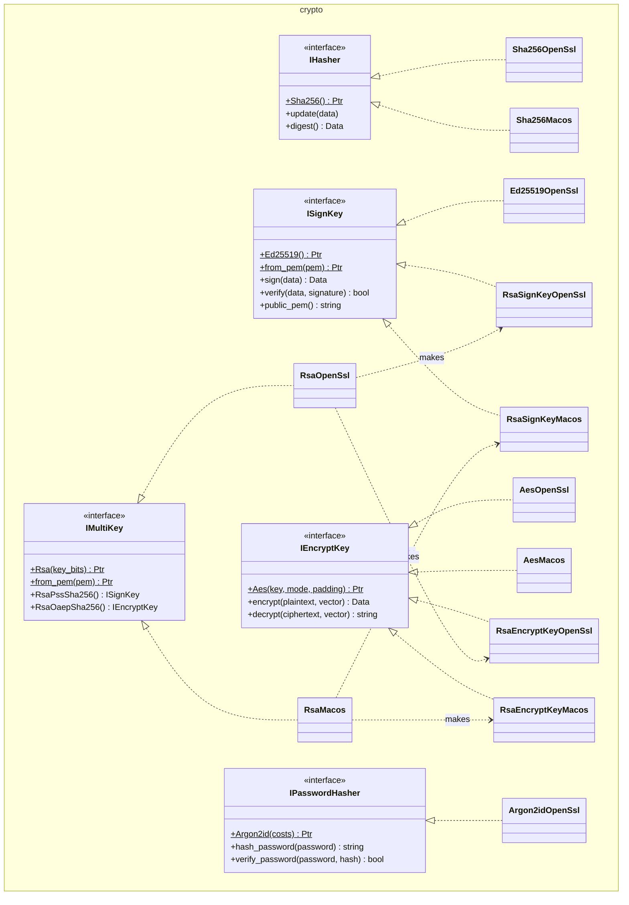

Beside these are the helpers the implementations share, which no other
library uses but `Base64`:

| Helper | For |
| --- | --- |
| `Base64` | Base64 text, to and from bytes; `http::StructuredField` uses it too |
| `Pem` | PEM's armor: a label, and Base64 lines |
| `RsaDer` | RSA keys in DER, between PKCS #1 and the forms that hold it |
| `RsaPemOpenSsl`, `RsaPemMacos` | RSA keys to and from PEM, on each platform |
| `OpenSsl.hpp` | `OpenSslBytes`, `OpenSslFree`, `OpenSslDer`, and `OpenSslError`: OpenSSL's bytes, objects, DER, and errors |
| `CFObject`, `CFBytes` | Core Foundation's objects, released when they go, and its data |

### 5.5 Peers

`peer`. `peer::Connections` dials the nodes `peer::DialPlan` names, to fill
the `peer::Buckets` of node ids left empty, and makes first contact with each
over a new `peer::PeerConnection` (`peer::FirstContact`), which gives a
`peer::PeerSession` once the node has proved its id. A session signs each
request, and checks each answer, over a connection that sends requests
without waiting for each answer. `Connections` takes its messages on an
`msg::AsyncChannel`, with a `msg::Timer` for its checks; `FirstContact` and
`SeekFulfiller` share the store.

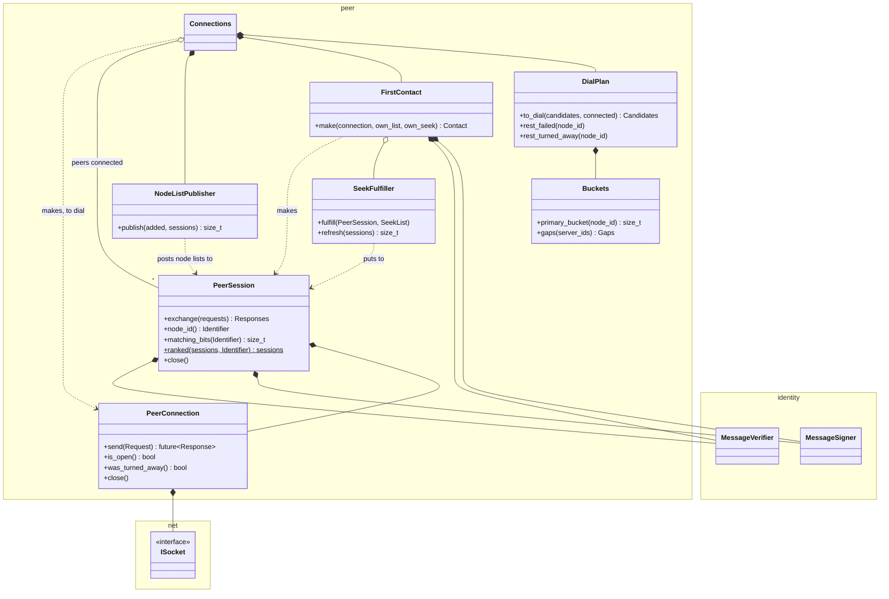

The rest of `peer` does its work over the sessions connected: `Fetch`,
`HandOff`, and `Pusher` are each given a function that gives them
(`GetPeers`), and `PeerSearch` is given them for each pass. `Fetch`,
`PeerSearch`, and `HandOff` run on the threads that call them; `Pusher`
takes `data.stored` on a `msg::AsyncChannel` of its own.

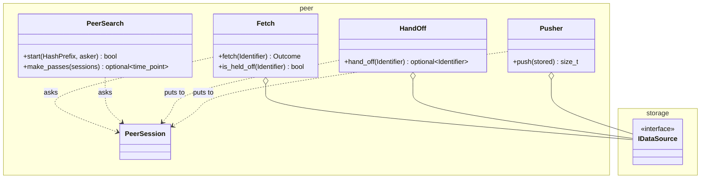

### 5.6 Stats and the Database

`stats` and `db`. `stats::Recorder` is the only class that opens the
database. It keeps a table for each of `stats::NodeAddresses`,
`stats::ContentUses`, and `stats::Sought`, each of which prepares the
`db::Statement`s it needs on the `db::Database` the recorder owns, and is
used from the recorder's thread alone. The recorder also keeps the
`protocol::NodeList` and `protocol::SeekList` it last derived, and takes its
messages on a `msg::AsyncChannel`, with a `msg::Timer` for its derivations.

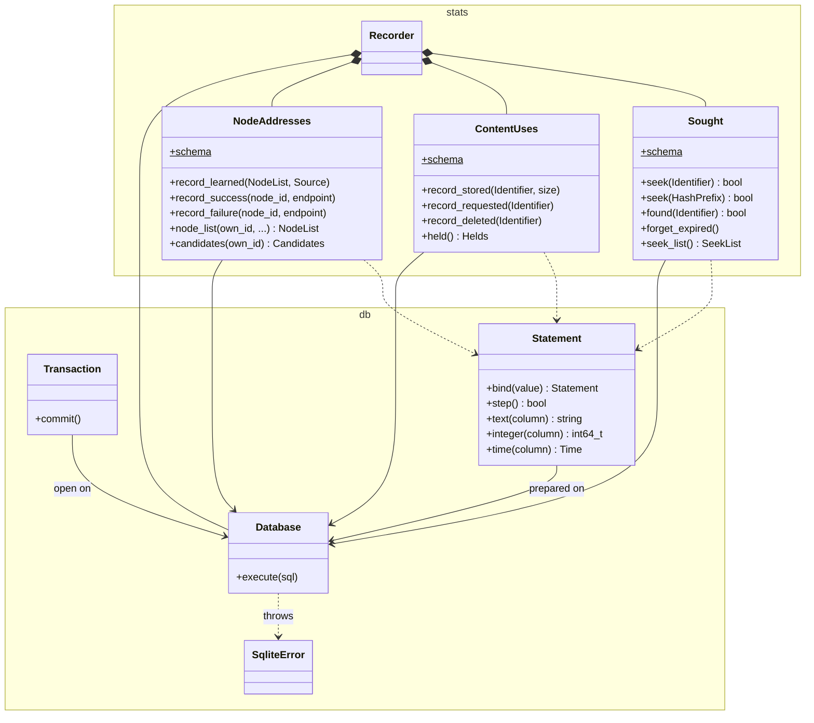

### 5.7 Eviction

`eviction`. `eviction::Evictor` asks `stats::Recorder`, by message, what to
let go of first, and the recorder ranks what is held with
`eviction::Scorer`. The evictor hands each object off through the functions
it is given (`Evictor::Peers`), which are to be bound to `peer::HandOff`
and `peer::Connections`, and deletes it from the store once a peer took it.

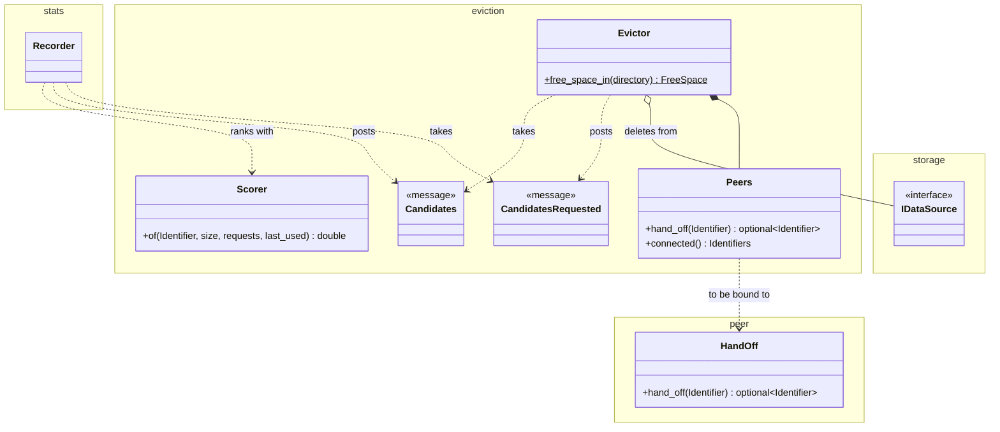

### 5.8 Messages and Threads

`msg`. A `msg::Channel` listens on names; `Channel::post()` wraps a value
in a `msg::Message` and puts it in the queue of every channel listening on
its name, from a registry of them all. A `msg::AsyncChannel` takes what
reaches it on a thread of its own, and calls its callback with each, in
order. A `msg::Timer` posts a `Timer::Tick` under a name every interval.

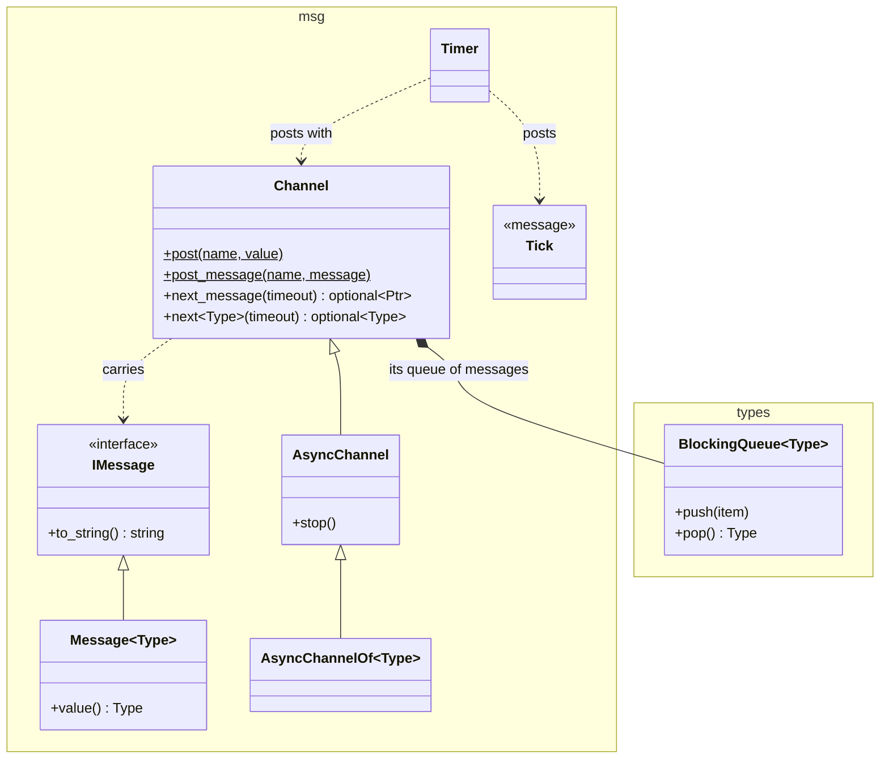

### 5.9 Input, Output, and Sockets

`io` and `net`. A `net::ISocket` is made by `bind()`, `connect()`, or
`accept()`. Readers are stacked: `web::Server` and `peer::PeerConnection` each
read through a `MeteredReader` over a `BufferedReader` over a
`SocketReader`, so that no input from outside takes more than its limit.

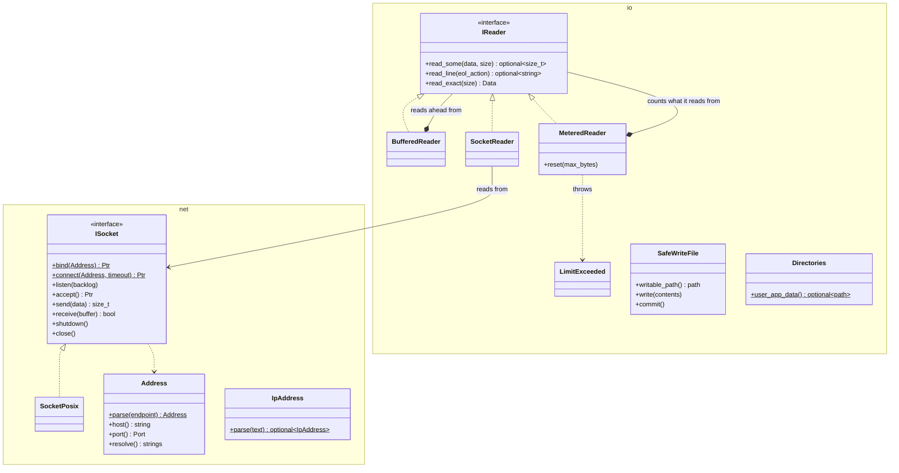

### 5.10 HTTP

`http`. A `Request` and a `Response` are read from, and written to, a
stream; `Response::read()` reads one through an `io::MeteredReader`, within
limits. An error is answered with a `Problem` (RFC 9457).
`StructuredField` reads and writes the dictionaries signatures and digests
are sent in (RFC 9651).

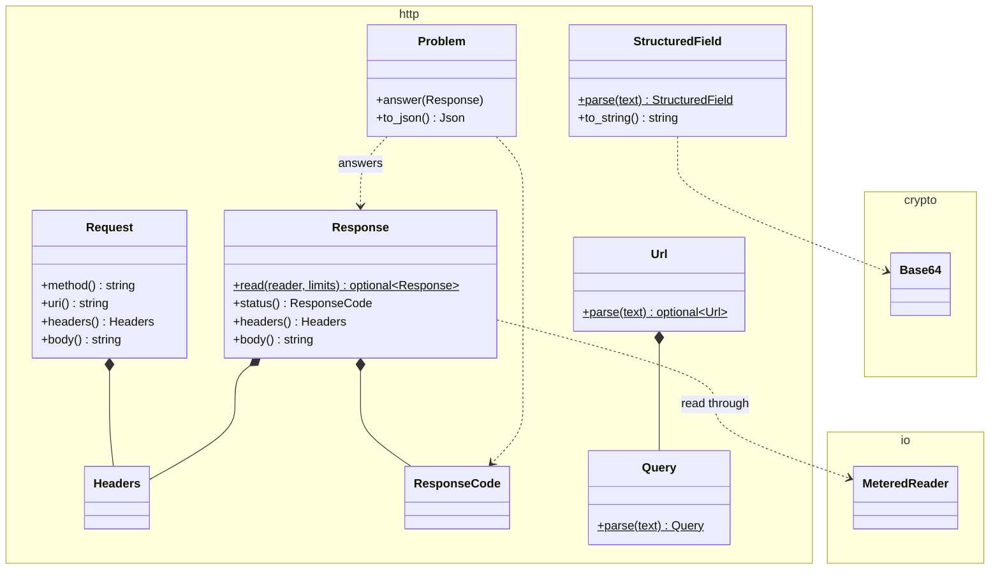

### 5.11 The Log

`logger`. Each line is a `logger::Logger`, made by a macro, as
`lWarn << "Cannot reach " << address;`, which writes itself to every output
when it goes, at the end of the statement, formatted by the formatter. What
it writes to, how, and at what level, are set for the whole program, by
`Logger`'s static methods.

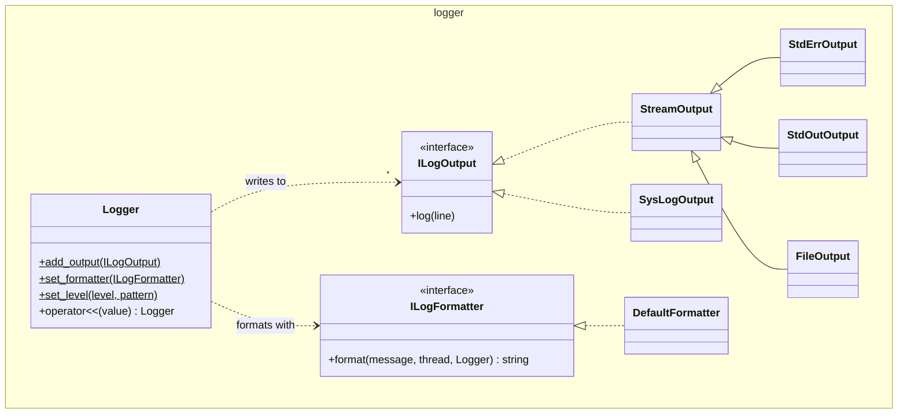

`types` has no diagram: its classes, `Json`, `Integer`, `BlockingQueue`,
and `Converter`, each stand alone.

## 6. Following the Code

### 6.1 A GET of Content

What happens when a client asks for `GET /data/sha256/{hash}`, in the node as
it runs now:

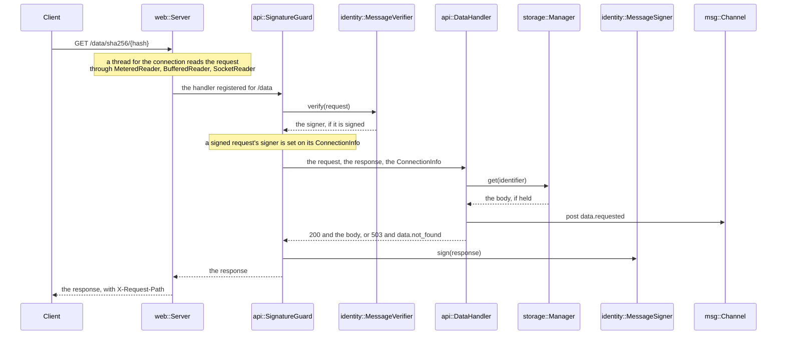

A `PUT` goes the same way to `DataHandler`, which checks the body against
its id (`storage::Identifier::content_of()`), puts it in the store, and posts
`data.stored`.

### 6.2 Dialing a Peer

What `peer::Connections` does as the candidates change, or a check is due.
Each dial runs on a thread of its own.

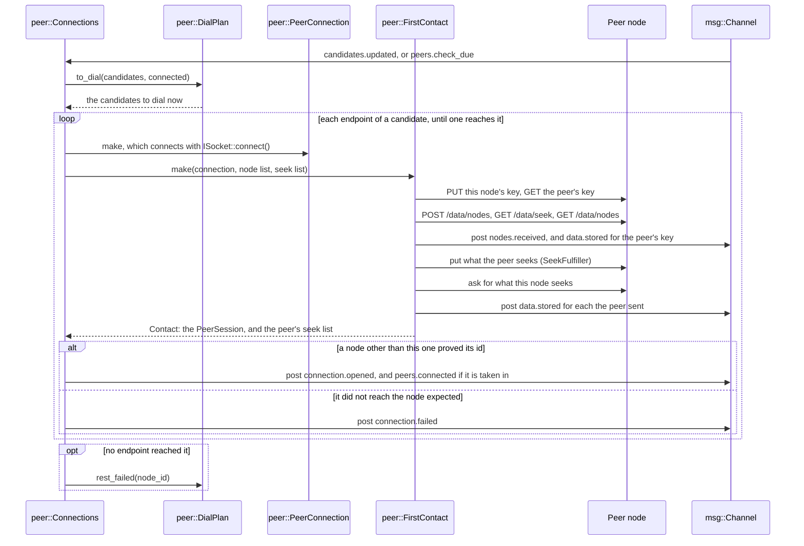

[Handshake Protocol §3](../../docs/specs/HandshakeProtocol.md) gives the
steps of first contact; `peer/FirstContact.hpp` says how the code takes
each.

## 7. Patterns Used Throughout

- **What the parts share is made once, by the node, and handed in.** The
  store is a `storage::IDataSource::Ptr`, a `std::shared_ptr`; the identity
  is passed by reference, and must outlive what it is given to. The only
  state held in statics is the log's, its outputs, formatter, and levels,
  and the registry of channels.
- **A class that starts threads owns them**, and stops and joins them as it
  goes: a `msg::AsyncChannel`, a `msg::Timer`, a `web::Server`, a
  `peer::PeerConnection`'s sender and reader, and the jobs `peer::Connections`
  and `eviction::Evictor` start. Such a class is neither copied nor moved,
  and declares its threads last, so that they stop first, before what they
  use goes.
- **Time is a function.** A class that needs the time takes a
  `ClockFunction`, `&Clock::now` by default, so that a test can set it.
- **A function stands in for a library above.** As §4.3 says, a class that
  must ask something of a library it does not use is given a function to
  call in its place.
- **Settings are a struct of the class's own**, as
  `eviction::Evictor::Settings`, with the defaults the Python node has, as
  `default_…` constants.
- **A message is a plain struct**, with its `name` and an
  `explicit operator std::string() const` for the log, posted with
  `msg::Channel::post()` and read with `msg::value_of<Type>()`.
- **A parser is a static method**, `parse()`, `read()`, or `from_body()`,
  that refuses what it cannot read with `std::invalid_argument`, or an empty
  `std::optional`, and has a fuzzer.
