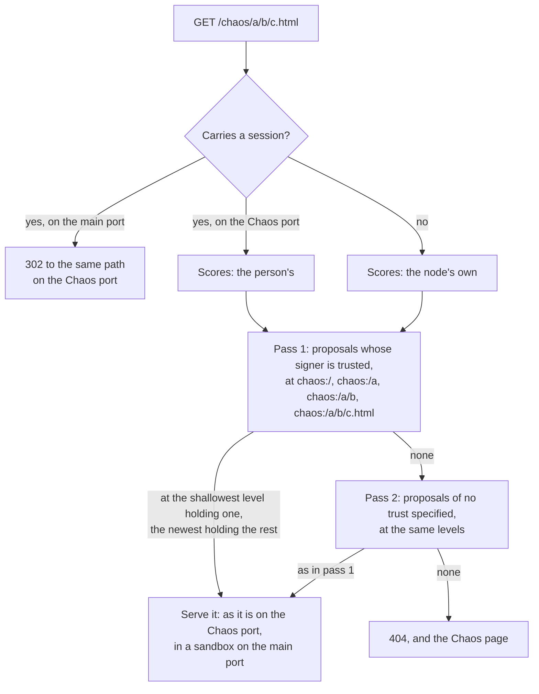

# Libranet Python Implementation Plan — Phase 7

Version 0.1 • November 2026

---

## 1. Purpose

This document plans the Chaos endpoint: pages that anyone may put at any
path beneath `/chaos`, and that each person sees as the people they trust
choose. Anyone may propose a bundle for a path, by placing a drop named
for it. A node serving a path beneath `/chaos` looks at the drop for each
part of the path, from the root down, and serves the newest bundle holding
the rest of the path, preferring one signed by someone the viewer trusts.
For a person signed in, every request their browser makes for a Chaos
path follows their trust: the page, its images and scripts, and each link
followed from it. A path for which no bundle is found is answered with a
page saying what was looked at. The same page, reached by ending any
address with `?`, shows every bundle proposed for the path, lets the
viewer trust or distrust whoever signed each, and lets them download a
bundle or propose one of their own.

Every step below comes from an issue in the GitHub **Phase 7 - Chaos
endpoint** milestone. Issue #595 asks for this plan, and has no text of
its own: the milestone's description, quoted in §2.1, is what is asked
for. Each step is to have an issue of its own, made from the text in §7.
Every issue in the milestone is either a step or accounted for in §4. As
in the phases before it, this is an implementation plan, not a protocol
specification: Step 155 writes the specification first, in
[HTTP API](../specs/HttpApi.md) and [Known Drops](../specs/KnownDrops.md),
and the steps after it build what it says.

Nothing here changes the architecture of Phase 1 §2: the same supervisor,
the same dispatcher, the same module processes, the same filesystem CAS,
and the same invariant that only the stats module opens SQLite. The Chaos
endpoint is served by the web server, on its main port and, for whoever is
signed in, on a port of its own (Step 157), from the building blocks it
has: the search of a drop and of the node's peers, signed content checked,
the trust scores of whoever is signed in and the node's own, reading into a
bundle, and making bundles and drops.

The web endpoint of Phase 8 (#596) is to work as this one does, but with
an owner for each path, who delegates the paths beneath it. Step 156's
resolution is written so that Phase 8 can reuse it.

## 2. What Phase 7 Adds

### 2.1 What the Milestone Asks

The milestone's description, as it is:

> A browser accessible endpoint that allows anyone to propose a bundle to
> be placed at a given path. Each user who views the Chaos endpoint may see
> different content depending on who they trust.
>
> When a path under chaos is given we evaluate each element of the path.
> starting at root and then adding each directory. We use that as a drop to
> look for a bundle. We list the bundles signed by trusted people that have
> the remaining path inside it and choose the latest one. If there is no
> trusted one then we move on to no trust specified bundles. If no
> zero-trust bundles have been found to contain the remaining path, we look
> at a drop that adds the next path element. This continues until the last
> path element.
>
> A 404 is shown if no bundle was found. The 404 page will show all the
> stats and have a reload button. Placing a question mark (?) at the end of
> any URL will show the same page, which will show the potential bundles,
> their dates, signers, etc. and will allow them to trust, distrust, or
> clear trust rating (remove self-references to trust, but still allow the
> trust web to dictate trust). It will also allow you to download and
> upload a bundle to that URL.

### 2.2 The Steps

Five steps, each built on the one before it:

- **The specification.** HTTP API gains a section for the Chaos
  endpoint, and Known Drops the drop a proposal is placed at. Step 155.
- **Resolving a path.** Which bundle a path beneath `/chaos` names, for
  whom, and why each other proposal was passed over. Step 156.
- **Serving `/chaos`.** For whoever is signed in, on a port of the node's
  own, where every request their browser makes carries their session, and
  so follows their trust. For anyone else, on the main port, in a sandbox.
  Step 157.
- **The Chaos page.** What a path resolves to, and why, shown for a `404`
  and for any address ending in `?`, with Trust, Distrust, and Clear for
  each signer. Step 158.
- **Proposing and downloading a bundle**, on the Chaos page. Step 159.

### 2.3 How a Path Is Resolved

A path beneath `/chaos/` has a **level** for the root and for each of its
elements in turn. Each level is a drop, named `chaos:/` and the level's
elements. A bundle proposed at a level is mounted there, and must hold the
**rest** of the path, what is left after the level's elements:

| Level | Drop | Rest, for `/chaos/a/b/c.html` |
| --- | --- | --- |
| 0 | `chaos:/` | `a/b/c.html` |
| 1 | `chaos:/a` | `b/c.html` |
| 2 | `chaos:/a/b` | `c.html` |
| 3 | `chaos:/a/b/c.html` | nothing: a file bundle's own file |

A path ending in `/` names that directory's `index.html`, so the rest of
`/chaos/a/b/` at level 2 is `index.html`, and it has no level 3.



Each request is resolved so, a page's images and scripts as much as the
page. Distrusted signers' proposals are never chosen. The order of the two
passes is this plan's, not the milestone's (Step 156, and §6).

## 3. How to Read the Steps Below

The conventions of [Phase 2](Phase%202.md) §3 carry over. In addition:

- **Step numbers stay stable**, and new steps take the next free number.
  [Music App](Music%20App.md) ends at Step 154, the highest assigned, so
  this plan starts at Step 155.
- **A step of another plan is named with its plan**, as Phase 2 names
  Phase 1's. A step number alone is a step of this document.
- **Settled in the milestone** is what the milestone's description says.
  **Ruled** is what the user decided once this plan was written, with the
  date. **My calls, not yet reviewed** are what this plan chose without
  asking, to be reviewed before the step is built. Every call is listed in
  §6 too.
- **Change sets.** Each step is one change set, under the 500 new lines
  of Python (not counting tests) past which CLAUDE.md asks for a split.
  Step 158's page and Step 159 are HTML and script, not Python.
- **Testing.** The Python is tested as the web server's is, with fakes for
  the store, the search, the scores, and the bundles read. The Chaos page
  has no automated tests but those of `tests/test_applications_packaged.py`;
  it is checked by hand, in at least Safari and one other browser, on a
  local client and on one elsewhere. Every change set passes the checks of
  [Phase 3](Phase%203.md) §3.

---

## Step 155 — Specifying the Chaos Endpoint

**Kind:** specification. **Issue:** #655 (§7.1). **Depends on:**
nothing.

Settled in the milestone: everything quoted in §2.1.

Ruled (2026-11-07): what a person signed in sees at a Chaos path follows
their trust, for every request their browser makes for one.

What is written:

- **HTTP API §13.6, The Chaos Endpoint** (new), with every rule Steps 156
  to 159 build: a path's levels and their drops; what a proposal is, signed
  or not; whose scores choose, and how; the Chaos port, and what each port
  serves, with what headers; the `404` and the page a bare `?` shows; and
  the report that page reads, `GET /data/chaos/{path}`. A sequence diagram,
  as §9.6 has, of a person's first view: the `302` to the Chaos port, and
  the page and its images served there, each carrying the session.
- **HTTP API §2**: `chaos` names the Chaos endpoint, rather than being
  reserved for the future, and is still never an application's name. The
  Chaos port is the node's third, beside the main port and `/config`'s.
- **HTTP API §2.5**: a page beneath `/chaos` on the main port is the Chaos
  page's, which counts as a trusted application's page, and the report is
  among the endpoints meant only for the node's own pages, served to any
  client.
- **HTTP API §13**, **§21**, and **§25**: the routing diagram's reserved
  names, the levels a node searches among the default limits, and the new
  endpoints in the summary.
- **High-Level Design §3.3.1 and §8**: `/chaos` is in use.
- **Known Drops**: a row in §1 and a section, §3.18, for `chaos:/{path}`.
- **Terms**: `chaos` defined.

The App Developer Guide and the Operator Guide change with the steps that
build what they describe.

My calls, not yet reviewed:

- **The specification first**, in a step of its own, as for the trust
  network (Phase 5 Step 94), so that the rules of §6 are reviewed once,
  before any code depends on them.
- **HTTP API §13.6**, beside the application routing it shares the main
  port's paths with, rather than a section of its own.

Calls made in writing it, not yet reviewed:

- **The open items of §6 are written in as this plan's calls**, so that a
  ruling against one changes the specification, not code.
- **A proposal's other members are ignored**, as a trust list's are (Trust
  Network §3.1), so that a later version can add one.
- **What is passed over before a proposer's newest is found.** A proposal
  that is not one, or whose signature, bundle, or date passes it over, does
  not supersede the proposer's older ones. One whose bundle lacks the
  rest, is unusable, or is still pending does, so that a proposer can take
  a path away.
- **The report's `null`s.** `signer`, `score`, and `step` are `null` for an
  unsigned proposal, `bundle` and `created` for what is not a proposal,
  `holds` where it was not asked, and `passed_over` for the proposal chosen
  and every one after it, which is not looked at.
- **Every cookie of the session's name is tried** (HttpApi §11.4), as the
  node already does, so that a Chaos site's script cannot hide the session
  behind a cookie it sets for a path of its own.
- **A link from another site's page** arrives without the session cookie,
  which is `SameSite=Strict`, so it is served by the node's scores, in the
  sandbox, and so is each link followed from that page. The specification
  says so (HttpApi §13.6.4) rather than working around it.
- **More sections than listed above**, so that none contradicts §13.6:
  HttpApi §2.1 and §2.4 (the report, and Chaos sites kept out), §11.4 (the
  cookie reaching the Chaos port), §13's opening, §13.5's text, §20
  (`no-store`), §23 (the TBD of sandboxing rules), and Terms' **Main Port**
  and **Reserved Names**.

**Testable in isolation:** a specification. Every link resolves, and
nothing still calls `/chaos` reserved.

---

## Step 156 — Resolving a Chaos Path

**Kind:** new node code. **Issue:** #656 (§7.2). **Depends on:**
Step 155; Phase 3 Steps 65 and 71; Phase 4 Steps 80, 89, and 93; Phase 5
Steps 99 and 113.

Settled in the milestone:

- **Anyone may propose a bundle** for a path.
- **Each level is a drop**, from the root, adding one element at a time,
  to the last.
- **The newest of those signed by trusted people that hold the rest** of
  the path is chosen, or else the newest of those with no trust specified.
- **What each viewer sees depends on whom they trust.**

Ruled (2026-11-07): **the person's trust.** A request carrying the session
of a person signed in is resolved by their scores, whatever it asks for.

What is built:

- **A Chaos path** (`ChaosPath`, `protocol/chaos.py`): the path beneath
  `/chaos/`, percent-decoded as an application's is, `%2F` becoming a `/`
  like any other, and split into its elements. Each element is an entry
  path's (BundleSpecification §3.1): not empty, `.`, or `..`, or the path
  names nothing, and is `404`. A path that is empty or ends in `/` names
  that directory's `index.html`. Its levels and their rests are as §2.3
  says, and level i's drop is the target string `chaos:/` followed by its
  first i elements, joined by `/`. Elements are compared byte for byte, as
  bundle paths are (BundleSpecification §1): never case-folded or
  normalized.
- **A proposal** (`ChaosProposal`, with `from_value` and `value`, in
  `protocol/chaos.py`):

  ```json
  {"bundle": "sha256/…", "created": "2026-11-07T15:04:05Z"}
  ```

  `bundle` names the bundle proposed, a directory bundle or a file bundle,
  in either form a read into a bundle takes (HttpApi §12.1), and `created`
  when it was proposed, in UTC, to the second. A **signed proposal** is a
  signed bundle (BundleSpecification §5) whose `contents` is a proposal,
  placed with `POST /data/signed`. An **unsigned proposal** is the proposal
  itself, placed with `POST /data/drop`. Either is placed at its level's
  drop, matching at least as many bits as a search returns
  (`storage.search_min_bits`).
- **Reading a level** (`ChaosResolver`, `webserver/chaos_resolver.py`).
  The drop is searched as signing in searches one
  (`SearchHandler.fresh_results`), so that a proposal placed since the last
  search is found at once, and the node's peers are asked for it too
  (Phase 4 Step 93). Each result held is read with its nonce stripped, as a
  signed proposal, checked under its signer's key as `GET /data/signed`
  checks one, or else as an unsigned proposal. Each proposal is passed
  over, with the reason kept, if:
  - it is neither (`not-a-proposal`), or its signature does not check
    (`bad-signature`);
  - its bundle is shunned (`shunned`);
  - it is dated more than `chaos.future_seconds` ahead of the node's clock
    (`future`);
  - its signer placed a newer one at the same level (`superseded`). Of two
    of the same moment, the one whose drop's id sorts first is the newer;
  - its signer is distrusted (`distrusted`).

  What is found and not held, a drop or a signer's key, is asked for, as
  any miss is (HttpApi §5.2), and named as missing. What a drop holds never
  changes, so a proposal read and checked is kept by its drop's id, for the
  1,000 drops read last, and not read again. What a level's search found
  is kept for `chaos.search_seconds`, so that a page's images and scripts,
  each resolved, do not each search every level again.
- **Whose scores choose.** Those of the person signed in, if the request
  carries their session (HttpApi §11.4), as `GET /data/trust` reads them,
  and otherwise the node's own (Phase 5 Step 113). A signer scoring above 0
  is **trusted**, and one below 0 **distrusted**. A proposal that is
  unsigned, or whose signer scores 0 or is not reached, is of **no trust
  specified**.
- **Choosing.** Two passes: first the trusted proposals at every level,
  from the root down, then those of no trust specified, the same way. At
  each level, its proposals of the pass are taken newest first, and the
  first whose bundle holds the rest is chosen. Whether it does is as
  `BundlePaths.entry` answers (Phase 3 Steps 65 and 71): a file, or a
  directory or symbolic link to be redirected to, holds it, a path not
  found does not (`lacks-path`), and a bundle that cannot be read, or is
  password-protected, is passed over (`unusable`).
- **Waiting.** What could change the choice, a drop, a signer's key, or
  an entry of a bundle not yet resolved, is waited for within one deadline,
  `network.app_wait_seconds`, as serving a file waits. What is still not
  known when it passes is left out (`pending`), named in the resolution,
  and asked for, so that the page's Reload finds it.
- **The resolution** (`ChaosResolution`): each level with its drop, its
  target hash, and its rest; each proposal with its drop's id, how many
  bits it shares with the target hash, its signer and their score, its
  bundle, when it was proposed, whether it holds the rest, and why it was
  passed over; what is missing; whose scores chose, and whether they are
  complete; and the proposal chosen, if any. Its `value()` is the report of
  Step 158.
- **Settings**, in a new `chaos` section of the configuration and of
  `examples/libranet.yaml`: `max_levels`, the levels searched, the
  shallowest first, 16 by default, so that a deeper path is served only
  from a bundle at one of those levels; `future_seconds`, how far ahead of
  the clock a proposal may be dated, 300 by default; and `search_seconds`,
  how long what a level's search found is kept, 5 by default.

My calls, not yet reviewed:

- **Two passes, which departs from the milestone.** Read literally, the
  milestone takes a level's proposals of no trust specified before the
  next level's trusted ones. Then anyone could take over a trusted site from
  a shallower drop: an unsigned proposal at `chaos:/` whose bundle holds
  `recipes/index.html` would beat one at `chaos:/recipes` signed by someone
  the viewer trusts. Two passes put trust first, at whatever level.
- **No trust specified** is an unsigned proposal, or one whose signer
  scores 0 or is not reached.
- **The node's own scores** for whoever is not signed in. That is every
  client not on the node's own machine, since only a local client signs in.
  The node's operator then decides what a stranger sees. Without them, a
  stranger would see only proposals of no trust specified, and none would
  be passed over.
- **Newest by `created`**, which the proposal says: a drop has no date of
  its own. Without the limit on dating ahead, a proposal dated 9999 would
  win for ever.
- **A signer's newest proposal at a level replaces their older ones**,
  before whether it holds the rest is asked. Otherwise no one could take a
  path away: an older proposal still holding it would win.
- **A proposal names a bundle**, rather than being one. A drop must fit
  in one object, and one bundle can then be proposed at many paths.
- **What a level's search found is kept for 5 seconds**, so that a page of
  many images searches each level once, not once for each image. A
  proposal placed meanwhile is found up to 5 seconds later.
- **`chaos:/` with a slash**, so that a level's drop reads as its path.
- **The limits are settings**, as other policy numbers only this node uses
  are, with the specification's values as defaults.

**Testable in isolation:** tests of paths and proposals, and of the
resolver with a fake store, search, scores, and bundle entries: each pass,
each level, each reason a proposal is passed over, a signer's newer
proposal lacking the path, the node's scores for a request with no session,
what a level's search found kept and then searched again, and what is still
pending when the deadline passes.

**Size:** about 450 new lines of Python.

---

## Step 157 — Serving /chaos

**Kind:** new node code. **Issue:** #657 (§7.3). **Depends on:**
Step 156; Phase 2 Step 58; Phase 3 Steps 65, 66, and 74.

Settled in the milestone: a path beneath `/chaos` is reached by a browser,
and a `404` is shown if no bundle is found.

Ruled (2026-11-07): what a person signed in sees follows their trust, for
every request their browser makes for a Chaos path.

Why a port of its own: the session cookie is `SameSite=Strict` (HttpApi
§11.4). A Chaos page served on the main port must be served in a sandbox,
since its scripts would otherwise have every power a trusted application
has (HttpApi §13.5). But a sandboxed page has an origin of its own, which
the browser takes to be another site. So each request it makes, for its
images and scripts and for each link followed from it, would come without
the cookie, as without a `Referer` (Phase 3 Step 74), and could not follow
the person's trust. A page served from a port of the node's own is not the
main port's origin, so it needs no sandbox, and can use nothing that serves
only the node's own pages: HttpApi §2.4's checks refuse a request from
another port of the machine, which the browser marks `same-site`. But the
cookie is sent to every port of a host, and every request such a page makes
of its own port is same-origin. So each one carries the person's session.

What is built:

- **The Chaos port**, `network.chaos_port`. Unset, it is the first port
  free of `listen_port` + 50, + 150, + 250, and so on, found as `/config`'s
  port is (Phase 2 Step 58), so that it is never one `/config` may take.
  It listens where the main port does, `listen_address`, since a local
  client reaches the node at any of the machine's addresses (HttpApi §2.4).
  The web server module runs a third server for it, with a router that
  serves `/chaos` and the paths beneath it, and nothing else. The local
  network script gives each node a Chaos port of its own, as it gives each
  its `/config` port.
- **`ChaosHandler`** (`webserver/chaos_handler.py`), on both ports, for
  `GET` and `HEAD` of `/chaos` and every path beneath it, the name matched
  ignoring case, as a reserved name is. `/chaos` is redirected to
  `/chaos/`. Any other method is `405 Method Not Allowed`.
- **On the main port**, a request carrying a session is `302 Found` to the
  same path, with its query, on the Chaos port, at the host the request
  named. Any other is resolved by the node's scores (Step 156), and served
  in the sandbox of an untrusted application (`UNTRUSTED_APP_HEADERS`,
  HttpApi §13.5). Only a local client signs in, so a client elsewhere is
  always served here, and needs nothing but the main port to reach the
  node.
- **On the Chaos port**, every request is resolved by the scores of the
  person whose session it carries, or else the node's, and served as it
  is, with `X-Content-Type-Options: nosniff` and no sandbox.
- **Serving** is as reading into a bundle serves (HttpApi §12.1): ranges,
  the content type, `503` while what is needed is not held, a directory's
  `index.html`, and a directory named without its `/`, or a symbolic link,
  redirected to the Chaos path it leads to, which is then resolved as any
  other. Nothing chosen is `404 Not Found`, a plain problem until Step 158
  gives it the Chaos page. Every answer carries `Cache-Control: no-store`,
  since it depends on who asks.
- **The App Developer Guide** gains §6.21, putting a site on Chaos: what to
  place, that each path is resolved on its own, and that its pages share
  one origin with every other Chaos site's. **The Operator Guide** gains
  `network.chaos_port` and the `chaos` settings.

My calls, not yet reviewed:

- **A port of its own**, which is how this plan follows the ruling. Phase
  3 Step 74 ruled out an origin for each application, for now, and this is
  one origin for all of Chaos, not one for each site. The other ways
  found each leave some requests without the person's session: a path
  naming the viewer is lost by a link written from the root, and a
  `SameSite=Lax` session cookie reaches a link followed, but not a page's
  images.
- **One origin for every Chaos site.** They share the browser's storage,
  and one can frame another and script it. That is Chaos, but the Guide
  says so.
- **Scripts on the Chaos port can set cookies for the host**, which every
  port is sent. They cannot replace the session cookie, which is
  `HttpOnly`, but could fill the browser's cookies for the host until its
  requests are refused, until they are cleared.
- **What a Chaos page's scripts read** of other Chaos paths shows them what
  the person's trust chose. That is inherent in following the person's
  trust. The scores themselves are only ever served on the main port.
- **The main port serves without a session**, rather than sending everyone
  to the Chaos port, so that a client elsewhere reaches Chaos without the
  Chaos port being reachable.
- **No `Host` check on the Chaos port.** What a request without the
  session cookie is served is public, and a site pointing a name of its own
  at the machine has no cookie for it.

**Testable in isolation:** handler tests with a fake resolver and fake
bundle paths: the `302` from the main port with a session, what is served
there without one and its sandbox, what the Chaos port serves with and
without a session, ranges, the `404`, and `no-store`; and tests of the
port's setting and of a third server bound. Live: in Chrome and Safari, a
site of several pages, images, and links, signed in and not, checking that
each request the Chaos port answers carries the session, and that a Chaos
page's request to the main port's endpoints is refused.

**Size:** about 400 new lines of Python.

---

## Step 158 — The Chaos Page

**Kind:** new node code, and a page. **Issue:** #658 (§7.4).
**Depends on:** Steps 156 and 157; Phase 5 Steps 97, 100, and 106.

Settled in the milestone:

- **A `404` shows all the stats, with a reload button.**
- **A `?` at the end of any address shows the same page**, with the
  bundles proposed, their dates, and their signers.
- **Trust, distrust, or clear the rating** of a signer, where clearing
  takes the person's own entry away and leaves the trust network to score
  them.

What is built:

- **A bare `?`.** `Request` (`webserver/http_types.py`) keeps whether its
  target held a `?`, even with nothing after it, since `urlsplit` reads
  `/chaos/a?` as it reads `/chaos/a` (`webserver/server.py`). On the main
  port, a `GET` or `HEAD` of a path beneath `/chaos` ending in a bare `?`
  is answered `200` with the Chaos page, and nothing is resolved for it. On
  the Chaos port, it is `302 Found` to the same address on the main port. A
  query with anything in it is ignored, as an application's is.
- **The `404`.** On the main port, a `404` from Step 157 carries the Chaos
  page. On the Chaos port, a `404` for a page the browser is opening
  (`Sec-Fetch-Dest: document`) is `302 Found` to the path with a bare `?`
  on the main port, and any other is a plain problem.
- **The page**, `applications/chaos/index.html`, one self-contained
  document, as each shipped page is. It is built with the shipped
  applications, and is not registered, since `chaos` is reserved. It is
  served only on the main port, on its origin, without a sandbox, under a
  policy like `/config`'s: it loads only what the node serves, and no page
  may frame it, so that no Chaos site can have a person click its buttons
  unseen.
- **The report**, `GET /data/chaos/{path}`, on the main port: Step 156's
  resolution of the path, resolved as a request for the path would be, and
  waiting as long, with where the path is served for whoever asks:

  ```json
  {"path": "a/b/c.html", "scores": "person", "complete": true,
   "served_at": "http://localhost:8130/chaos/a/b/c.html",
   "chosen": {"level": 1, "drop": "sha256/…"},
   "levels": [
     {"target": "chaos:/", "hash": "<target hash>", "rest": "a/b/c.html",
      "proposals": [
        {"drop": "sha256/…", "matching_bits": 26, "signer": "sha256/…",
         "score": 1, "step": 1, "bundle": "sha256/…",
         "created": "2026-11-07T15:04:05Z", "holds": false,
         "passed_over": "lacks-path"}],
      "missing": ["sha256/…"]}]}
  ```

  It is served to the node's own pages, from any client, as making a drop
  is (HttpApi §2.5), with `Cache-Control: no-store`. `scores` is `person`
  or `node`.
- **A page beneath `/chaos` on the main port is the Chaos page's** to
  HttpApi §2.5's `Referer` checks, and counts as a trusted application's
  (`webserver/own_pages.py`). So the page may change the person's trust
  list, sign, and make bundles (Step 159), on a local client. A Chaos site
  cannot, whatever `Referer` it sends: on the Chaos port its requests come
  from another origin, and on the main port from a sandbox, and either way
  HttpApi §2.4's checks of `Origin` and `Sec-Fetch-Site` refuse them, as
  §2.5 already relies on them to keep out an untrusted application.
- **What the page shows**: the path, whose scores chose and whether they
  are complete, and the bundle chosen, with a link to the path where it is
  served. For each level: its drop, and each proposal, with its signer,
  their mark (⚪🟢🟡🔴, as Phase 5 Step 106 shows them) and name, when it
  was proposed, its bundle, whether it holds the rest, and why it was
  passed over, with a link reading into its bundle at the rest (HttpApi
  §12.1); then what is still missing. **Reload** asks for the path again,
  so that what has been found since is served. While anything is pending,
  or the scores are not complete, the page reads the report again every 2
  seconds, as the user directory reads scores (Phase 5 Step 101).
- **Trust, Distrust, and Clear** beside each signer, through
  `PUT /data/trust/{id}` and `DELETE /data/trust/{id}` (HttpApi §11.7),
  shown only to a client signed in on the node's own machine. The page
  reads the report again after each.
- **The App Developer Guide** §6.21 gains the `?` page and the report, and
  the README names the Chaos endpoint among what a node serves.

My calls, not yet reviewed:

- **One page** for the `404` and the `?`, as the milestone says, and only
  on the main port: the Chaos port can use none of the endpoints it needs,
  and every Chaos site's scripts could read a report served there.
- **A page opened on the Chaos port that is not found** goes to the Chaos
  page, rather than showing a page of its own, which could show no stats.
- **The node reports, and the page shows**, so that the rule of Step 156
  is written once, rather than again in the page's script.
- **Any `Referer` beneath `/chaos`** on the main port is the page's, rather
  than only one ending in `?`. `RefererPage` drops the `?` as `urlsplit`
  does, and browsers may not send it.
- **A proposal not chosen is shown by reading into its bundle**, which is
  sandboxed with no scripts, rather than at a path of the Chaos port.
- **A signer's name** is the one they give themselves (Phase 4 Step 80),
  read as the user directory reads it, with their id beside it.
- **No page may frame it.**

**Testable in isolation:** tests of the `?` kept on a request, of the `?`
and the `404` on each port, of the report's handler, of the `Referer` of a
page beneath `/chaos`, and of the page as shipped: built from its
directory, reaching nothing beyond the node, and calling only endpoints the
node serves. The page is checked by hand.

**Size:** about 250 new lines of Python, and the page, about 900 lines.

---

## Step 159 — Proposing and Downloading a Bundle

**Kind:** improvement in the UI: the page alone. **Issue:** #659 (§7.5).
**Depends on:** Step 158; Phase 3 Steps 69 and 72; Phase 4 Steps 80 and
89.

Settled in the milestone: the page lets a viewer download and upload a
bundle to the address it is open on.

What is built:

- **Proposing**, on a local client, from a dialog of the Chaos page. The
  person chooses files, a folder, or a `.zip` from their computer, or
  files from the folders the node offers (HttpApi §12.2), as the movie
  application adds a movie. The page makes a directory bundle of them with
  `POST /data/bundles` (HttpApi §12.3), in requests of at most 4 MiB, each
  over the bundle the one before made. A file larger than one request can
  carry, about 3 MiB, is imported from the node's folders instead (HttpApi
  §12.2). Then it places a proposal of the last bundle at the level chosen:
  signed by the person, with `POST /data/signed`, if they are signed in,
  and otherwise unsigned, with `POST /data/drop`. Each matches at least 24
  bits, searched for up to 5 seconds. Then the page reads the report again.
- **The level** is the directory the address names, by default, or any
  level above it, chosen in the dialog, with the drop it places at shown.
- **Downloading**: the file the path serves, as it is, and any bundle
  listed, as a `.zip` the page builds from reads into the bundle (HttpApi
  §12.1), its entries stored without compression.
- **A client elsewhere** may download, but not propose: making bundles
  serves only local clients.
- **The App Developer Guide** §6.21 gains placing a proposal from another
  application.

My calls, not yet reviewed:

- **A `.zip` both ways**, so that a bundle downloaded, changed, and
  uploaded again is proposed as it was changed. The browser's
  `DecompressionStream` reads a compressed entry.
- **The page proposes directory bundles**, at a directory's level. A file
  bundle at a file's level is chosen as any other (Step 156), but this page
  makes none.
- **`created` is the browser's clock**, which `chaos.future_seconds`
  forgives for being a little ahead.
- **Requests chained by `base`**, rather than a bundle for each request
  combined at the end, since each is then a version of the last.

**Testable in isolation:** by hand: proposing signed and unsigned, from
files, a folder, a `.zip`, and the node's folders, at each level, and
seeing the proposal chosen or passed over as the report says; and
downloading a bundle and proposing it again.

**Size:** the page alone, about 600 lines.

---

## 4. Issues in the Milestone

Every issue in the **Phase 7 - Chaos endpoint** milestone, by number, and
where it went. The issue of each step was made from the text in §7.

| Issue | Asks for | Step |
| --- | --- | --- |
| #595 | Planning the Chaos endpoint | None: this plan |
| #655 | Specifying the Chaos endpoint (§7.1) | 155 |
| #656 | Resolving a Chaos path (§7.2) | 156 |
| #657 | Serving `/chaos` (§7.3) | 157 |
| #658 | The Chaos page (§7.4) | 158 |
| #659 | Proposing and downloading a bundle (§7.5) | 159 |

## 5. Suggested Build Order

| Order | Step | Why here |
| --- | --- | --- |
| 1 | 155 | Settles the rules of §6 before any code depends on them. |
| 2 | 156 | Every other step serves or shows what it resolves. |
| 3 | 157 | The endpoint itself; it is usable once this is built, by proposals placed from a script. |
| 4 | 158 | Shows what Step 157 chose, and why, and lets the viewer change it through whom they trust. |
| 5 | 159 | Lets anyone propose from a browser, and is needed least. |

## 6. Open Items Not Yet Decided

Ruled on 2026-11-07, once this plan was written:

- **The person's trust.** What a person signed in sees at a Chaos path
  follows their trust, for every request their browser makes for one: the
  page, its images and scripts, and each link followed from it (Steps 156
  and 157).

Still to be ruled on, each this plan's call. Step 155 writes each into the
specification as it stands, to be changed there if ruled otherwise:

- **Trust before depth** (Step 156): two passes, every level's trusted
  proposals before any of no trust specified, rather than the milestone's
  order, which lets a shallower proposal of no trust specified override a
  trusted one.
- **No trust specified** (Step 156): unsigned, or signed by someone
  scoring 0 or not reached.
- **Whose scores** a viewer not signed in goes by (Step 156): the node's
  own, or none.
- **Newest** (Step 156): by the proposal's `created`, those dated more than
  5 minutes ahead passed over, and each signer's newest alone counting.
- **What a drop holds** (Step 156): a proposal naming a bundle, rather
  than the bundle.
- **A port of its own** (Step 157), the way this plan follows the ruling
  above. What it costs: a third port; one origin shared by every Chaos
  site; cookies for the host that a Chaos page's scripts can set; and what
  those scripts can read of what the person's trust chose. Without it, a
  page's images, or the links followed from it, would come without the
  person's session.
- **Download and upload** (Step 159): a `.zip` both ways, as well as files
  and folders, and the node's folders for large files.

Not asked by the milestone, and not planned:

- **Shunning an unsigned proposal.** A signer can be distrusted, but an
  unsigned proposal cannot, so the only way to keep one off a node is to
  shun its drop (HttpApi §5.5). The Chaos page could offer that.
- **Whether a browser sends a bare `?`.** Chrome and Safari are to be
  checked when Step 158 is built. If either drops it, a named query, such
  as `?about`, would show the page instead.
- **Phase 8's reuse** of Step 156's resolution, for paths with owners.

## 7. Issues to Make

One issue for each step, to be made in the **Phase 7 - Chaos endpoint**
milestone. Each body is written to be copied as it is.

### 7.1 Step 155

**Title:** Specify the Chaos endpoint

```markdown
Plan: docs/implementation/Phase 7.md, Step 155.

Write the Chaos endpoint into the specifications before any code depends
on it, once the open items of the plan's §6 are ruled on:

- HTTP API §13.6 (new), The Chaos Endpoint: a path's levels and their
  drops (`chaos:/`, `chaos:/a`, ...), what a proposal is, signed or not,
  whose scores choose and how, the Chaos port and what each port serves,
  the 404, the page a bare `?` shows, and the report,
  `GET /data/chaos/{path}`.
- HTTP API §2: `chaos` names the Chaos endpoint, no longer reserved for
  the future, and still never an application's name; the Chaos port is
  the node's third.
- HTTP API §2.5: a page beneath `/chaos` on the main port is the Chaos
  page's, a trusted application's; the report serves the node's own pages.
- HTTP API §13, §21, and §25, High-Level Design §3.3.1 and §8, and Terms.
- Known Drops: a row and §3.18 for `chaos:/{path}`.

What a person signed in sees follows their trust, for every request their
browser makes for a Chaos path (ruled 2026-11-07).

Done when the specifications say everything Steps 156 to 159 build, and
nothing still calls `/chaos` reserved for the future.
```

### 7.2 Step 156

**Title:** Resolve a Chaos path

```markdown
Plan: docs/implementation/Phase 7.md, Step 156.

Work out which bundle a path beneath `/chaos` names, for whom, and why
every other proposal was passed over:

- `ChaosPath` and `ChaosProposal` (`protocol/chaos.py`): a path's levels,
  their drops and rests, and a proposal,
  `{"bundle": "sha256/…", "created": "…"}`, signed or not.
- `ChaosResolver` (`webserver/chaos_resolver.py`): search each level's
  drop and the node's peers, check each signature, and pass over what is
  not a proposal, is shunned, dated ahead, superseded by its signer's
  newer one, or distrusted.
- Choose by the scores of the person whose session the request carries,
  whatever it asks for, or else the node's own: trusted proposals at every
  level from the root down, then those of no trust specified; at a level,
  the newest whose bundle holds the rest.
- Wait within `network.app_wait_seconds` for what could change the
  choice, and name what is still pending.
- `ChaosResolution`, with every level, proposal, and reason, as the report
  will give it.
- Settings `chaos.max_levels` (16), `chaos.future_seconds` (300), and
  `chaos.search_seconds` (5).

Done when the resolver's tests cover each pass, each level, and each
reason a proposal is passed over.
```

### 7.3 Step 157

**Title:** Serve /chaos, on a port of its own for whoever is signed in

```markdown
Plan: docs/implementation/Phase 7.md, Step 157.

Serve the bundle a Chaos path resolves to, following the trust of the
person signed in for every request their browser makes:

- `network.chaos_port`, the node's third port, listening where the main
  port does; unset, the first free of `listen_port` + 50, + 150, and so
  on. A third server serves `/chaos` there and nothing else. The local
  network script gives each node one.
- `ChaosHandler` (`webserver/chaos_handler.py`) for `GET` and `HEAD` of
  `/chaos` and beneath it, on both ports.
- Main port: a request carrying a session is a `302` to the same path on
  the Chaos port; any other is resolved by the node's scores and served in
  the untrusted application's sandbox.
- Chaos port: resolved by the scores of the person whose session the
  request carries, or else the node's, and served without a sandbox.
- Served as reading into a bundle is; nothing found is a `404`; everything
  carries `Cache-Control: no-store`.
- App Developer Guide §6.21, putting a site on Chaos; Operator Guide, the
  Chaos port and the `chaos` settings.

The session cookie is `SameSite=Strict`, so a sandboxed page's images,
scripts, and followed links come without it. A port of its own is another
origin, which needs no sandbox and is refused the main port's endpoints,
and the cookie reaches every port of the host.

Done when, in Chrome and Safari, a site of several pages, images, and
links is served by the person's trust on the Chaos port, signed in, and by
the node's on the main port, signed out; a Chaos page's requests to the
main port's endpoints are refused; and the handler's tests pass.
```

### 7.4 Step 158

**Title:** The Chaos page: what a path resolves to, and trust

```markdown
Plan: docs/implementation/Phase 7.md, Step 158.

Show what a Chaos path resolves to, and why, and let the viewer change it
through whom they trust:

- `Request` keeps a bare `?`, which `urlsplit` drops. On the main port, a
  path beneath `/chaos` ending in `?` is the Chaos page, `200`, and a
  `404` carries it too. On the Chaos port, a `?`, or a `404` for a page
  being opened, is a `302` to the Chaos page on the main port.
- `applications/chaos/index.html`, built with the shipped applications but
  not registered, served on the main port alone, unsandboxed and
  unframeable.
- `GET /data/chaos/{path}`: the resolution as JSON, with where the path is
  served for whoever asks, for the node's own pages, `no-store`.
- A `Referer` beneath `/chaos` on the main port is the Chaos page's, a
  trusted application's.
- The page shows every level, proposal, signer (mark and name), date,
  whether it holds the rest, why it was passed over, and the one chosen,
  with Reload, and Trust, Distrust, and Clear beside each signer for a
  client signed in on the node's machine.

Done when the `404` and the `?` page show every proposal of a path with
its reason, Trust, Distrust, and Clear change what is chosen, and Chrome
and Safari both send the bare `?`.
```

### 7.5 Step 159

**Title:** Propose and download a bundle on the Chaos page

```markdown
Plan: docs/implementation/Phase 7.md, Step 159.

From the Chaos page, on a local client:

- Propose files, a folder, or a `.zip` from the computer, or files from
  the node's folders: made a bundle with `POST /data/bundles` in requests
  of at most 4 MiB, then proposed at the level chosen, signed with
  `POST /data/signed` if signed in, or else unsigned with
  `POST /data/drop`.
- Download the file a path serves, or any bundle listed as a `.zip`, from
  any client.

Done when a bundle downloaded as a `.zip` and proposed again is chosen as
the report says, signed and unsigned, in Safari and one other browser.
```
