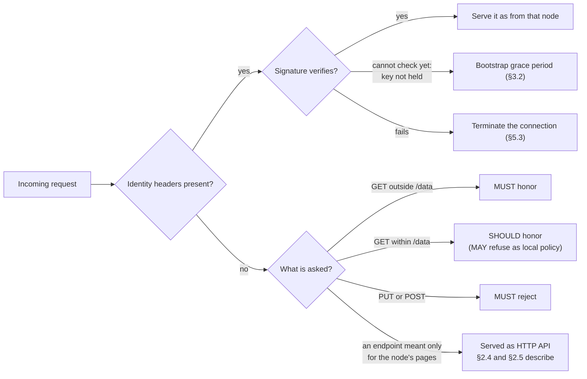
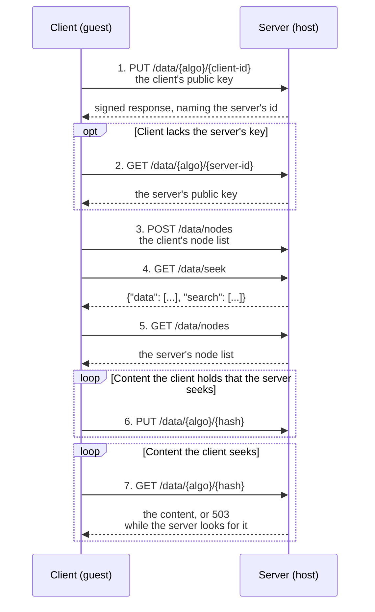
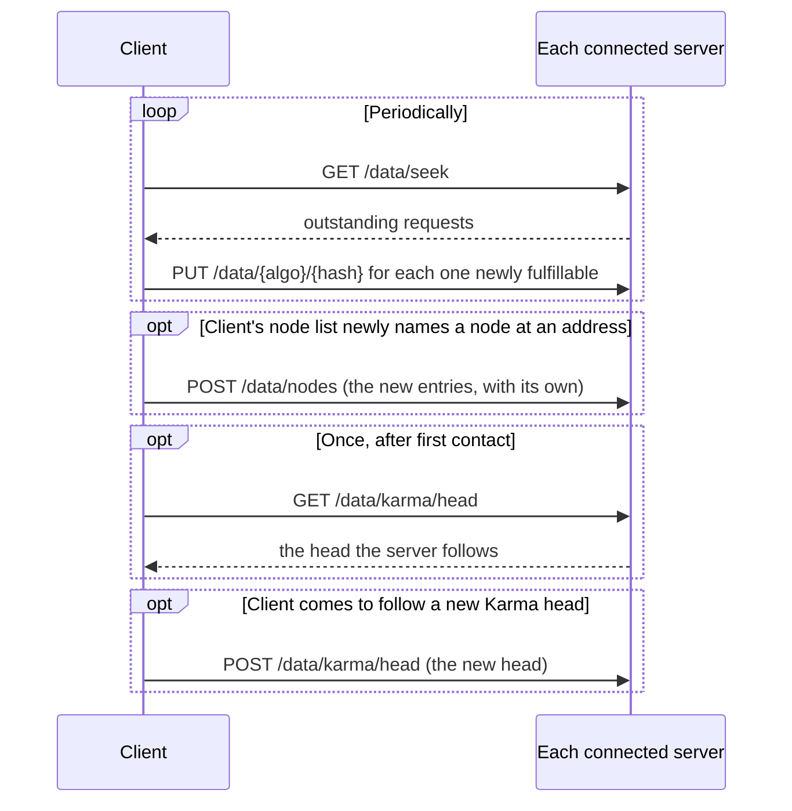

# Libranet Handshake Protocol

Version 0.2 • October 2026

---

## 1. Overview

Libranet has no persistent connection or session state (see §6). What is
described here as a "handshake" is not a distinct wire protocol or a
required negotiation — it is the conventional first-contact exchange
between two nodes, expressed as an ordered sequence of ordinary HTTP
requests. Following this ordering is etiquette, not a hard requirement:
any request is valid at any time (see §2), but a node that skips the
value-first ordering below may be treated less graciously by its peer
(see §5).

This document expands on the brief handshake sketch in
[High-Level Design §3.2](HighLevelDesign.md#32-connection--handshake-protocol)
and should be treated as the authoritative description going forward.

## 2. Relationship to the Identity Layer

Authentication is defined in
[High-Level Design §2.2](HighLevelDesign.md#22-cryptographic-authentication):
every programmatic request and response carries the sender's node
identifier and a signature over the relevant headers, proving possession
of the private key corresponding to that identifier.

The handshake relies entirely on the freshness mechanism RFC 9421 already
provides — the `created` parameter (and optionally `expires`) in
`Signature-Input`.

The residual risk of a bare timestamp-based freshness window — a
captured signature being replayed once more before it expires — is low
in practice: request signatures cover `@method`, `@path`, and
`Content-Digest` (HTTP API §11), and Libranet's core operations are
idempotent or content-addressed, so replaying a captured signature mostly
just repeats an already-authorized, harmless action (re-storing content
that hashes to the same address, re-fetching already-public content, and
so on).

**Freshness window:** the acceptable age of a signature (via `created`,
and optionally bounded further by `expires`) SHOULD default to a few
seconds. The exact value MUST be configurable per node rather than
hard-coded. Implementations MUST allow for reasonable clock skew between
peers — strict clock synchronization (e.g., NTP-disciplined clocks) is
not required, so nodes SHOULD apply a tolerance around the nominal window
rather than rejecting a signature for marginal skew. The reference node
accepts a signature whose `created` time is no more than 35 seconds before
its own clock, and no more than 30 seconds after it: a window of 5 seconds,
widened by 30 seconds' tolerance for skew. It honors an `expires` time with
the same tolerance.

Because the node identifier is the hash of the node's public key, and the
public key itself is CAS-addressed content (§4.1 of the High-Level
Design), a peer that does not yet hold the other side's public key can
always retrieve it via `GET /data/{algo}/{identifier}`. The handshake
below pushes the public key proactively so the very first response can
already be authenticated without a round trip.

### 2.1 Unauthenticated Requests

A node MAY omit identity headers entirely. Unauthenticated requests are
handled as follows:

- `GET` requests outside `/data` (web applications and other
  human-facing paths) MUST be honored normally.
- `GET` requests within `/data` (the programmatic API) SHOULD be honored
  normally. A node MAY refuse them as a stricter local policy, as HTTP
  API §7.3 allows.
- `PUT` requests (uploads) and `POST` requests (published node and seek
  lists) MUST always be rejected, whatever the node's local policy, since
  there is no identity to attribute the pushed content or
  outstanding-request entry to.

The endpoints meant only for the pages a node serves, and never for another
node (HTTP API §2.5), are none of these. A browser sends every request to them
unsigned, writes included, and each is served as HTTP API §2.4 and §2.5
describe: one that changes anything, only to a client on the node's own
machine. A node that refuses unsigned reads within `/data`, as the rule above
allows, refuses the reads among them as well, so its applications cannot use
them.

If identity headers are present but the signature fails to verify, the
connection MUST be terminated (§5.3), subject to the bootstrap grace
period in §3.2. This is distinct from omitting authentication
altogether, which is permitted for reads as described above.

## 3. First-Contact Exchange

When a node (the **client**) initiates contact with a peer (the
**server**) it has not recently talked to, the following ordered exchange
is the convention:

1. **`PUT` local public key** — the client pushes its own public key to
   the server under `/data/{algo}/{client-identifier}`. This lets the
   server authenticate the client's identity on this and all subsequent
   requests in the exchange, without a separate lookup.
2. **`GET` remote public key** *(optional)* — if the client does not
   already hold the server's public key, it fetches
   `/data/{algo}/{server-identifier}` to authenticate the server's
   signed response headers. The server identifier is available from the
   response headers of step 1. If the client already has the server's
   key cached, this step is skipped.
3. **`POST` node list** — the client publishes its known node addresses
   to `/data/nodes`, using the `{"nodes": {"<address>": "<node-id>"}}`
   schema defined in HTTP API §10.6.
4. **`GET` outstanding requests** — the client fetches the server's list
   of currently-sought hashes from `/data/seek` (§4.8 of the High-Level
   Design), using the `{"data": [...], "search": [...]}` schema defined
   in HTTP API §10.7.1.
5. **`GET` node list** — the client fetches the server's known node
   addresses from `/data/nodes`.
6. **`PUT` fulfillable items** — for any hashes from step 4 that the
   client already holds, and for any content it holds that matches a
   hash prefix from step 4 closely (HTTP API §10.7.2), the client pushes
   the corresponding content to the server via `PUT /data/{algo}/{hash}`.
7. **`GET` requested items** — the client requests the content it is
   itself seeking, checking whether the server can fulfill any of it.

### 3.1 Rationale for the Ordering

The ordering follows a single principle: **add value before requesting
value.**

- Keys are exchanged first because nothing else can be authenticated
  until identity is established.
- The client publishes its node list next, and both node lists are
  exchanged before any content, so that if the connection drops
  immediately afterward, both sides still gained something durable —
  additional peers to try — preserving overall network reachability.
- The client fetches the server's outstanding requests before the
  server's node list, and offers content it can supply *before* asking
  the server for any content, again leading with value rather than a
  request.

### 3.2 Bootstrap Authentication Grace Period

HTTP API §11.1 specifies that a server node **MUST NOT** break the
connection due to authentication failure until after at least the first
two requests. This is necessary because identity verification is not yet
possible until both keys have been exchanged: the server cannot validate
the client's signature until step 1 completes, and the client cannot
validate the server's response signature until step 2 completes. How many
requests the reference node allows is given in HTTP API §11.1.

This grace period applies only to the *inability to verify yet* during
steps 1–2. It does not relax the rule in §2.1: a signature that is
present and actively fails verification (as opposed to one that cannot
yet be checked) is still grounds for termination once verification is
possible.

### 3.3 Steady-State Interaction

Once the first-contact exchange completes, the relationship between the
two nodes is no longer a distinct "handshake" — it is ordinary traffic:

- The client routes new requests to whichever peers are the best match
  by priority (§4.7 of the High-Level Design).
- The client periodically re-fetches the server's outstanding-request
  list and pushes any newly-available fulfillable content, continuing
  the same add-value-first convention on an ongoing basis.
- Whenever the client's own node list comes to name a node at an address
  it did not name before, as once the client has reached that node there
  (HTTP API §10.6), the client publishes those entries to every server it
  is connected to (`POST /data/nodes`, HTTP API §10.5), with its own
  (HTTP API §10.1), so that the servers learn of nodes the client reaches
  after their first contact. A server is not sent its own entry. A server
  the client connects to later learns of them in step 3 of its own
  first-contact exchange.
- Once the first-contact exchange is over, the client asks the server which
  Karma head it follows (`GET /data/karma/head`, HTTP API §10.9), once while
  the connection lasts. A server that serves no Karma yet answers `404`,
  which is no error.
- Whenever the client comes to follow a new Karma head, it publishes it to
  every server it is connected to (`POST /data/karma/head`), as it publishes
  new entries of its node list, so that a heavier chain is found soon
  ([Karma Ledger §3.5](KarmaLedger.md#35-heads)). A server the client
  connects to later is not told of the head followed then; it learns of it
  by asking, over a connection of its own to the client.

## 4. Roles: Guests and Hosts

Because every node acts as both a client and a server depending on the
direction of a given connection, this document uses a **guest/host**
framing to describe expected behavior:

- **Clients are guests.** A guest should be polite: add value (node
  lists, fulfilled requests) before drawing on the host's resources.
- **Servers are hosts.** A host should be gracious, but is not obligated
  to be infinitely generous — hosts may set and enforce boundaries on
  guests who take without giving.

Neither role is fixed per node; the same two nodes may simultaneously
hold a client relationship in one direction and a server relationship in
the other.

## 5. Karma and Connection Management

[Karma](Karma.md) informs how both roles behave, but does not gate the
protocol itself — a connection is never refused solely for low Karma.

A node's Karma, here, is its balance as the chain this node follows states
it ([Karma Ledger §5.3](KarmaLedger.md#53-balances-and-reach),
[HTTP API §10.10](HttpApi.md#1010-reading-karma)). Neither side reads the
other's claim of its own Karma, so there is none to check, and each compares
the nodes at hand by the balances its own chain states.

### 5.1 Client Behavior

A client MAY use a candidate server's relative Karma to decide which
peers to prefer when initiating contact, favoring higher-Karma servers
when a choice is available.

The reference node orders the nodes it may dial with those it has reached
before first. Within each part, it climbs from its own Karma: those holding
as much as it does or more come first, those holding least of them first,
then those holding less, the nearest first. It fills its peer mix from the
front of that order (High-Level Design §4.6). A server keeps a client holding
as much as the median of its clients (§5.2), so a client fares best among
the servers near its own Karma, and since every node climbs from its own,
the nodes do not all dial the same few of most Karma. It dials no fewer for
Karma, and none is left out for holding none.

A server that closes the connection once it has answered, as one does a
client it does not keep (§5.2), is not dialed again by the reference node
for `peers.turned_away_rest_seconds`, an hour unless its configuration says
otherwise, rather than the `peers.retry_delay_seconds` after another close.
Meanwhile it dials the next node in that order, so it works through the
servers until it finds one that keeps it.

### 5.2 Server Behavior

A server uses a connected client's relative Karma to decide how
generously to treat that client:

- A server SHOULD keep a new client connected for at least the first
  dozen or so requests, regardless of Karma, to allow node-list exchange
  to complete (§3, steps 3 and 5) and to give the client a chance to prove
  itself by fulfilling outstanding requests.
- If a client has relatively lower Karma and is not providing value
  proportionate to what it requests — for example, fetching outstanding
  requests without ever fulfilling any — the server MAY terminate the
  connection.
- If a client has relatively higher Karma, the server MAY keep the
  connection open longer even without immediate reciprocation, since the
  client has already demonstrated it can provide value and may simply
  need time to retrieve fulfillable content from its own connections.

This allows a low-Karma node to still reach high-Karma servers, obtain
node lists, and attempt to earn Karma by fulfilling outstanding requests,
rather than being locked out for having no track record yet.

The reference node keeps a client connected for its first
`network.client_grace_requests` requests, 12 unless its configuration says
otherwise, counted on all the client's connections from the first request
the client's key verifies. Past them, it closes a client whose Karma is below
the median of the clients connected to it, and that has pushed nothing it
seeks for `network.client_value_seconds`, ten minutes unless its
configuration says otherwise. What it seeks is what its seek list names, or
what a search the list names would find (HTTP API §10.7.2), and a push counts
once it is accepted, before the content is checked. The request being served
is answered first, with `Connection: close`, and each other connection of
the client's is closed as it is next answered. A client of the median's
Karma or more is kept however little it pushes, so none is closed while
every client holds as much as the others, as while the node follows no
chain. A client that connects again once its last connection has closed
starts afresh.

HTTP API §7.5 independently lists a low ratio of desired data (what the
host's `/data/seek` asks for) to undesired data as an example of abusive
behavior justifying an abrupt connection break. The Karma-relative
treatment above is this document's more detailed elaboration of that
same rule.

### 5.3 Termination

Either side MAY close the connection at any time:

- A server MAY close the connection for a guest that is abusive or is
  not adding enough value relative to its Karma (§5.2).
- A client MAY close the connection if it judges that the server is not
  delivering enough value in return for what the client has offered.
- A connection MUST be terminated if a required signature fails to
  verify (§2).

Termination has no protocol-level consequence beyond ending the current
sequence of requests — see §6.

## 6. Statelessness

Libranet has no session token, session identifier, or other persistent
handshake state. Every request is authenticated independently via its
own signed headers (§2). The first-contact exchange in §3 is a
convention for the *order* of early requests, not a stateful protocol
phase — a node could, in principle, jump straight to step 7 and it would
still be a valid (if impolite) sequence of ordinary HTTP requests.

The session a person signs in to (HTTP API §11.4) is between a browser and
its own node, and is no part of this protocol. No node sends another a
session's cookie, or learns of a session from another.

## 7. Versioning

The handshake has no version number of its own. It is a purely
conversational convention layered on ordinary HTTP requests, governed by
etiquette (§4, §5) rather than a negotiated protocol version.

---

## Open Cross-References

The following details are defined in other documents and are referenced
here rather than restated:

- Signed-header mechanics (RFC 9421 Signature-Input/Signature headers,
  `keyid` format) — see HTTP API §11.
- Node address list wire format — see HTTP API §10.6 and §4.9 of the
  High-Level Design.
- `/data/seek` request/response shape — see HTTP API §10.7.1.

## Reconciliation Notes

Raised while cross-referencing the HTTP API spec, and how each was
settled:

1. **Scope of the no-headers restriction** — resolved in §2.1:
   unauthenticated `GET` requests outside `/data` are always honored,
   HTTP API §7.3's restriction applies only within `/data`, and
   unauthenticated uploads and published lists are always rejected.
   Protocol Specification §5.2 now requires returning stored content only
   to nodes that have proven their identity, and defers to §2.1 for
   everything else.
2. **§3.2 of the High-Level Design** is now superseded by §3 of this
   document (see §1). Deliberately left as-is for now rather than
   trimmed to a pointer.
