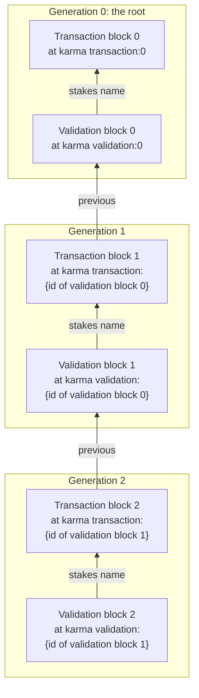
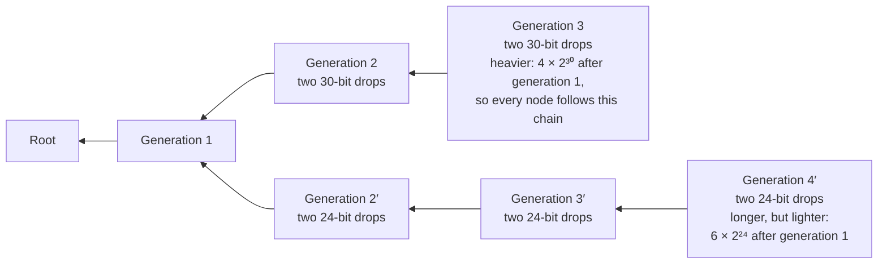
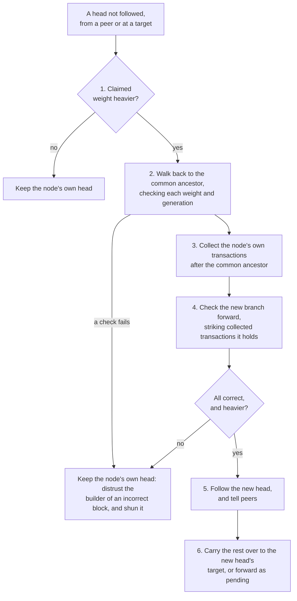
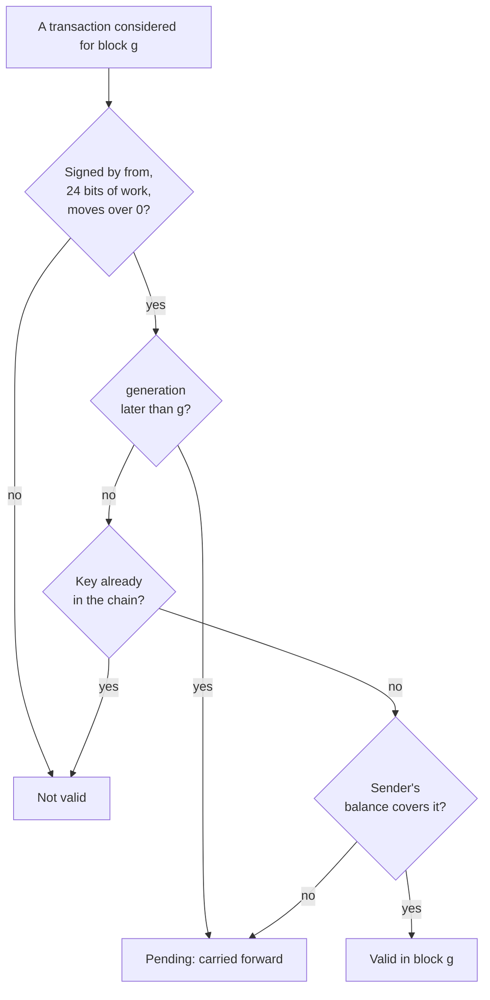
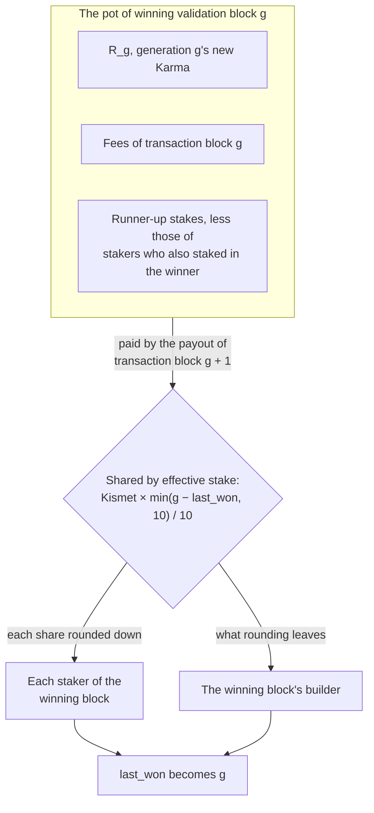

# Libranet Karma Ledger Specification

- Status: Draft
- Version: 0.1.0
- Editors: Marc (author), Claude (drafting assistance)

## 1. Overview

[Karma](Karma.md) says what Karma is for, how much of it is issued, and how
validators are rewarded. This document says how it is kept: how
transactions, transaction blocks, and validation blocks are written, where
each is placed in the content-addressed store, how a node finds the newest,
and how it checks what it finds. Every node must do these alike, so that a
block one node builds is one every other checks the same way.

The ledger is a chain of **generations**. Each generation has a
**transaction block**, which records transfers of Kismet and the balances
they leave, and a **validation block**, a collection of signed stakes that
validates it. The winning validation block of one generation names where the
next is placed (§3.1), so the chain grows a generation at a time, and the
chain holding the most work is the one every node follows (§3.3).

This version specifies the root (§7), transactions (§4), transaction blocks
(§5), and validation blocks (§6). What it leaves for later is listed in §9.

## 2. Relationship to Other Documents

- **[Karma](Karma.md)** is the economic design, and this document adds
  nothing to its economics. Karma numbers its generations from 1 (Karma §6).
  This document numbers them from 0, so its generation g is Karma's
  generation g + 1, and the new Karma of generation g is

  ```text
  R_g = 2,000,000,000,000,000 − 200·g Kismet
  ```

  20 Karma for generation 0, falling to 200 Kismet in generation
  9,999,999,999,999, the last that issues any. In all, the generations
  issue 100,000,000,000,010 Karma, the "approximately 100 trillion" of
  Karma §8.
- **Every block, transaction, and stake is a signed bundle**
  ([Bundle Specification §5](BundleSpecification.md#5-signed-bundle)) whose
  `contents` is JSON this document defines. A block is signed by its
  builder, a transaction by its sender, and a stake by its staker. Each may
  be any identity a signed bundle accepts, a person's or a node's
  ([HTTP API §11.2](HttpApi.md#112-keys-and-signature-parameters),
  [§11.3](HttpApi.md#113-a-persons-identity)). No object in a block's JSON,
  or in the `contents` of a transaction, a payout, or a stake, names a
  member twice. JSON readers differ on which of the two they keep, so a
  reader refuses JSON that does, and every node reads it alike.
- **Every block is a drop**
  ([HTTP API §9](HttpApi.md#9-drops)): its signed bundle's JSON, a null
  byte, and a nonce, placed at a target string. The nonce lies outside the
  signature, so a builder signs once and then searches for a nonce. The
  number of leading bits a block's id shares with its target hash is its
  proof of work, the binary match of Karma §18. Each block is placed
  sharing at least as many bits as a node's search returns, 24 by default
  ([HTTP API §6](HttpApi.md#6-content-search)), so that a search finds it.
- **A builder found to state something false is distrusted** in the
  verifying node's own trust list
  ([Trust Network Specification §4.5](TrustNetwork.md#45-a-nodes-own-scores)),
  as §3.8 says.
- **The targets** are cataloged in [Known Drops](KnownDrops.md) §3.10 and
  §3.11.
- **Shunning** is a node's own shun list
  ([HTTP API §5.5](HttpApi.md#55-shunned-content)). It is used here to let
  go of blocks that a larger block or a heavier chain supersedes.
- **Eviction** treats Karma's blocks as any other content
  ([High-Level Design §4.5](HighLevelDesign.md#45-storage-priority-and-eviction)).
  A node that needs a block it no longer holds fetches it again.

## 3. Generations

### 3.1 Targets

Generation 0, the root (§7), is placed at two target strings:

- `karma transaction:0` for its transaction block;
- `karma validation:0` for its validation block.

Each generation after is placed at targets named for the winning
validation block of the generation before:

- `karma transaction:{id}` for transaction block g + 1;
- `karma validation:{id}` for validation block g + 1;

where `{id}` is the id of the winning validation block g, whole, such as
`karma transaction:sha256/0a1b…`. Each target string is hashed as any drop's
is ([HTTP API §9.3](HttpApi.md#93-drop-target)). A generation's targets
cannot be known before the generation before it has a validation block, so
no block of it can be built in advance (Karma §20).



### 3.2 Choosing the Winner

Many validation blocks may be placed for one generation (§6). A builder
builds generation g + 1 on the best validation block g it has seen (§6.5),
at that block's targets. Builders who choose differently fork the chain,
and each fork grows at targets of its own. The fork that wins is the
heaviest (§3.3). The winning validation block of each generation is the one
the heaviest chain goes through.

### 3.3 The Heaviest Chain

A chain is a root and the generations built on it, each a transaction
block and the validation block that validates it. Its **weight** is the sum
of 2^b over both drops of every generation, where b is the number of
leading bits the drop's id shares with its target hash. A drop matching b
bits takes about 2^b hashes to find, so the weight is the work it took to
build the chain. Summing bits instead would let two 15-bit drops weigh as
much as one 30-bit drop, which took 32,768 times the work of either.

The **heaviest chain** is the one of greatest weight, and of two as heavy,
the one whose latest winning validation block's id sorts first. Every node
follows the heaviest chain it knows.



Each transaction block states the weight of the chain before it (§5.1), and
a reader checks it against the block before. So a reader sees how heavy a
chain claims to be from a single block, before it fetches the rest.

A chain is never final. A block becomes harder to replace as weight is
built after it, and a rival holding more work from any point back replaces
everything after that point. Rival roots are settled the same way (§7.5).

### 3.4 False Starts

A transaction put up at the targets of a validation block g that does not
win is a **false start**: it was placed where the next generation looked
likely to begin. Any node may take transactions from the transaction
targets of every rival validation block g into blocks at the winning
target. A transaction is signed apart from any block or target (§4.1), so
it is carried over unchanged, and its sender does not put it up again.

### 3.5 Heads

A node's **head** is the validation block whose id names the target that
new transactions are put up at (§3.1): the winning validation block of the
latest generation it has chosen one for. A head's weight is the `weight` of
the transaction block it validates, plus 2^b for that block's drop and for
the head's own.

#### 3.5.1 Genealogy

A node keeps the **genealogy** of its head: the id of the winning
validation block of every generation, from its head back to the root's. It
keeps it across restarts. That is one id per generation, and it is all a
node needs to find where another chain leaves its own, even once it has let
go of the blocks themselves (§5.3).

#### 3.5.2 Telling and Asking

A node tells its peers its head each time it chooses a validation block for
the latest generation, and asks a peer for its head
([HTTP API §10.9](HttpApi.md#109-karma-heads)). A head it is told of is only
a pointer, until the node has checked the chain it names.

#### 3.5.3 Changing Heads

When a node learns of a head it does not follow, from a peer or at a
target, it goes through these steps in order:

1. **Read the claim.** It reads that head and the transaction block it
   validates, whose `weight` says how heavy the chain behind it claims to
   be. If that is not heavier than its own head, the node stops evaluating
   the new head.
2. **Walk back.** It walks the new head's generations back, from each
   validation block to the transaction block its stakes name, and from that
   block's `previous` to the validation block before. It stops at the first
   validation block in its genealogy, the **common ancestor**. At each step
   it checks that the transaction block's `weight` is the one before's plus
   2^b for the two drops between, so that a false weight is caught where it
   first fails. It also validates the generation.
3. **Collect the old branch.** It collects every transaction, payouts left
   out, in its own chain's transaction blocks after the common ancestor,
   through its own head.
4. **Check the new branch.** It checks the new chain's blocks, from the
   common ancestor forward to the new head (§5.5, §6.5), fetching any block
   it no longer holds. Each collected transaction whose key (§4.2) it meets
   in the new chain is already accounted for, and it strikes that
   transaction from what it collected.
5. **Follow.** If every block validates as correct, and the new head is heavier, the node
   follows it. Its genealogy after the common ancestor becomes the new
   chain's, and it tells its peers its new head (§3.5.2). A block that does
   not validate as correct distrusts its builder (§3.8), and the node keeps its own head.
   Any invalid blocks are also shunned.
6. **Carry the rest over.** It puts each collected transaction into the
   transaction block it builds at the new head's target. One whose sender's
   balance the new chain does not cover, as when the new chain has spent
   it, or whose `generation` the new chain has not reached, it carries
   forward as a pending transaction (§4.4).



### 3.6 Weak Chains

A node never shuns a transaction block or a validation block for being on
a lighter chain. A chain may be lighter only as far as the node can see. A
node cut off from most of the network, which has gone on far beyond, would
otherwise shun the chain it has to come back to. Once it is connected
again, the heads its peers tell it of (§3.5) bring it back.

Blocks on a lighter chain go as any content does, by eviction. A node that
leaves a chain for a heavier one carries over its transactions that the
heavier one lacks (§3.5.3).

### 3.7 Shunning What Is Superseded

A block that is not signed, whose signature fails, or fails validation of
weight or generation, is no block of the
ledger, and a node SHOULD shun it (§3.8). Otherwise, a node MUST NOT shun
a validation block, since any one may lead to another chain. It MUST NOT
shun a transaction block that a validation block names. Validation blocks
are made only on full transaction blocks, so a node SHOULD NOT shun a
transaction block near 1 MiB either: one full, or near enough to full that
a validation block the node has not seen yet may name it (§5.4) unless
it fails basic validation.

A node MAY shun any other transaction block, such as one put up small or
one still being combined, whose data is all held in another transaction
block of the same generation. This means searches carry less of the same
data. It shuns one only if the other block holds more data, or holds the
same data and shares more bits with its target hash. A transaction block's
data is its transactions. The data is not lost: it is kept in the other
block, and a node shuns a block only while it holds the block that keeps
it.

### 3.8 Distrusted Builders

A block that is not signed, or whose signature fails, can be attributed to
no one: anyone can write another's id into `signer`. A node SHOULD shun
it, and distrusts no one for it.

A node that checks a signed block and finds that it states something false
**distrusts its builder**: it marks the builder's id distrusted in its own
trust list ([Trust Network Specification §3](TrustNetwork.md#3-trust-lists),
§4.5). Something false is a statement the block makes that the block
itself, and the chain its `previous` names, prove wrong:

- **In the block alone:** it is not well-formed (§5.1, §6.1), with a field
  missing, a field of the wrong type, a member named twice in one object
  (§2), or an amount that is not a decimal string; its transactions,
  stakes, or witnesses are out of order or repeated, or two of its
  transactions share a key (§4.2); its `balances` has more entries than
  §5.3 allows; it holds a transaction or a stake whose signature fails, a
  transaction whose `from` is not its signer, whose proof of work is under
  the minimum, or that moves 0 Kismet outside the root, or a stake whose
  `staker` is not its signer; or its payout is signed, missing, or more
  than one.
- **Against its target:** its `generation` is not one more than that of the
  validation block its target is named for; a validation block has no stake,
  its stakes name more than one transaction block, or one built on that
  validation block that is not at the transaction target, or its `runner_up`
  names itself, a block at another target, or one validating the same
  transaction block; or a transaction block at the root's target does not
  have the root's shape (§7.2).
- **Against the chain:** its `weight`, payout, or `reach` is wrong, or a
  stated balance's `kismet` or `last_won` is wrong (§5.3), or a sender or
  recipient is left unstated; a transaction overspends its sender, or its
  key is already in the chain within the history the node holds; a
  validation block lists a witness that an earlier winning validation block
  of its chain lists, within the history the node holds (§6.4); a staker's
  stakes, or the runner-up's stakes the block would take from them, exceed
  what covers them (§6.3); or a validation block names a transaction block
  that is itself incorrect.

A block is held to what it states against a target only where its own
contents place it: a transaction block at the targets named for the
validation block its `previous` names, and a validation block at those named
for the one the transaction block its stakes name is built on.

A node also distrusts the staker of a stake that, alone, exceeds what
covers it at the transaction block it names (§6.3), since that never
changes. It never distrusts a transaction's sender for an overspend,
since a sender's balance can change after they sign, as when another of
their transactions is taken first.

A small block, such as one transaction put up on its own (§5.6), is held to
everything it states, its `weight`, its payout, and its balances among them.
It may be short of full, and may break the half-free rule, without either
counting against its builder.

None of these makes a builder distrusted, since an honest builder can meet
each one:

- a block judged full or not full, or near 1 MiB or not (§5.4), or a
  validation block naming a transaction block judged not full, since
  copies of a block compressed otherwise measure otherwise;
- the half-free rule broken in a block that is not full and that no
  validation block names (§5.6);
- a block built on, or chosen, that is not the best the node has seen, or
  that is not on the node's own chain (§3.2, §3.6), since the builder may
  have seen less, or another part of the network;
- which runner-up is chosen, of those §6.5 allows (§6.1), and the
  witnesses listed (§6.4);
- a duplicate, or a witness listed again, older than the history the node
  holds (§4.4, §6.4);
- a transaction included before the generation it names, which makes the
  block incorrect (§5.5) but is no false statement, since a transaction
  may name a generation ahead of the chain (§4.4);
- a balance of 0 stated for an identity that holds 0 and that the block's
  transactions do not name, which makes the block incorrect (§5.3, §5.5)
  but states nothing untrue;
- a validation block at `karma validation:0` that is not the root's, which
  a reader passes over (§7.3), since anyone may place a root (§7.5);
- a block read at a target its own contents do not place it at: one of the
  other kind, a transaction block whose `previous` names another validation
  block than the one the target is named for, or a validation block whose
  stakes name a transaction block built on another. A drop's nonce lies
  outside the signature (§2), so anyone may place a copy of a signed block
  at any target, and a drop may share a target's bits by chance. A reader
  passes it over, and judges it only at its own target;
- a block on a chain the node has not fetched and checked, which it judges
  only once it has.

A block whose builder is distrusted may still be on the chain, since other
nodes may not distrust its builder, and a node follows the heaviest chain
whatever it distrusts (§3.6). Distrust keeps a node from building blocks
with what it distrusts, not from using them. A node builds no validation
block on a transaction block a distrusted identity signed, and puts no
stake of a distrusted identity in a validation block it builds. But it
builds the next transaction block on the heaviest chain's winning
validation block, whoever signed it.

## 4. Transactions

### 4.1 Contents

A transaction is a signed bundle whose `contents` is the JSON object

```json
{"from": "sha256/0a1b…",
 "to": {"sha256/9f8e…": "250", "sha256/7c6d…": "75"},
 "fee_kismet": "0",
 "generation": 41,
 "created": "2026-10-21T14:03:22Z",
 "nonce": "…"}
```

- **`from`** is the sender's id. A transaction whose `from` is not its
  `signer` is invalid.
- **`to`** maps each recipient's id to the Kismet sent them. One
  transaction pays any number of recipients, so a node pays many small
  rewards in one transaction, not one each.
- **`fee_kismet`** is the fee, paid to the validators (§6.6). A transaction
  whose fee is `"0"` is **free**, and any other is **paid**. The fee leaves
  the sender's balance in the next block's payout (§5.2), not in the block
  that includes the transaction.
- **`generation`** is the generation the transaction was created in.
- **`created`** is when the sender decided to pay: an RFC 3339 moment in
  UTC, to the second
  ([RFC References §2.2](RfcReferences.md#22-rfc-3339-timestamps)). Like
  `generation`, it is the sender's word, and is checked against no clock.
  With `from`, it is the transaction's key (§4.2).
- **`nonce`** is any string, searched for to give the transaction its proof
  of work (§4.3). It is not part of the transaction's key (§4.2).

An amount is a string of decimal digits, with no sign, and with no leading
zero unless it is `"0"`. Ten octillion Kismet, the most there can be, does
not fit a 64-bit integer, and a JavaScript number holds no whole number
above 2^53 exactly.

A reader ignores any other member of the object, so that a later version of
this document can add one, and refuses an object naming a member twice
(§2).

### 4.2 A Transaction's Identity

A transaction is known by its `hash`, the hash of its `contents` (Bundle
Specification §5), not by the id of its bundle. Signing the same contents
again with a person's RSA key gives another signature and another bundle,
since RSASSA-PSS is randomized, but the same `hash`, and so the same
transaction.

A transaction's **key** is its `from` and its `created`. Two transactions
with the same key are one payment, whatever else they hold, and the chain
includes only one of them (§4.4). Mining a transaction again gives it
another `nonce` and another `hash` (§4.3), but the same key. A sender's
software stamps `created` once, when the sender decides to pay, and reuses
it whenever it puts the payment up again, signs it again, or mines it
again, so that a retry is never taken as a second payment. A sender who
means to pay the same recipients the same amounts twice signs two
transactions with different `created`. Two transactions a sender signs in
the same second share a key, and only one is included; one transaction
already pays any number of recipients (§4.1).

### 4.3 Proof of Work

A transaction's proof of work is the number of leading bits its `hash`
shares with the SHA-256 of the fixed target string `transaction`. A
transaction is not a drop: its `nonce` is in its `contents`, so the sender
searches for it before signing, and what it changes is the transaction's
own `hash`, not the id of the block that carries it. The string is the
same for every transaction, and is no block's target (§3.1), so that a
transaction's proof of work holds in whichever generation's block it is
carried to (§3.4). A transaction sharing fewer than 24 bits with it is
invalid. Finding a nonce for 24 bits takes about 2^24, some 17 million,
tries.

The work is the cost of every transaction, free or paid. A free transaction
costs no Kismet, but spam costs compute, and a sender who wants a free
transaction taken sooner mines more bits (§5.4).

### 4.4 When a Transaction Is Valid

A transaction may be included in the transaction block of its own
generation or of any later one, and never expires. It is valid in
transaction block g when:

- it is signed (Bundle Specification §5), and its `from` is its signer;
- its `generation` is no later than g;
- it moves more than 0 Kismet in all, its `to` and its fee together, unless
  it is the root's (§7.1);
- its `hash` shares at least 24 leading bits with the SHA-256 of
  `transaction` (§4.3);
- its sender's balance, as block g's transactions are checked against
  (§5.3), covers all it sends and its fee, together with all the sender's
  other transactions in block g send and their fees; and
- its key (§4.2) is that of no transaction in a transaction block of the
  chain from its `generation` through g − 1, nor of any other transaction
  in block g.

A transaction's balance is checked in the block that includes it, not in
the one it was created in. The check for duplicates reaches back to the
transaction's `generation`, however far that is (§9).



A transaction that fails only because its sender's balance does not cover
it, or because its `generation` is later than g, is **pending**, is not
dropped, and is no error. A `generation` ahead of the chain is to be
expected: a transaction made on another chain that had gone further is
carried over to a shorter one (§3.5.3). Builders carry a pending
transaction forward, trying it in each later block, since the sender may
yet receive enough, and the chain will reach its generation. It is not
included before then, since the check for duplicates starts at its
`generation`, and one included earlier could be included again. Builders
stop carrying it a number of generations after the generation it was
witnessed in (§4.5), which each node sets in its configuration, 3 by
default. It stays valid, never expiring: anyone holding it may put it up
again, and it is included if it is valid then.
A node that carries a pending transaction lists its hash among the
witnesses of the validation blocks it builds until its chain has witnessed
it (§6.4), so that its count starts.

A transaction's validity is its own. A transaction that is valid stays
valid whatever block it arrives in, so a builder may take it from a block
that is not (§5.6).

### 4.5 Age

The `generation` a transaction claims is its sender's word, and cannot be
checked: every old block's id is public, so a transaction can name any
generation. The claim sets the earliest block that may include the
transaction, and where the check for duplicates starts (§4.4), and nothing
else.

A transaction's age is what the chain witnessed of it. A transaction is
**witnessed** in the generation of the winning validation block on the
chain that lists its `hash`, of which there is at most one (§6.4), or else
in the generation of the transaction block that includes it, the youngest
it can be, if that is earlier. A hash listed before its transaction was put
up is still proof that the transaction existed then, since the hash commits
to its contents.

### 4.6 A Node's Payments

A node pays other nodes for what they do for it (Karma §11). For most
common payments, it pays 0.01% of its balance, rounded down to whole
Kismet, so that what it gives keeps in step with what it holds. A node
holding under 10,000 Kismet pays nothing, since its payment rounds to 0.

A node does not put each payment up as it makes it. It queues them, and
puts them up together as one transaction, whose `to` pays every recipient
(§4.1), once 100 are queued or an hour has passed since its last
transaction, whichever is first. Both are in its configuration. So a
node's many small payments cost the work of one transaction (§4.3), and do
not flood the network.

At times in its configuration, hourly by default, a node rates the servers
it is connected to as a client
([Handshake Protocol §3](HandshakeProtocol.md#3-first-contact-exchange)),
over the time since it last rated them: by the data it received from each,
and by the number of its requests each fulfilled. It pays the server rated
highest by each, 0.01% of its balance, queued as any payment is.

## 5. Transaction Blocks

### 5.1 Contents

Transaction block g is a signed bundle, signed by its builder, made a drop
at the transaction target of generation g (§3.1). Its `contents` is the
JSON object

```json
{"generation": 42,
 "previous": "sha256/…",
 "weight": "1288490188800",
 "reach": 3,
 "transactions": [],
 "balances": {"sha256/0a1b…": {"kismet": "1250000", "last_won": 40}}}
```

- **`generation`** is g. A block placed at another generation's target is
  not that generation's.
- **`previous`** is the id of the winning validation block g − 1, the one
  the block's target is named for, so that a block read on its own says
  what it builds on. It is `null` only in the root.
- **`weight`** is the weight (§3.3) of the chain before this block: 2^b
  over both drops of each of generations 0 through g − 1. It leaves out the
  block's own drop, whose bits are mined only once its content is fixed. It
  is a string of decimal digits, as an amount is (§4.1), since one drop
  alone may add 2^256, and it is `"0"` in the root. A block's `weight` is
  that of transaction block g − 1, plus 2^b for that block's drop and for
  validation block g − 1's.
- **`reach`** is how many blocks back a reader goes to find every identity
  holding Kismet (§5.3).
- **`transactions`** are the block's transactions, as objects, sorted by
  `hash`, the payout (§5.2) among them. No two of them share a key (§4.2).
  At least half of the transactions other than the payout are free (Karma
  §13).
- **`balances`** maps ids to balances (§5.3), each the balance after every
  transaction in the block, the payout among them, has been applied.

Anyone may build a block, from transactions others signed, and may combine
others' blocks (§5.6). Whoever builds a block signs it, and answers for
everything it states (§3.8).

### 5.2 The Payout

Every transaction block after the root holds one **payout**, the
transaction that moves the reward of generation g − 1 (§6.6). No sender
signs it, so it is written as a signed transaction is, with `algorithm`,
`hash`, and `contents`, but no `signer` and no `signature`. Its `contents`
is the JSON object

```json
{"from": {"null": "1999999999991800",
          "sha256/5e4f…": "100000000000250",
          "sha256/7c6d…": "75"},
 "to": {"sha256/0a1b…": "1399999999994750",
        "sha256/9f8e…": "699999999997375"},
 "generation": 42}
```

- **`from`** maps each identity the pot of generation g − 1 (§6.6) comes
  from to all it gives: the fees of its transactions in transaction block
  g − 1, and, if it is a runner-up staker whose stakes are taken, the
  Kismet taken, summed. Generation g − 1's new Karma (§2), which comes
  from no one, is under the key `"null"`. One that gives nothing is left
  out (§6.6).
- **`to`** maps each staker of the winning validation block g − 1 to their
  share of the pot, in proportion to their effective stake and rounded
  down, and that block's builder to what rounding leaves over, as §6.6
  says, summed by identity. One paid 0 is left out.
- **`generation`** is g.

The amounts in `to` total those in `from`. Each identity's amount in
`from` leaves its balance in block g (§5.3), so a reader checks a balance
against the payout without looking up any transaction of block g − 1.

A reader works out the payout from validation block g − 1 and the
transaction block it validates, and passes over a block whose payout
differs from it. The payout is applied before any other transaction in the
block, so Karma received in it may be spent in the same block. It counts
as neither free nor paid in the half-free rule (§5.1), and is left out of
the age a block is scored by (§5.5).

### 5.3 Balances and Reach

A **balance** is the JSON object `{"kismet": amount, "last_won":
generation}`: the Kismet an identity holds, and the generation of the last
validation block whose reward paid it (§6.6), or `null` if none has.

A block's `balances` states, as of the end of the block, the balance of
every sender and every recipient of its transactions, the payout's among
them. It MAY state other balances too, to shorten its reach, but no more of
them than it must state: its `balances` has at most twice as many entries
as there are identities its transactions name as sender or recipient, the
payout's among them. This keeps a block from being filled to full (§5.4)
with balances anyone can work out, in place of transactions. A balance of
0 is stated only for a sender or a recipient, and an identity stated
nowhere holds nothing.

An identity's balance as block g leaves it is the one stated in the latest
of blocks g − n through g that states it, n being the greater of block g's
`reach` (below) and 10, since every block states each balance it changes.
The reach takes in every identity holding Kismet, and ten blocks every
`last_won` that still lowers a stake's weight (§6.6). One stated in none of
them holds `{"kismet": "0", "last_won": null}`, even if an earlier block
states it holding 0 with a `last_won`: that `last_won` is more than ten
generations old, and weighs a stake as `null` does, so no reader looks
further back. The balances block g's transactions are checked against are
those transaction block g − 1 leaves, with block g's payout applied.

A reader checks every balance a block states, both its `kismet` and its
`last_won`, whether the block must state it or states it only to shorten
its reach. A block that states one wrongly is incorrect. Each is the
identity's balance before the block, the latest stated before it or else
`{"kismet": "0", "last_won": null}`, with the block's transactions applied:

- its `kismet` is that Kismet, plus all the block's transactions pay the
  identity, the payout's among them, less all the payout's `from` takes
  from it (§5.2), and less all it sends as a sender, its fees aside, which
  the next block's payout takes; and
- its `last_won` is g − 1 if the payout pays the identity any of the reward
  of validation block g − 1 (§6.6), as a staker or as its builder, and
  otherwise is the `last_won` it had before the block.

A `last_won` weighs an identity's stakes (§6.6), so one stated wrongly
shifts the pot as surely as a wrong `kismet` shifts Kismet.

A block's **`reach`** is the least r such that every identity holding more
than 0 Kismet is stated in one of blocks g − r through g. A block that
states every holder has reach 0. A reader checks `reach`, and a block whose
`reach` is wrong is incorrect. A node needs whole transaction blocks back
only as far as the reach of the heaviest chain's latest, or ten blocks if
that is further, to know any balance.

### 5.4 Full

A block is **full** when its drop, compressed as zlib
([RFC 1950](https://www.rfc-editor.org/rfc/rfc1950.html)), is no larger
than 1 MiB (1,048,576 bytes) and larger than 1 MiB less 128 KiB (917,504
bytes). A node measures the copy it holds. Only a full block is validated
(§6), except the root.

The 128 KiB is room for what a builder cannot control. A block grows a
transaction at a time, by about 350 to 850 bytes compressed for a
transaction to one recipient, and the same transaction compresses to sizes
as much as 100 bytes apart, depending on where in the block it sorts. More
than that, a block's size depends on what compressed it. Its builder
compresses it with whatever zlib and settings it chooses, and any node may
compress it again, better, as long as it still fits in 1 MiB
([HTTP API §8](HttpApi.md#8-optional-compressed-storage)). The strongest
zlib encoders, such as libdeflate and zopfli, make a block about 8%
smaller than the reference zlib at level 9, and zlib-ng about 1.5% larger.
So a block its builder fills near 1 MiB is full in every copy, however it
is compressed after. A lower floor costs nothing, since fees draw builders
to fit in as many transactions as they can.

A builder fills the free half of a block with the free transactions of most
bits first (§4.3).

### 5.5 Scoring

When validating, a node scores each full transaction block of a generation
by, in order:

- **(a)** the bits its drop shares with its target hash, more being better;
- **(b)** its `reach`, shorter being better;
- **(c)** the average generation its transactions were witnessed in (§4.5),
  lower being better.

Each compares only where every one before it ties. There are no weights.
The payout does not count in (c). The mix of free and paid transactions is
not scored: the half-free rule caps the paid ones (§5.1), and their fees
draw builders to as many as it allows (§6.6).

A block with anything incorrect about it scores zero, below every correct
block. A correct block is signed, is full, is shaped and placed as §5.1 to
§5.3 say, holds only valid transactions (§4.4), and states its payout, its
balances (`kismet` and `last_won` alike), its `weight`, and its `reach` as
they are.

### 5.6 Building and Combining

A transaction is put up for a generation as a transaction block of its own,
at the generation's transaction target, signed by whoever puts it up. It
holds that transaction and the payout, and states its `weight`, its
balances, and its `reach` truly (§3.8). Builders combine the blocks at a
generation's targets, false starts among them (§3.4), into larger ones, for
a better score.

A block that is not full, or that scores zero, is never validated, but it
is still read: a builder takes its valid transactions into correct blocks.
This is how a paid transaction put up alone, which breaks the half-free
rule, is taken in. A block whose transactions are all in a larger block, or
in one as large sharing more bits, may then be shunned, unless it is near
1 MiB or a validation block names it (§3.7).

## 6. Validation Blocks

### 6.1 Contents

Validation block g is a signed bundle, signed by its builder, made a drop
at the validation target of generation g (§3.1). Its `contents` is the JSON
object

```json
{"generation": 42,
 "runner_up": "sha256/…",
 "stakes": [],
 "witnessed": ["…"]}
```

- **`generation`** is g.
- **`runner_up`** is the id of a rival validation block at the same target,
  chosen by whoever builds this one (Karma §25), or `null`. Its stakes name
  a transaction block of generation g other than this one's: a runner-up
  validates a block that loses.
- **`stakes`** are signed stakes (§6.2), as objects, sorted by `hash`, none
  twice, and at least one. Every stake names the same transaction block g,
  and that is the block the validation block validates, so it is not named
  again beside them.
- **`witnessed`** lists the hashes of transactions its builder has seen
  (§6.4), sorted, none twice, and none that an earlier winning validation
  block of its chain lists.

A validation block is a collection of stakes, each signed by its staker, so
anyone may build one from others' stakes (Karma §21), and signs it as its
builder. A builder leaves out the stakes of every identity it distrusts, and
builds on no transaction block a distrusted identity signed (§3.8). It
fits in 1 MiB compressed (§5.4), and its stakes and witnesses
share that room. A validation block is never shunned (§3.7).

### 6.2 Stakes

A stake is a signed bundle whose `contents` is the JSON object

```json
{"staker": "sha256/0a1b…",
 "transaction_block": "sha256/…",
 "kismet": "1000000000000000",
 "created": "2026-10-21T14:03:22Z"}
```

- **`staker`** is the staker's id. A stake whose `staker` is not its
  `signer` is invalid. The signer names the staker too, but contents that
  did not would be the same for two stakers who stake one amount on one
  block in one second, and the two stakes would share a hash.
- **`transaction_block`** is the id of the transaction block staked on.
  Every stake in a validation block names the same one, the block it
  validates (§6.1).
- **`kismet`** is the amount staked.
- **`created`** is when the staker made the stake, an RFC 3339 moment in
  UTC, to the second, as a transaction's is (§4.1). So one staker can put
  up several stakes of one amount (Karma §29). Two that one staker makes
  of one amount in the same second are one stake.

The staker is the stake's signer, whom its `staker` names. A stake signs a
transaction block's id, so it cannot be made before that block exists (Karma
§20). A stake is known by its `hash`, as a transaction is (§4.2).

### 6.3 Covering Stakes

A staker's stakes in one validation block, together, may not exceed the
staker's balance as transaction block g leaves it (§5.3), less the fees of
the staker's transactions in that block, since block g + 1's payout takes
those fees and any stakes taken together (§5.2). A staker may stake in any
number of validation blocks (Karma §29), each covered on its own.

A validation block also answers for its runner-up, since the runner-up's
stakes are taken by the payout of the chain it builds (§6.6). Each staker
whose stakes in the runner-up would be taken must be covered for them in
the same way, by the balances the validation block's own transaction block
leaves, less the fees of the staker's transactions there. The runner-up's
own transaction block may leave a staker more, and covering its stakes
there is not enough.

### 6.4 Witnesses

`witnessed` is its builder's list, signed with the block. Each entry is a
transaction's `hash`, which commits to the transaction's contents, so a
hash listed is proof that the transaction existed by the generation listing
it, whoever lists it. The list sets the age of transactions (§4.5), and
nothing else. Only the chain's winning validation blocks count: a witness
in a validation block that does not win, or on a fork, does not.

A hash is witnessed once in a chain. A validation block lists no hash that
an earlier winning validation block of its chain, back to the root, lists
(§3.5.1), so its room goes to transactions not yet witnessed.

Witness spam limits itself. Witnesses share a validation block's room with
its stakes (§6.1), so a builder who fills it with hashes, of real
transactions or not, leaves out stakes, and its block loses to one holding
more effective stake (§6.5). A hash may be listed after its transaction is
included, but changes nothing, since the transaction is witnessed by then
(§4.5).

### 6.5 Correct, and Best

A validation block is correct when:

- it is signed by its builder;
- it is at the validation target of its generation, and its `generation`
  is that generation;
- it has at least one stake, and its stakes all name one transaction block,
  which is at the transaction target of the same generation, is full, and
  scores above zero (§5.5);
- its `runner_up` is another validation block at the same target, whose
  stakes name a transaction block other than its own, and whose stakes it
  would take are covered (§6.3), or is `null`;
- each stake is signed by the staker it names, and each staker's stakes
  are covered (§6.3);
- its stakes and its witnesses are sorted, each only once, and no witness
  is listed by an earlier winning validation block of its chain (§6.4);
  and
- it fits in 1 MiB compressed (§5.4).

Of a generation's correct validation blocks, the best is, in order (Karma
§19):

- the one sharing the most bits with its target hash;
- of those, the one holding the greatest total effective stake: the sum,
  over its stakes, of each stake's Kismet times its staker's weight
  (§6.6); and
- of those, the one whose id sorts first, as of two chains as heavy
  (§3.3).

A builder builds the next generation on the best it has seen (§3.2).

### 6.6 The Reward

The reward of the winning validation block g is paid by the payout of
transaction block g + 1 (§5.2). The reward, its **pot**, is:

- R_g, generation g's new Karma (§2);
- the fees of transaction block g; and
- the stakes in the runner-up, less those of every staker who also has a
  stake in the winning block (Karma §26). The two validate different
  transaction blocks, so no stake is in both, but a staker may have staked
  on both; such a staker is on the winning side, and its stakes in the
  runner-up are not taken.

The pot is shared among the winning block's stakers by **effective stake**:
each stake's Kismet times its staker's weight. The weight is a tenth for
each generation since the staker last won, up to the whole,
min(g − `last_won`, 10) / 10, taking `last_won` from the balances
transaction block g leaves (§5.3), and a staker whose `last_won` is `null`
has the whole (Karma §23). So a staker that won generation g − 1 weighs a
tenth, one that won g − 2 two tenths, and one that last won ten or more
generations back as much as one that never has. All of one staker's stakes
in a generation weigh alike, and an effective stake is a whole number of
tenths of a Kismet, with no fraction to round.

Each staker's **share** is the pot times their effective stake, over the
total of the block's effective stakes, rounded down to whole Kismet. The
Kismet left over, fewer than the block has stakers, go to the block's
builder, its signer, whether or not it is a staker, so that the payout's
`to` totals the pot exactly, and every node divides it alike. When the
block's effective stakes total 0, the pot is divided equally among its
stakers, what is left over going to the builder too. The root's reward
(§7.4), whose one stake is `"0"`, is shared by this rule rather than as an
exception to it.

The payout's `from` takes the pot from those it comes from, each sender's
fees and each runner-up staker's stakes taken summed by identity, and its
`to` pays each staker their share, and the builder what is left over
(§5.2). Neither names anyone for 0. A staker whose share is 0, and that is
not paid what is left over, is not in `to`, and keeps the `last_won` it
had. `from` leaves out a sender whose transactions are all free, a
runner-up staker whose stakes taken are `"0"`, and the new Karma of a
generation that issues none (§2). Each identity `to` pays, the builder
among them, has `last_won` g in block g + 1's balances, since each has won
generation g.



## 7. The Root

### 7.1 The Root Transaction

The root's one transaction is signed by its creator, who may be any
identity a signed bundle accepts (§2), and sends nothing: its `from` is the
creator, its `to` is `{creator: "0"}`, its `fee_kismet` is `"0"`, its
`generation` is 0, and its `created` is when its creator made it. It is the
only transaction that may move 0 Kismet (§4.4).

### 7.2 Transaction Block 0

Transaction block 0 is signed by the root's creator and placed at
`karma transaction:0`. Its `previous` is `null`, its `weight` is `"0"`, its
`reach` is 0, and it holds no payout. Its `transactions` is the root
transaction alone. Its `balances` states the creator, who both sent and
received it: `{creator: {"kismet": "0", "last_won": null}}`. It need not be
full (§5.4).

### 7.3 Validation Block 0

Validation block 0 is signed by the root's creator and placed at
`karma validation:0`. It has one stake, of `"0"`, signed by the root's
creator and naming transaction block 0, its `runner_up` is `null`, and it
has no witnesses. A reader passes over a validation block at
`karma validation:0` shaped otherwise, or signed by anyone else, or whose
stake is not the root creator's.

Both drops of the root share at least as many bits with their target
hashes as a node's search returns, as every block does (§2).

### 7.4 The Root's Reward

The root's creator receives the whole of generation 0's reward, 20 Karma,
in transaction block 1's payout, whose `from` is
`{"null": "2000000000000000"}`, and block 1 states them with `last_won` 0.
Validation block 0's one stake is `"0"`, so its effective stake totals 0,
and the pot is divided equally among its stakers (§6.6), of whom the
creator is the only one. The payout is applied first in block 1 (§5.2), so
the creator may spend it there, and may stake it in validation block 1.

### 7.5 Rival Roots

Anyone may place a root. Of the roots found, the chain's is the one the
heaviest chain (§3.3) is built on. A stronger root placed later replaces an
established one only by outweighing the whole chain built on it.

## 8. Security Considerations

- **The early chain is cheap to replace.** Weight grows only as generations
  are built (§3.3), so just after the root a rival root or fork needs only a
  few drops' work to win. The risk falls with each generation.
- **Catching up.** A rival doing a fraction q of the work, behind by z
  generations' worth, catches up with a probability of about
  (q / (1 − q))^z: about 2 in a million for q = 0.1 and z = 6, and about
  0.6% for q = 0.3. That is how far a lead must grow before it is, in
  practice, safe to rely on.
- **Nothing is shunned for being light.** A node cut off from most of the
  network follows the heaviest chain it can see, and comes back to the
  network's once it is connected again (§3.6). The cost is that no history
  is final: a rival who out-mines the chain from any point back replaces
  it.
- **Only what no chain can use is shunned.** A node's shun list is
  permanent ([HTTP API §5.5](HttpApi.md#55-shunned-content)), and a node
  cannot check a chain that runs through a block it has shunned. So it never
  shuns a validation block, a transaction block one names, or one near
  1 MiB (§3.7). A smaller transaction block can never be validated, so no
  correct chain runs through it, as long as nodes measure fullness alike
  (§5.4).
- **Distrust has reach beyond Karma.** A builder distrusted for a false
  block is distrusted in the node's own trust list (§3.8). If the builder
  is a node, this node then neither connects to it nor serves it (Trust
  Network Specification §4.5). The distrust also counts, at the next
  step's weight, in the scores of every node that trusts this one. Only
  what is provably false counts (§3.8), so that an honest builder, or one
  on another part of the network, is never distrusted for it. A copy of a
  signed block that anyone places at another target is passed over there,
  so that no one can have a builder distrusted for where a block is found.
  A node's operator can clear an entry from `/config`.
- **A head is a pointer, not proof.** A peer may tell of a head that does
  not exist, or one whose chain does not weigh what its `weight` claims. A
  node reads the claimed weight from one block before it fetches more. As
  it walks back, it checks each `weight` against the one before (§3.5.3),
  and it follows only a chain it has checked. So a false weight costs it
  fetches only as far back as the lie.
- **Compression varies.** Whether a block is full decides which blocks are
  validated, the same bytes compress to sizes some 9% apart by which zlib
  and level compress them, and any node may compress a block again (HTTP
  API §8). The 128 KiB below 1 MiB that counts as full is wider than that,
  so a block its builder fills near 1 MiB is full in every copy (§5.4).
  One built with weak compression just over the floor may be full in one
  copy and not in another. That is accepted: builders aim for the top.
- **Free transactions cost work.** Half of every block is kept for free
  transactions (Karma §13). Filling that half with junk is limited by the
  bits each must share (§4.3), and builders take the free transactions of
  most bits first.
- **A claimed generation proves nothing.** Only the chain's witnesses set a
  transaction's age (§4.5), so naming an old generation buys no priority.
- **A retry is not a second payment.** Two transactions with the same
  sender and `created` are one payment (§4.2), so a sender's software that
  mines or signs a transaction again cannot pay twice by accident. A
  collision fails safe: a second payment stamped in the same second is left
  out as a duplicate, not paid twice.
- **Runner-up stakes are at risk.** A staker in the block chosen as
  runner-up loses its stakes in it, unless it also has a stake in the
  winner (§6.6), whatever their weight, as Karma §24 intends.

## 9. Open Items

Not yet specified:

- Whether effective stake breaks ties between chains, or counts in their
  weight.
- How far back transaction keys are kept for the check for duplicates
  (§4.4), and witnessed hashes for the check of witnesses (§6.4), since a
  transaction never expires, and what a node does with a transaction older
  than any block it holds.
- Early blocks that fill slowly while few identities hold Karma.
- What the specifications that already use Karma read a node's Karma from
  ([Handshake Protocol §5](HandshakeProtocol.md#5-karma-and-connection-management),
  [HTTP API §10.6](HttpApi.md#106-peer-list-json-schema)), and how a node
  checks what a peer claims.
- How else Karma and the trust network
  ([Trust Network Specification](TrustNetwork.md)) bear on each other,
  beyond the distrust of builders (§3.8).
- Whether a node follows the part of a heavier chain that checks, when a
  later block in it does not (§3.5.3).
