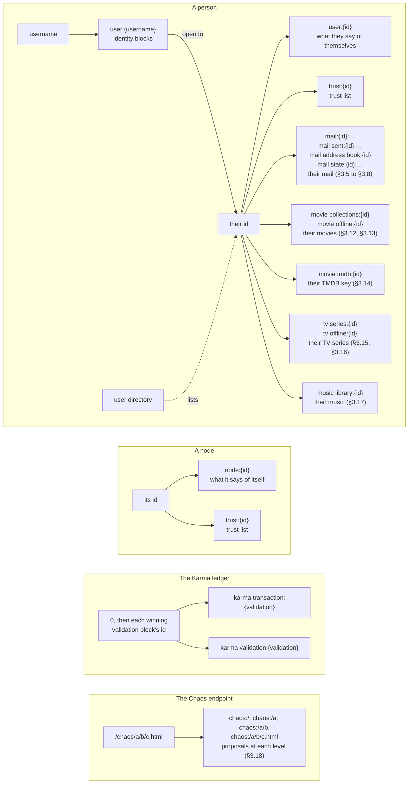
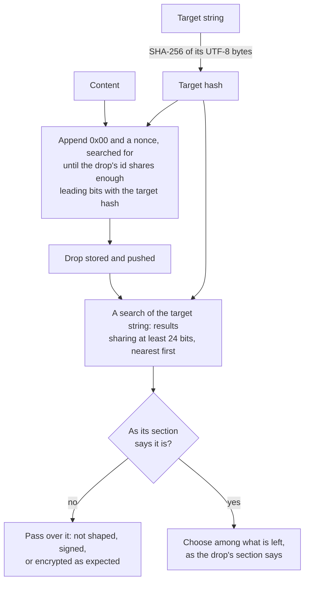

# Libranet Known Drops

- Status: Draft
- Version: 0.2.0
- Editors: Marc (author), Claude (drafting assistance)

A **drop** is content placed where others can find it by a name they know,
its **target string**, rather than by its id
([HTTP API §9](HttpApi.md#9-drops),
[High-Level Design §4.4](HighLevelDesign.md#44-prefix-based-data-placement-drops)).
This document catalogs every target string that the node or a shipped
application places drops at. It defines none of them. Each section says what
is placed at its target, and links to the documents that define it.

## 1. Summary

| Target | What is placed there | Placed by | Signed by | Encrypted | Status |
| --- | --- | --- | --- | --- | --- |
| [`user:{username}`](#31-identity-blocks) | A person's identity blocks, holding their private key and their fallback's | The node | No one | By the username and a password | In use |
| [`user:{id}`](#32-what-a-person-says-of-themselves) | The versions of what a person says of themselves | The node, then the directory application | The person, or their fallback | No | In use |
| [`user directory`](#33-the-user-directory) | Copies of the user directory | The directory application | No one | No | In use |
| [`trust:{id}`](#34-trust-lists) | The versions of a trust list | The node | The list's owner | No | In use |
| [`mail:{id}:{year}/{month}/{day}`](#35-mail-received) | A copy of each message sent to a person on that day | The mail application | The sender | For the reader | In use |
| [`mail sent:{id}:{year}/{month}/{day}`](#36-mail-sent) | The sender's own copy of each message they sent on that day | The mail application | The sender | For the sender | In use |
| [`mail address book:{id}`](#37-address-books) | The versions of a person's address book | The mail application | The person | For the person | In use |
| [`mail state:{id}:{year}/{month}`](#38-read-and-hidden-marks) | The versions of what a person read and hid of a month's mail | The mail application | The person | For the person | In use |
| [`movie collections:{id}`](#312-movie-collections) | The versions of a person's list of movie collections | The movie application | The person | For the person | In use |
| [`movie offline:{id}`](#313-movies-kept-offline) | A version for each collection a person keeps offline | The movie application | The person | For the person | In use |
| [`movie tmdb:{id}`](#314-tmdb-keys) | The versions of the key a person looks things up at TMDB with | The movie and TV applications | The person | For the person | In use |
| [`tv series:{id}`](#315-tv-series) | The versions of a person's list of TV series | The TV application | The person | For the person | In use |
| [`tv offline:{id}`](#316-tv-series-kept-offline) | A version for each series a person keeps offline | The TV application | The person | For the person | In use |
| [`music library:{id}`](#317-music-libraries) | The versions of a person's library of music | The music application | The person | For the person | In use |
| [`node:{id}`](#39-what-a-node-says-of-itself) | The versions of what a node says of itself | The node | The node | No | In use |
| [`karma transaction:{validation}`](#310-karma-transaction-blocks) | Karma's transaction blocks, and transactions put up for them | Anyone | Its builder; each transaction by its sender | No | In use |
| [`karma validation:{validation}`](#311-karma-validation-blocks) | Karma's validation blocks | Anyone | Its builder; each stake by its staker | No | In use |
| [`chaos:/{path}`](#318-chaos-proposals) | Proposals of a bundle to serve at that path beneath `/chaos` | Anyone | Its proposer, or no one | No | Specified |

A drop **in use** is placed by the node or a shipped application today. A
**specified** drop is defined by a specification, but nothing places it yet.

## 2. Reading the Catalog

### 2.1 Target Strings

A target string is written with its variable parts in braces:

- **`{username}`** is a username normalized as
  [HTTP API §11.3](HttpApi.md#113-a-persons-identity) says: trimmed,
  case-folded, and in Normalization Form C, so that `Alice` and `alice`
  name one drop.
- **`{id}`** is an identity's id, whole: the content identifier of its
  public key, such as `sha256/0a1b…`, in lower-case hex.
- **`{validation}`** is `0` for Karma's root, or else the id of the winning
  validation block of the generation before, whole, such as `sha256/0a1b…`
  ([Karma Ledger §3.1](KarmaLedger.md#31-targets)).
- **`{year}/{month}/{day}`** is a date in UTC, with two digits for each
  part but the year, such as `2026/10/12`.
- **`{path}`** is the elements of a path beneath `/chaos/` down to a level,
  percent-decoded and joined by `/`, such as `recipes/cakes`, and is empty
  for the root's level, `chaos:/`
  ([HTTP API §13.6.1](HttpApi.md#1361-levels)).

The node hashes a target string's UTF-8 bytes, as they are, with SHA-256
([HTTP API §9.6](HttpApi.md#96-making-a-drop-from-a-page)). A page searches
a drop by its target string
([HTTP API §9.7](HttpApi.md#97-searching-a-drop-by-its-target)), so a page
never hashes one itself.

### 2.2 What Every Reader Does

Anyone may place anything at any target
([HTTP API §9.5](HttpApi.md#95-malicious-drop-bombing)), and a search of a
drop answers whatever lies nearest the target hash, whether it was placed
there or not, so long as it shares as many leading bits with the target hash
as the node's search returns, 24 by default
([HTTP API §6](HttpApi.md#6-content-search)). So a reader of each drop below
passes over what it does not expect: content that is not shaped, signed, or
encrypted as the section says. Each section then says how a reader chooses
among what is left.

Each drop is placed with a nonce, searched for so that the drop's id shares
leading bits with the target hash
([HTTP API §9.6](HttpApi.md#96-making-a-drop-from-a-page)). The more bits
it shares, the nearer the top of a search it is, however much else is
placed there. A node limits what a page may ask for, by default to 60
seconds and 32 bits.

### 2.3 Adding a Drop

A step that has the node or a shipped application place drops at a new
target adds it here, with a row in §1 and a section in §3.

Targets that appear only as examples are not placed by anything, and are
not listed. Examples are `John` in High-Level Design §4.4, and `user:alice`,
`notes:{id}`, and `my notes` in the App Developer Guide.

## 3. The Drops

### 3.1 Identity Blocks

**Target:** `user:{username}`

A person's private key is kept in the network, so that they can sign in on
any node that holds it. It is kept in an identity block, which also says
when the identity was made, and names its fallback. Each identity has two
blocks at its username's drop: its own, opened by the person's password,
and its fallback's, opened by the fallback password. When a fallback takes
over, the fallback's block is placed again, naming the identity it takes
over from and a new fallback of its own. The new fallback's block is placed
there too, opened by a new fallback password. Two people may choose one
username: each finds only the blocks their own passwords open.

- **Placed by** the node. It places the blocks when an identity is made,
  with `POST /data/users`, or with `POST /config/api/users` from the
  `/config` page. It places them again when a fallback takes over, with
  `POST /data/fallback` from the directory application.
- **Not signed.** Each block is protected as a bundle's JSON is, by the key
  that `ARGON2ID` derives from the username and password. It is not a
  bundle.
- **Bits:** as many as the request asks for, within the node's limits, the
  time asked for being shared among the drops the request places. The
  `/config` page and the directory application ask for 24 bits and 10
  seconds.
- **Reading:** when a person signs in, the node searches the drop and tries
  each block found with the key that the username and password derive. A
  reader requires no number of bits, since the password is what passes over
  everything else. The first block that opens to an identity is the
  person's. A fallback that took over has two blocks there, and the one
  that names its own fallback is used.
- **Defined in:**
  [HTTP API §11.3](HttpApi.md#113-a-persons-identity) for the block and
  for making identities, and
  [§11.4](HttpApi.md#114-signing-in) for signing in;
  [Bundle Specification §6.2.1](BundleSpecification.md#621-argon2id) for
  the key derivation.
- **See also:**
  [App Developer Guide §6.10](../operations/App%20Developer%20Guide.md#610-identities-and-signing-in);
  [Operator Guide §6.5](../operations/Operator%20Guide.md#65-creating-a-user).

### 3.2 What a Person Says of Themselves

**Target:** `user:{id}`

A person's public metadata is kept in versions: the details they give of
themselves, when their id was made, and the id of their fallback. A version
signed by their fallback can say the identity is compromised. Each version
is numbered, and names the version it replaces, so that a reader can walk
the history back to the first. A fallback has its own drop, at `user:{id}`
of its own id.

- **Placed by** the node, which places the first version when it makes an
  identity, or when a fallback takes over. Every version after the first is
  placed with `POST /data/signed`: the directory application places them,
  and any application may.
- **Signed** by the person, or, for a version saying they are compromised,
  by their fallback. **Not encrypted**: anyone may read it.
- **Bits:** placed matching at least 24, searched for 10 seconds by the
  directory application. The node places the first version with the bits
  asked for in making the identity, sharing the time asked for with the
  identity blocks (§3.1).
- **Reading:** a reader counts only what the person signed, and a
  version their fallback signed saying they are compromised. The newest
  version is the one numbered highest. Of two numbered as high, the newest
  is the one whose drop's id comes first. No version is ever shunned.
- **Defined in:**
  [App Developer Guide §6.14](../operations/App%20Developer%20Guide.md#614-what-people-say-of-themselves)
  for the versions and their reading;
  [HTTP API §11.3](HttpApi.md#113-a-persons-identity) for the first
  version.
- **See also:**
  [HTTP API §11.5](HttpApi.md#115-signing-as-a-person) for signing;
  [App Developer Guide §6.13](../operations/App%20Developer%20Guide.md#613-signing-as-a-person).

### 3.3 The User Directory

**Target:** `user directory`

The user directory lists the people who have opened it, by their ids. Each
copy is a directory bundle holding one entry for each person. The entry's
path is the person's id, and its only part is the person's public key. A
copy that grows too large to fit in a drop names extensions, which are
directory bundles stored at their own ids, not drops. The node knows nothing
of the directory: only applications keep it.

- **Placed by** the directory application, with `POST /data/drop`. The mail
  application reads it.
- **Not signed, and not encrypted.**
- **Bits:** placed matching at least 24, searched for 10 seconds.
- **Reading:** a reader passes over everything that is not a directory
  bundle listing only people, rather than by bits. Everyone listed in any
  copy is in the directory. The newest copy lists the most people. Of two
  that list as many, the newest is the one whose id comes first. When the
  newest copy does not list everyone, a reader makes a new copy that does,
  and shuns the copies it was made from.
- **Defined in:**
  [App Developer Guide §6.12](../operations/App%20Developer%20Guide.md#612-the-user-directory).
- **See also:**
  [App Developer Guide §6.11](../operations/App%20Developer%20Guide.md#611-shunning-content)
  for shunning what is replaced.

### 3.4 Trust Lists

**Target:** `trust:{id}`

An identity's trust list says which identities it trusts or distrusts. A
node builds a person's scores from their list and the lists it reaches. The
list is kept in versions. Each version is numbered and names the version it
replaces. A list is public, including distrust, since others read it for
their scores to reach through it.

- **Status:** in use, placed by the node when a page asks, since
  [Phase 5](../implementation/Phase%205.md) Step 97. The directory
  application asks (Step 101). A node's own list is in use since Step 110.
- **Placed by** the node, when the person signed in trusts, distrusts, or
  clears an identity, with `PUT` or `DELETE /data/trust/{id}`. A node keeps
  a list of its own, signed by its own key (Bundle Specification §5), and
  places it when its operator changes it on `/config`, with `PUT` or
  `DELETE /config/api/trust/{id}`. The node reads the lists to build each
  person's scores (Steps 99 and 100), and the directory application reads
  a person's to show it on their page (Step 105).
- **Signed** by the list's owner. **Not encrypted.**
- **Bits:** placed matching at least as many as the node's search returns,
  24 by default, with no search for a nonce past that.
- **Reading:** a reader counts only the versions that the owner
  signed. The newest version is the one numbered highest. Of two numbered as
  high, the newest is the one whose drop's id comes first. A node shuns
  every version it reads that is older than the newest, and every version
  a version it places replaces.
- **Defined in:**
  [Trust Network Specification §3](TrustNetwork.md#3-trust-lists), for what
  a version holds (§3.1), where it is kept (§3.2), reading it (§3.3), and
  changing it (§3.4);
  [HTTP API §11.7](HttpApi.md#117-trust) for the endpoints that change it.
- **See also:**
  [HTTP API §5.5](HttpApi.md#55-shunned-content) for shunning.

### 3.5 Mail Received

**Target:** `mail:{id}:{year}/{month}/{day}`

Each message is sent as a copy for each of its readers. The copy for a
reader is placed at the reader's drop for the day, in UTC, that the
message is sent on. A reader reads a period by searching each day of it.
Mail is kept by the day, since a search answers with as many results as
fit in 1 MiB, tens of thousands
([HTTP API §6.1](HttpApi.md#61-search-response)). A reader who is
compromised is mailed at their fallback instead.

- **Placed by** the mail application, with `POST /data/signed`, given
  `encrypt: {for: reader}`.
- **Signed** by the sender, then **encrypted** for the reader. The copy
  names its reader, so that a reader can pass over a copy encrypted again
  for them by someone else.
- **Bits:** placed matching at least the bits the sender's postage asks
  for: 24 for bulk, 28 for first class, and 32 for priority, searched for
  1 second, since a message to many people places many copies. The more
  bits, the nearer the top of a search the copy is.
- **Reading:** a reader passes over each copy that does not open, is not
  signed, or does not name them. Every copy left is mail. What the reader
  has read and hidden is kept apart (§3.8).
- **Defined in:**
  [App Developer Guide §6.16](../operations/App%20Developer%20Guide.md#616-mail).
- **See also:**
  [HTTP API §11.6](HttpApi.md#116-encrypting-a-block) for encrypting;
  [Bundle Specification §8](BundleSpecification.md#8-encryption-for-a-person).

### 3.6 Mail Sent

**Target:** `mail sent:{id}:{year}/{month}/{day}`

The sender keeps a copy of each message they send, at their own drop for
the day they sent it on. Their copy names every reader, BCC readers
included.

- **Placed by** the mail application, with `POST /data/signed`, as it
  places each reader's copy (§3.5).
- **Signed** by the sender, then **encrypted** for the sender.
- **Bits:** placed matching at least 24, searched for 1 second.
- **Reading:** as for mail received (§3.5), except that a copy counts only
  if the person reading it signed it.
- **Defined in:**
  [App Developer Guide §6.16](../operations/App%20Developer%20Guide.md#616-mail).

### 3.7 Address Books

**Target:** `mail address book:{id}`

A person's address book maps the names they give people to those people's
ids. It is kept in versions, and each version names the versions it
replaces. A removal is kept as a change, so that a merge does not undo it.

- **Placed by** the mail application, with `POST /data/signed`, whenever
  something in the address book changes.
- **Signed** by the person, then **encrypted** for the person.
- **Bits:** placed matching at least 24, searched for 1 second.
- **Reading:** a reader passes over every version that the person did not
  sign. It merges every version left: of the changes to one name, the
  latest wins. A version that no other version names is a head. When more
  than one head is found, a reader places a new version naming every head.
  Versions that are replaced are shunned, so that they do not crowd the
  newest out of a search.
- **Defined in:**
  [App Developer Guide §6.16](../operations/App%20Developer%20Guide.md#616-mail).

### 3.8 Read and Hidden Marks

**Target:** `mail state:{id}:{year}/{month}`

What a person has read and hidden is kept for each month. The month is the
month of the drop each copy was found at (§3.5, §3.6). Each version maps the
drop id of each copy to whether the person has read it and hidden it.

- **Placed by** the mail application, with `POST /data/signed`, whenever
  the person reads or hides a message.
- **Signed** by the person, then **encrypted** for the person.
- **Bits:** placed matching at least 24, searched for 1 second.
- **Reading:** as for address books (§3.7). Versions are merged by the drop
  id of each copy, rather than by name.
- **Defined in:**
  [App Developer Guide §6.16](../operations/App%20Developer%20Guide.md#616-mail).

### 3.9 What a Node Says of Itself

**Target:** `node:{id}`

A node's public metadata is kept in versions: what it is called, a
description of it, where it is, and any other detail its operator gives.
Each version is numbered, and names the version it replaces. Pages show a
node by its name, with the rest of what it says when the name is hovered
over or tapped.

- **Placed by** the node, when its operator saves what it says on `/config`,
  with `PUT /config/api/metadata`. No page places one, since a node signs
  only what it places itself.
- **Signed** by the node, with its own key. **Not encrypted**: anyone may
  read it.
- **Bits:** placed matching at least as many as the node's search returns,
  24 by default, with no search for a nonce past that.
- **Reading:** a reader counts only the versions that the node
  signed. The newest version is the one numbered highest. Of two numbered as
  high, the newest is the one whose drop's id comes first. Whenever its
  operator saves, the node shuns every version it reads but the newest,
  and the newest too once it places a version over it.
- **Defined in:**
  [HTTP API §11.8](HttpApi.md#118-what-a-node-says-of-itself) for the
  versions, their reading, and the endpoints that place them.
- **See also:**
  [App Developer Guide §6.18](../operations/App%20Developer%20Guide.md#618-what-nodes-say-of-themselves)
  for reading them from a page and showing a node by its name;
  [Operator Guide §4.5](../operations/Operator%20Guide.md#45-what-this-node-says-of-itself).

### 3.10 Karma Transaction Blocks

**Target:** `karma transaction:{validation}`

Each generation of the Karma ledger has a transaction block: the
transactions of that generation, and the balances they leave. The root's is
at `karma transaction:0`, and each generation after is at the id of the
winning validation block before it. A transaction is put up as a block of
its own at its generation's target, and the blocks there are combined into
larger ones.

- **Placed by** anyone: whoever puts up a transaction, and whoever builds
  a block from others.
- **Signed** by its builder, and each transaction in it by its sender. The
  payout it holds has no signature of its own. **Not encrypted.**
- **Bits:** as many as its builder mines, since the bits are the block's
  proof of work, its first score, and part of the chain's weight. Each,
  the root's among them, is placed matching at least as many as the node's
  search returns, 24 by default.
- **Reading:** a reader follows the heaviest chain, scores each full block
  at the winning target, and takes valid transactions from any block,
  false starts and blocks that score zero among them. A block's `weight`
  says how heavy the chain before it claims to be. A block whose
  transactions are all in a larger block, or in one as large sharing more
  bits, may be shunned, unless it is full or a validation block names it.
  No block is shunned for being on a lighter chain. A block that is no
  block of the ledger, unsigned or found, as a head's chain is walked back,
  stating its `weight`, `stake_baseline`, or `generation` falsely, is
  shunned, and the builder of a block found to state something false is
  distrusted in the node's own trust list.
- **Defined in:**
  [Karma Ledger §3](KarmaLedger.md#3-generations) for the targets, the
  heaviest chain, heads, shunning, and distrusted builders,
  [§4](KarmaLedger.md#4-transactions) for transactions,
  [§5](KarmaLedger.md#5-transaction-blocks) for the block, and
  [§7](KarmaLedger.md#7-the-root) for the root.
- **See also:** [Karma](Karma.md) for the economics.

### 3.11 Karma Validation Blocks

**Target:** `karma validation:{validation}`

Each generation's validation block is a collection of signed stakes on one
of its full transaction blocks, at the same `{validation}` as that
transaction block. It names a runner-up, a rival on another of the
generation's transaction blocks, and lists the hashes of transactions its
builder has seen that its chain has not yet witnessed. Many are placed for
each generation, and the one the heaviest chain goes through wins.

- **Placed by** anyone, and may be built from others' stakes.
- **Signed** by its builder, its list of witnesses with it, and each stake
  in it by its staker. **Not encrypted.**
- **Bits:** as many as its builder mines. The block adds 2^b times the
  stake it counts to the chain's weight, b being its bits, counted to at
  most 27. Each, the root's among them, is placed matching at least as many
  as the node's search returns, 24 by default.
- **Reading:** a reader passes over a block that is not correct, ranks the
  rest by the weight each adds to its chain, then by effective stake, then
  by bits, then by id
  ([Karma Ledger §6.5](KarmaLedger.md#65-correct-and-best)), and builds the
  next generation on the best. The winner's stakers share the generation's
  reward, and the runner-up's stakers lose their stakes in it, unless they
  also staked in the winner. A validation block is shunned only when it is
  no block of the ledger, unsigned or found, as a head's chain is walked
  back, stating its `generation` falsely, since any other may lead to
  another chain.
  A builder found to state something false is distrusted, and no builder
  puts a distrusted identity's stake in a block. A node's head, the winner
  whose id names the target for new transactions, is told to its peers
  with `POST /data/karma/head`.
- **Defined in:**
  [Karma Ledger §6](KarmaLedger.md#6-validation-blocks) for the block, and
  [§7.3](KarmaLedger.md#73-validation-block-0) for the root's.
- **See also:** [Karma](Karma.md) §17 to §33 for the economics.

### 3.12 Movie Collections

**Target:** `movie collections:{id}`

A person's list of movie collections names each collection, with its
newest bundle and when it last changed. It is kept in versions, so that it
follows the person from node to node, and versions made apart, on two
nodes say, are merged as they are read. A client no one is signed in on
reads the node's collections from the application's store instead.

- **Placed by** the movie application, with `POST /data/signed`, given
  `encrypt: {for: id}`, whenever the person's list of collections changes.
- **Signed** by the person, then **encrypted** for the person.
- **Bits:** placed matching at least 24, searched for 1 second.
- **Reading:** a reader passes over every version that does not open for
  the person, or that they did not sign. It merges every version left:
  each collection at the version that changed it last, and of two changed
  in the same second, the one whose drop's id comes first. Each change
  places a version holding the merged list, and shuns the versions read,
  which it replaces, so that they do not crowd the newest out of a search.
- **Defined in:**
  [Improve Movie Web App](../implementation/Improve%20Movie%20Web%20App.md)
  Step 83.
- **See also:**
  [App Developer Guide §7](../operations/App%20Developer%20Guide.md#7-patterns-from-the-movie-library).

### 3.13 Movies Kept Offline

**Target:** `movie offline:{id}`

Each collection a person keeps offline has a version of its own here: the
collection's name, a bundle of the movies kept, when it was kept, and the
identity block the person signed in with. The node keeps that bundle, the
version, the identity block, and the person's public key in an archive of
its own, so that the person can sign in and play the movies with the node
offline. The versions are kept apart from the person's collections
(§3.12), since each change there shuns the versions it replaces, and a
node's search leaves out what it has shunned, archived or not.

- **Placed by** the movie application, with `POST /data/signed`, given
  `encrypt: {for: id}`, as the person keeps movies offline.
- **Signed** by the person, then **encrypted** for the person.
- **Bits:** placed matching at least 24, searched for 1 second.
- **Reading:** a reader passes over every version that does not open for
  the person, or that they did not sign. Each collection listed in a
  version left is kept offline while the node reports an archive holding
  its bundle. A version older than a minute whose bundle no archive holds, as
  once its archive expires, is shunned.
- **Defined in:**
  [Improve Movie Web App](../implementation/Improve%20Movie%20Web%20App.md)
  Step 115.
- **See also:**
  [HTTP API §12.4](HttpApi.md#124-keeping-content-offline) for the
  archives;
  [App Developer Guide §6.19](../operations/App%20Developer%20Guide.md#619-keeping-content-offline).

### 3.14 TMDB Keys

**Target:** `movie tmdb:{id}`

The key a person looks things up at TMDB, The Movie Database, with: what
is known of a movie added from a file, and of a TV series, its seasons, and
its episodes. It is kept in versions, the newest of which holds it, so
that it follows the person from node to node. The movie application placed
it first, and the TV application reads and keeps it at the same drop, so
that a key given in either serves both.

- **Placed by** the movie application and the TV application, with
  `POST /data/signed`, given `encrypt: {for: id}`, whenever the person
  changes the key.
- **Signed** by the person, then **encrypted** for the person.
- **Bits:** placed matching at least 24, searched for 1 second.
- **Reading:** a reader passes over every version that does not open for
  the person, that they did not sign, or that does not hold a `key` and
  when it `changed`. The newest version left holds the key, and of two
  changed in the same moment, the one whose drop's id comes first. An
  empty key is none. Each change places a version, and shuns the versions
  read, which it replaces.
- **Defined in:** the movie application's page (#588), and
  [TV App](../implementation/TV%20App.md) Step 144.

### 3.15 TV Series

**Target:** `tv series:{id}`

A person's list of TV series names each series, with its newest bundle and
when it last changed, and what the person has watched of it, if anything:
`{"series": [{"name", "bundle", "changed", "watching"}, ...]}`. `watching`
is `{"watched": ["<episode folder>", ...], "stopped": {"episode": "<episode
folder>", "seconds": 1234}, "changed": "…"}`: the folders of the episodes
watched, where the person stopped in the one they left part way through,
if any, and when it last changed. It is kept in versions, so that it
follows the person from node to node, and versions made apart, on two
nodes say, are merged as they are read. The node keeps no list of series
for a client no one is signed in on.

- **Placed by** the TV application, with `POST /data/signed`, given
  `encrypt: {for: id}`, whenever the person's list of series changes, and
  what they have watched with it: as an episode is paused, ends, or is
  left, as the page is hidden, and every five minutes while one plays.
- **Signed** by the person, then **encrypted** for the person.
- **Bits:** placed matching at least 24, searched for 1 second.
- **Reading:** a reader passes over every version that does not open for
  the person, or that they did not sign. It merges every version left:
  each series, found by its name ignoring case, at the version that
  changed it last, and of two changed in the same second, the one whose
  drop's id comes first. Each series' `watching` is merged apart from its
  bundle, at the version that changed it last, by its own `changed`, so
  that an episode watched on one node and a season added on another both
  stay. A `watching` that is not one is passed over. Each change places a
  version holding the merged list, and shuns the versions read, which it
  replaces, as for movie collections (§3.12).
- **Defined in:** [TV App](../implementation/TV%20App.md) Steps 144 and
  147.

### 3.16 TV Series Kept Offline

**Target:** `tv offline:{id}`

Each series a person keeps offline has a version of its own here, as each
collection kept offline has at `movie offline:{id}` (§3.13): `{"series":
[{"name", "bundle", "changed", "block"}]}`, the name it is kept under, a
series bundle of the seasons kept, when it was kept, and the identity block
the person signed in with. The node keeps that bundle, the version, the
identity block, and the person's public key in an archive of its own, so
that the person can sign in and play the series with the node offline. The
versions are kept apart from the person's list of series (§3.15), since
each change there shuns the versions it replaces, and a node's search
leaves out what it has shunned, archived or not. For the same reason, what
the person watches of a series kept offline is kept nowhere.

- **Placed by** the TV application, with `POST /data/signed`, given
  `encrypt: {for: id}`, as the person keeps seasons of a series offline.
- **Signed** by the person, then **encrypted** for the person.
- **Bits:** placed matching at least 24, searched for 1 second.
- **Reading:** as for movies kept offline (§3.13): a reader passes over
  every version that does not open for the person, or that they did not
  sign. Each series listed in a version left is kept offline while the node
  reports an archive holding its bundle. A version older than a minute
  whose bundle no archive holds, as once its archive expires, is shunned.
- **Defined in:** [TV App](../implementation/TV%20App.md) Step 148.
- **See also:**
  [HTTP API §12.4](HttpApi.md#124-keeping-content-offline) for the
  archives;
  [App Developer Guide §6.19](../operations/App%20Developer%20Guide.md#619-keeping-content-offline).

### 3.17 Music Libraries

**Target:** `music library:{id}`

A person's library of music names its newest bundle, and when it last
changed, and holds their playlists: `{"library": {"bundle", "changed"},
"playlists": [{"id", "name", "songs": ["<song folder>", …], "changed"},
…]}`. The bundle is encrypted, so that only whoever is given its id can
read it. It holds `songs/`, each song in a folder named by the first 16 hex
digits of its own bundle's hash, and `index/`, what is known of every song,
in files each holding the songs whose folders begin with the same two hex
digits. A playlist names songs of the library by their folders, each once,
in its order; its `id` is made at random as it is, and `changed` is when it
last changed. It is kept in versions, so that it follows the person from
node to node, and versions made apart, on two nodes say, are merged as they
are read. The node keeps no library for a client no one is signed in on.

- **Placed by** the music application, with `POST /data/signed`, given
  `encrypt: {for: id}`, whenever the person's library or a playlist
  changes: once for each song added from a file, once for each folder of
  songs added together, once every song of it is imported, once for each
  song whose tags gave no duration, as it first plays, and once for each
  playlist made, renamed, removed, added to, reordered, or removed from. A
  change of the playlists alone names the bundle the library has already.
- **Signed** by the person, then **encrypted** for the person.
- **Bits:** placed matching at least 24, searched for 1 second.
- **Reading:** a reader passes over every version that does not open for
  the person, that they did not sign, or that names no bundle. It merges
  every version left: the library at the version that changed it last, and
  of two changed in the same moment, the one whose drop's id comes first,
  with each song the others hold and it does not, and their entries in
  `index/`, added to it. Merging adds songs, and never removes any. Each
  playlist, found by its `id`, is the one of the version that changed it
  last, by its own `changed`, apart from the library, and a playlist one
  version holds and another does not is kept. A reader passes over a
  playlist that is not such an object, and over any of its songs that is
  not a song's folder. Each change places a version naming the merged
  library's newest bundle, and holding every playlist merged, and shuns the
  versions read, which it replaces, as for movie collections (§3.12), but
  for any it could not merge whole.
- **Defined in:** [Music App](../implementation/Music%20App.md) Steps 149
  and 151.

### 3.18 Chaos Proposals

**Target:** `chaos:/{path}`

A proposal names a bundle to serve beneath `/chaos`, at the level its
target names, and says when it was proposed: `{"bundle", "created"}`. The
bundle is mounted at the level, and serves each path beneath it that it
holds. Anyone may propose at any level, signed or not, and the node of each
viewer chooses among the proposals by the viewer's trust, or, for anyone
not signed in, by the node's own.

- **Status:** specified, in [Phase 7](../implementation/Phase%207.md) Step
  155. The node reads it from Step 156, and the Chaos page places it from
  Step 159.
- **Placed by** anyone. The Chaos page places one on a local client, with
  `POST /data/signed` for a person signed in, and with `POST /data/drop`
  otherwise. The node reads the proposals at each level of a path for every
  request beneath `/chaos`, and for the report the Chaos page reads.
- **Signed** by its proposer, or by no one. **Not encrypted**, since the
  node of every viewer reads it, though the bundle it names may be.
- **Bits:** placed matching at least as many as the node's search returns,
  24 by default. The Chaos page searches for 5 seconds.
- **Reading:** a reader passes over, in order, what is not a proposal,
  signed or unsigned; a signed one whose signature does not check; one
  whose bundle is shunned; one dated more than the node allows ahead of its
  clock, 5 minutes by default; and each of a proposer's proposals at the
  level but their newest. The newest is the one whose `created` is latest,
  and of two of the same moment, the one whose drop's id comes first. It
  never chooses a proposal whose proposer is distrusted. Of the rest, it
  chooses the newest trusted proposal at the shallowest level whose bundle
  holds the rest of the path, and when there is none, the newest of no trust
  specified, in the same way. Nothing is shunned.
- **Defined in:**
  [HTTP API §13.6](HttpApi.md#136-the-chaos-endpoint), for the levels
  (§13.6.1), the proposals (§13.6.2), and choosing among them (§13.6.3).
- **See also:**
  [HTTP API §11.7](HttpApi.md#117-trust) for the scores that choose;
  [Trust Network §4.5](TrustNetwork.md#45-a-nodes-own-scores) for the
  node's own.
