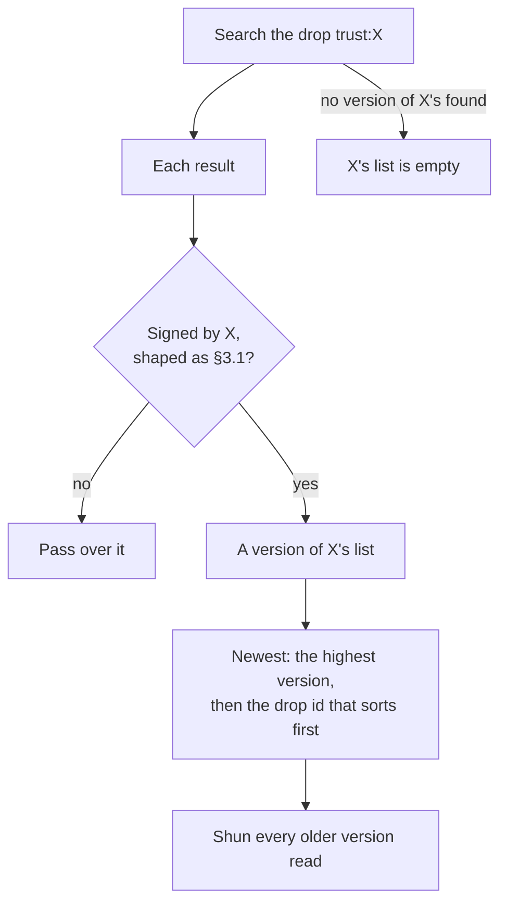
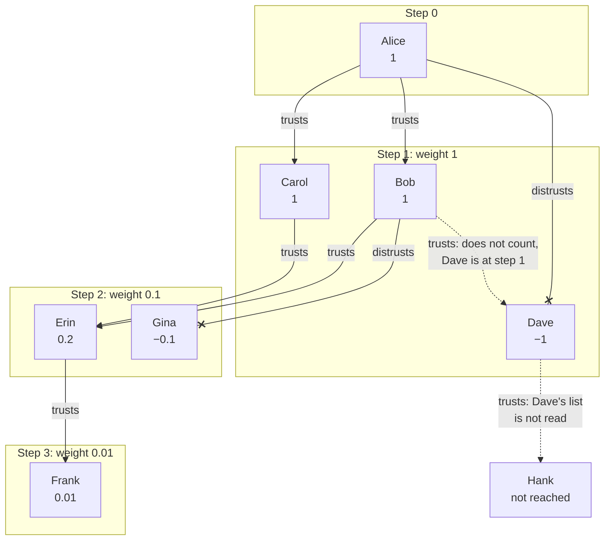
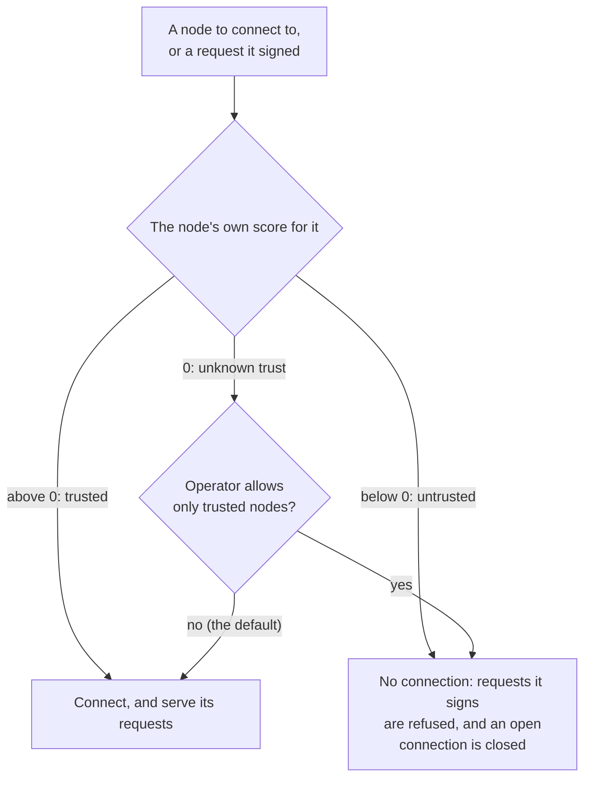

# Libranet Trust Network Specification

- Status: Draft
- Version: 0.1.0
- Editors: Marc (author), Claude (drafting assistance)

## 1. Overview

Each identity may keep a **trust list**: the identities it trusts, and the
identities it distrusts. From the list of whoever is signed in, the lists of
those they trust, the lists those lists trust, and so on onward, a node
builds a **score** for every identity the lists reach. A node builds scores
of its own the same way, from its own list, and connects only to the nodes
they allow (§4.5).

This document specifies what a trust list holds, where it is kept, how its
newest version is found, and the rule that turns lists into scores. Every
node must apply them alike, so that a list one node writes is one every
other can score. The endpoints a page uses to change the list of whoever is
signed in, and to read their scores, are in
[HTTP API §11.7](HttpApi.md#117-trust).

## 2. Relationship to Other Documents

- A trust list is the `contents` of a signed bundle
  ([Bundle Specification §5](BundleSpecification.md#5-signed-bundle)),
  made a drop ([HTTP API §9](HttpApi.md#9-drops)). This document adds
  nothing to the bundle format.
- An identity is as HTTP API §11.2 and §11.3 give one: its id is the
  content identifier of its public key, a node's or a person's. The two
  have one form, so a list may name either, and either may keep a list
  (§3.2).
- Scores are built for a person signed in on a node
  ([HTTP API §11.4](HttpApi.md#114-signing-in)), and for the node itself
  (§4.5). The session is between a browser and its node, and is no part of
  the protocol between nodes, and neither are the scores a node builds.
  What nodes exchange is the lists, as they exchange any content.

## 3. Trust Lists

### 3.1 What a List Holds

A version of a trust list is the JSON object

```json
{"entries": {"sha256/0a1b…": true, "sha256/9f8e…": false},
 "version": 2,
 "versions": ["sha256/…"]}
```

- **`entries`** maps each identity named to `true`, trusted, or `false`,
  distrusted. An identity the list does not name is neither. Each name is a
  content identifier, `{hash-algorithm}/{hash}`
  ([HTTP API §5](HttpApi.md#5-content-addressed-storage)), of a person's
  public key or a node's. An entry is only trust or distrust: it carries no
  strength of its own.
- **`version`** is 1 for the first version, and one more than the version
  it replaces for each after.
- **`versions`** names the drop of the version it replaces, and is left
  out of the first.

A reader passes over an entry whose name is not a content identifier, or
whose value is not `true` or `false`, and a name in `versions` that is not a
content identifier, and counts the rest of the list. An identity named
more than once, its identifier spelled in different cases (HTTP API §5.4),
counts only if each entry says the same, so that a list reads alike in
whatever order its members are read. A reader ignores any other member of
the object, so that a later version of this document can add one. An entry
naming the list's own owner never counts (§4.1).

### 3.2 Where a List Is Kept

A trust list is a signed bundle whose `contents` is a version of the list,
signed by its owner, and made a drop at the target string `trust:{id}`,
the owner's id after `trust:`, such as `trust:sha256/0a1b…`. Each version
is placed matching at least as many leading bits of the target hash as a
node's search returns ([HTTP API §6](HttpApi.md#6-content-search)), 24 by
default, so that a search of the drop finds it.

A list is **public**, distrust included. It is read by others for their
scores to reach through it (§4), so it is never encrypted, and anyone may
read whom its owner trusts and distrusts.

A person's list is signed with their key, as HTTP API §11.5 signs for them.
Nothing in this document tells a person's list from a node's, and a node's
is kept and read the same way, signed with its Ed25519 key (HTTP API §11.2),
as Bundle Specification §5 defines a node's signature. A node signs only
what it places itself (HTTP API §11.5), and places its own list as its
operator changes it (HTTP API §11.7). It also places it as it distrusts the
builder of a Karma block found to state something false
([Karma Ledger §3.8](KarmaLedger.md#38-distrusted-builders)).

### 3.3 Reading a List

A reader finds the newest version of the list of an identity `X` this way:

- **Search the drop** `trust:X`
  ([HTTP API §9.7](HttpApi.md#97-searching-a-drop-by-its-target)). The node
  leaves out what shares too few leading bits with the target hash, which is
  nearest the target but placed for something else
  ([HTTP API §6](HttpApi.md#6-content-search)).
- **Count only what is `X`'s.** Check each result as signed content
  ([HTTP API §11.5](HttpApi.md#115-signing-as-a-person)), and count it only
  if its `signer` is `X` and its `contents` is a version shaped as §3.1
  gives one: an object whose `entries` is an object, and whose `version` is
  a whole number of at least 1. Anyone can place a version of their own at
  the drop.
- **The newest is numbered highest**, and of two numbered as high, the one
  whose drop's identifier sorts first. Only `X` signs a version, so no one
  else can make one newer, and no clock is trusted.

An identity none of whose versions is found has an empty list.



A node shuns every version it reads that is older than the newest
([HTTP API §5.5](HttpApi.md#55-shunned-content)), since the newest replaces
it. Every version is placed at the same drop, and a search lists at most 32
results ([HTTP API §6](HttpApi.md#6-content-search)), so a list changed
often would otherwise crowd its newest version out of a search with its
own history.

### 3.4 Changing a List

Only its owner changes a list, by placing a new version over the newest:
numbered one more, and naming the newest in `versions`. A writer holds off
while a version found at the drop is not held yet, since it may be newer
than the newest read, and one placed over the older would be numbered
under it.

A writer places the new version matching at least as many leading bits of
the target hash as a search returns (§3.2), and shuns every version it read, since the new one
replaces them all (§3.3).

## 4. Scores

### 4.1 Steps and Weights

A person's scores are built from their own list outward, in **steps**:

- **Step 0** is the person, who scores 1, whatever any list says, since
  everyone is in their own trust network.
- **Step 1** reads the person's own list. Each identity it names is at
  step 1.
- **Step n + 1** reads the list of every identity at step n whose score is
  above 0. Each identity those lists name that no earlier step reached is
  at step n + 1.

An entry read at step n weighs a tenth of an entry read at step n − 1: 1 at
step 1, 0.1 at step 2, 0.01 at step 3, and so on. An identity's **score**
is the sum, over the lists read at its step, of the weight for each that
trusts it and minus the weight for each that distrusts it. That is the
number trusting it less the number distrusting it, divided by 10 to the
power of one less than its step. A node computes it as that quotient,
rather than by adding weights one at a time, so that three entries at step
2 score exactly 0.3.

- **Only the nearest step counts.** An identity's score comes from the
  step that first reaches it, and no entry further away changes it. A
  person's own entry is final, whatever the lists of those they trust say,
  and among lists equally near, more trusting an identity outweigh fewer
  distrusting it.
- **Only the trusted are followed.** A score above 0 is trust, below 0 is
  distrust, and 0 is neither. The list of an identity scoring 0 or less is
  not read.
- **The person always trusts themselves.** They are at step 0, and their
  own id is passed over wherever a list names it, so that no list, theirs
  or another's, changes their score.
- **Each list is read at most once.** An identity is at one step, so a
  cycle ends where it comes back to an identity already reached.

For example, Alice trusts Bob and Carol, and distrusts Dave. Bob trusts
Dave and Erin, and distrusts Gina. Carol trusts Erin. Erin trusts Frank.
Dave trusts Hank. Alice's scores are:

| Identity | Step | Score | Why |
| --- | --- | --- | --- |
| Alice | 0 | 1 | She is the person whose scores they are |
| Bob | 1 | 1 | Alice trusts him |
| Carol | 1 | 1 | Alice trusts her |
| Dave | 1 | −1 | Alice distrusts him; Bob's trust is at step 2, and does not count |
| Erin | 2 | 0.2 | Bob and Carol trust her |
| Gina | 2 | −0.1 | Bob distrusts her |
| Frank | 3 | 0.01 | Erin trusts him |
| Hank | — | — | Only Dave's list names him, and Dave's is not read |



### 4.2 Limits

Each step multiplies the lists read, so a node limits a build, which stops
at whichever of these comes first:

- **The most steps.** Identities at the last step are scored, but their
  lists are not read. A node SHOULD go to 4 steps by default, scoring
  entries down to a weight of 0.001.
- **The most lists read.** The person's own list counts as one. Within a
  step, lists are read in order of score, highest first, and of two
  scoring the same, the one whose id sorts first, so that a build cut short
  has read the lists of those most trusted. A node SHOULD read at most
  1,000 lists in a build by default.

Both are the node's to set. A build stopped by either keeps the scores of
every identity reached so far.

### 4.3 Building

When a person signs in, the node starts building their scores, and answers
the sign-in without waiting for it. A node holds one build for each person
signed in on it, shared by all of their sessions. Each sign-in starts it
again from the start, reading every list afresh, and it ends with the
person's last session. Between sign-ins it is not refreshed, updated, or
built again, except as §4.4 says.

The node reads each list as §3.3 says, asking its peers for what it does
not hold (HTTP API §5.2, §6). It reads a list once a version is found at its
drop and every version found there is held, or once a time the node sets has
passed since it began looking for it, from the versions it holds then. Until
then it looks again, so that a list kept only on another node is found by
the search of the node's peers that looking starts. A list of which no
version is held by then is empty for the rest of the build, and is not
looked for again until the next sign-in. The reference node looks for a list
for 30 seconds, by default, longer than its search of its peers lasts
(High-Level Design §4.7).

The scores of a step are final once every list of the step before it is
read. Until then, the node answers with what it has read so far, saying
that the build is not complete (HTTP API §11.7). The score of an identity
at the step under way may change as more of that step's lists are read,
and never changes once its step is final.

The node keeps the lists it read for as long as the build lasts.

### 4.4 When the Person Changes Their List

When the person changes their own list through their node
([HTTP API §11.7](HttpApi.md#117-trust)), the node scores again with the
new version at step 1, as §4.1 says, from the lists the build holds. It
reads only the lists the change newly reaches that the build does not hold,
as §4.3 reads them, so that the scores are those a build would give from
the same lists. A list given up stays given up. A version the person places
any other way is read at their next sign-in.

### 4.5 A Node's Own Scores

A node that keeps a list (§3.2) builds scores of its own from it, as a
person's are built (§4.1 to §4.3), with the node at step 0, and goes by them
in choosing its peers. An identity they score above 0 is **trusted**, below 0
**untrusted**, and any other of **unknown** trust. The node itself is always
trusted.

- **No untrusted peer.** A node connects to no node its scores call
  untrusted, and serves no request one signs
  ([HTTP API §7.3](HttpApi.md#73-valid-connections)). It closes a connection
  to a node as soon as its scores call it untrusted.
- **Only the trusted, if its operator says so.** A node connects to the
  nodes of unknown trust too, by default, and its operator may have it
  connect only to those it trusts, and serve only those.
- **When it builds them.** It builds its scores as it starts, and again
  from time to time, reading every list afresh, so that it reads what has
  changed in the lists of others. It scores a change its operator makes to
  its own list, or it makes itself (§3.2), at once, as §4.4 scores a
  person's. The reference node builds
  them again every hour, by default.
- **What it goes by meanwhile.** Until a build is complete, the node goes by
  what the last complete build said, with what the build under way has read
  laid over it, and keeps the state of each identity across a restart, so
  that it connects to no node it distrusted before it stopped while it reads
  the lists again.



**TBD:**

- **Compromised identities.** Whether an entry naming an identity that is
  compromised (HTTP API §11.3) counts for its fallback, and whether the
  list of a compromised identity is still read, since whoever holds its key
  can place a newer version.
- **Memory.** A build may hold as many lists as it reads, each up to an
  object's worth of entries (HighLevelDesign §4.3), and whether a node
  also limits the entries a build reads.

## 5. Security Considerations

- **A list is public.** Whom a person trusts and distrusts is read by
  anyone, and a page that changes a list SHOULD say so.
- **Only the owner's key changes a list.** Anyone may place a version at
  the drop, but a reader counts only the owner's (§3.3). Whoever holds the
  owner's key can place a newer version, as they can of anything the owner
  signs.
- **Far lists cannot outweigh near ones.** An identity's score comes only
  from its nearest step (§4.1), so an identity trusted far away, by any
  number of lists, never overturns a nearer entry. An identity a person
  trusts can bring in any number of others at the next step's weight, and
  those others can bring in more; distrusting it stops its list being read
  at the next sign-in.
- **Scores depend on what a node has read.** Lists spread through the
  network as any content does, so two nodes, or two sign-ins on one node,
  may read different versions and give different scores.
- **A build is bounded** by the limits of §4.2, and by the time a list is
  looked for (§4.3), so a sign-in cannot be made to read without end.
- **A node trusted can turn a node away from others.** A node's scores
  reach through the lists of the nodes it trusts (§4.5), so a node it trusts
  that distrusts another makes it refuse that one too, unless its own list,
  nearer, trusts it. Distrusting the first stops its list being read at the
  next build.
